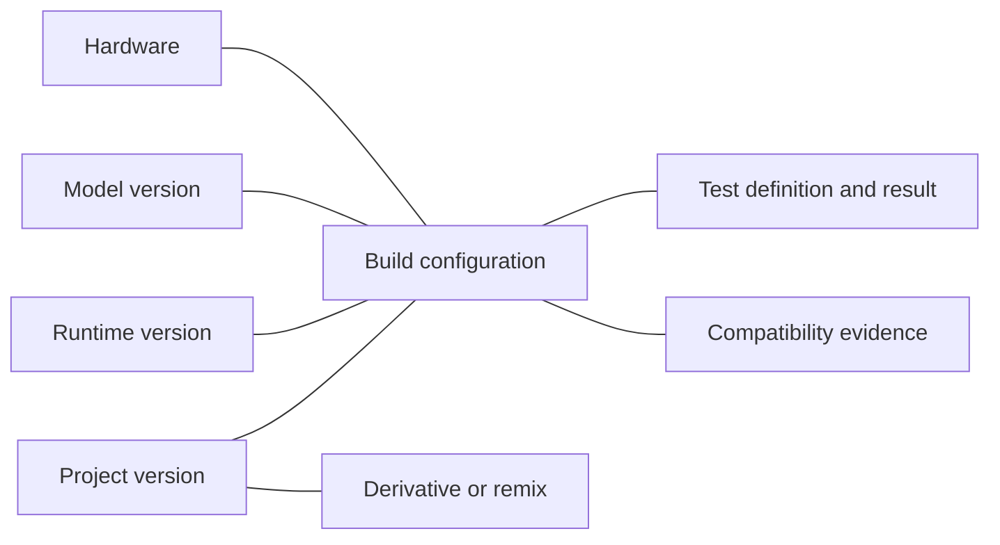

# Localfirst.sh — The home of local AI

**Version:** 0.2 · October 11, 2026  
**Status:** Product research and architecture proposals; no implementation or hardware validation completed.  
**Engineering companion:** [BACKEND_PRD.md](BACKEND_PRD.md)

**Mission:** Help people discover, build, test, reproduce, and share AI projects that run on hardware they own, using models and inference runtimes they control.

This revision replaces the earlier small-business deployment/support-marketplace emphasis with an agent-native builder community. It preserves portable metadata, attribution, exact configurations, scoped access, and evidence-based compatibility. GitHub is a useful source integration and initial sign-in provider, not a requirement for every project.

## 1. Thesis, findings, and hypotheses

Hugging Face helps people find models. Localfirst helps people discover what they can build and run with models on their own hardware. This is a positioning shorthand, not a claim that Hugging Face lacks applications, community tools, local integrations, or evaluation infrastructure.

The strategic thesis is that local inference will become increasingly mainstream as people care more about model choice, data control, hardware fit, modification, and dependence on remote providers. **That adoption trajectory is a hypothesis.** This review establishes documented integration capabilities and useful precedents; it does not establish market size, willingness to pay, or a universal migration away from cloud inference.

Use three labels throughout product work:

- **Finding:** Supported by an identified primary source. It establishes documented capability, not a Localfirst-tested deployment.
- **Inference:** A conclusion drawn from those capabilities or system boundaries, requiring validation.
- **Proposal:** A product or engineering decision to test through implementation and community pilots.

| Item | Classification | Implication |
| --- | --- | --- |
| Existing runtimes expose local inference interfaces | Finding; see sections 7–8 | Localfirst can integrate rather than supply inference |
| Markdown plus structured metadata supports discovery | Finding; model cards provide a precedent | Define a portable project specification |
| Hardware-specific tutorials and builder contributions already exist | Finding; Jetson sources in section 11 | Curate with attribution before asking for new submissions |
| Developers lose useful compatibility context across repos and discussions | Product hypothesis | Validate with builder interviews and failed reproduction examples |
| A graph of actual configurations can improve project selection | Product hypothesis | Collect narrow, comparable evidence rather than claim predictive accuracy |
| Agents can reduce contribution friction | Product hypothesis | Measure draft correction and completion rates in real clients |

Do not describe the opportunity as an uncontested market. The defensible proposition is useful deployment and test knowledge across existing ecosystems.

## 2. Target communities and problems

The initial community comprises local-AI builders, Jetson and edge developers, robotics/hardware experimenters, homelab users, developers using Ollama or LM Studio, and people adapting open-source projects to their own machines. Educators, researchers, and privacy-conscious application users are adjacent audiences. Small businesses may benefit, but no CRM, business-management suite, or integrator marketplace is required to serve them.

| Problem | Useful Localfirst answer |
| --- | --- |
| A demo omits its model, runtime, or hardware | A structured project version with explicit knowns and unknowns |
| A project is documented for a different machine | A compatibility assessment explaining relevant evidence and gaps |
| The user already has models installed | A supported component test against a selected local model |
| A README's minimum RAM claim is ambiguous | A declared requirement distinguished from observed measurements |
| A working configuration was modified during setup | A build recording the actual model, runtime, source, and changes |
| An impressive result cannot be reproduced | A versioned harness, inputs, criteria, and environment, when available |
| Useful experiments only exist as hardware notes | Documentation-only and hardware projects without mandatory GitHub |
| A failure disappears into a discussion thread | A bounded troubleshooting report linked to the exact configuration |

Validate these problems through a small number of observed reproduction sessions, not only preference surveys. Ask what users changed, what information was missing, and whether they will share a sanitized report after an unsuccessful run.

## 3. Four connected ecosystem pillars

The product has four discovery pillars, joined by runtimes and evidence:

| Pillar | What Localfirst records | Boundary |
| --- | --- | --- |
| **Models** | Source references, versions/artifact identities, capabilities, task roles, licenses, observed use | Link to upstream sources; never require weight hosting |
| **Hardware** | Platform, OS, RAM/VRAM, accelerator and relevant driver/software stack | Measurements describe a configuration, not every machine in a family |
| **Projects** | Applications, workflows, demos, robotics, experiments, and documented hardware builds | Code or documentation remains with its author/source |
| **Builds** | Actual combinations of project version, models, runtime, hardware, changes, and outcome | A saved configuration alone is not evidence that it ran |

The knowledge relationship is:

A model appearing in project documentation creates a reference edge. A submitted success creates a reported-run edge. A reproducible test result creates a more specific test edge. An independent verifier creates another provenance record. None implies all the others.

Start with relational tables and versioned JSON, not a dedicated graph database or four separately maintained marketplaces. Model and hardware pages can initially be views over project/build references.

## 4. Adjacent ecosystems and differentiation

| Ecosystem | Documented role or product precedent | Localfirst contribution |
| --- | --- | --- |
| Hugging Face | Model distribution and model cards using Markdown/YAML | Project/build knowledge connecting models to owned hardware; preserve model source and license |
| GitHub | Source repositories and project collaboration | Normalize configuration and reproduction information across sources; do not replace source control |
| Ollama | APIs for local and cloud model use | Select existing local models, enforce local test boundaries, preserve runtime-specific evidence |
| LM Studio | Local model/server APIs and developer tooling | Discover available/loaded models and test supported tasks through an adapter |
| Jetson AI Lab and community projects | Device-oriented tutorials, demos, and contribution workflows | Curated, attributed entries with separate documented versus observed compatibility |
| llama.cpp and MLX-LM | Local inference building blocks | Record backend/artifact differences and link to upstream implementations |
| Home Assistant | An integration catalog with quality and connection classifications | Use explicit evidence and data-path labels rather than one vague local badge |
| Reddit and other communities | Discovery and troubleshooting context | Convert voluntarily contributed findings into structured, source-linked knowledge; do not scrape private discussions or imply forum consensus proves compatibility |
| Project galleries | Visual discovery and inspiration | Retrieve requirements, supported tests, build variations, and failure history programmatically |
| Skills.sh | Command-first agent onboarding and a searchable directory | Put MCP connection instructions at the top of the human interface |

The metadata precedent is documented in [Hugging Face model cards](https://huggingface.co/docs/hub/model-cards). Adjacent local stacks include [llama.cpp](https://github.com/ggml-org/llama.cpp) and [MLX-LM](https://github.com/ml-explore/mlx-lm). [Home Assistant's catalog](https://www.home-assistant.io/integrations/) explicitly offers IoT-class and quality filters. These are useful patterns, not evidence that Localfirst already has equivalent coverage.

**Proposal:** Differentiate on actionable relationships and provenance. Discovery should answer “what can I run or test with this model on this machine?” with a stated evidence level. Avoid leading with upvotes, installs, generic agent listings, or claims that a named runtime guarantees privacy.

## 5. Agent-native publishing and discovery

MCP, a public REST API, and an optional CLI/skill form the contribution interface. The website is a human-readable projection of the same records, plus account, consent, and contribution review surfaces. It must not require a creator to rebuild metadata manually in a website form.

### Publishing

A user asks an existing agent to publish a local-AI project. With the user's permission, the agent inspects relevant files or notes locally, proposes model/runtime/hardware metadata, creates `PROJECT.md`, identifies source and author relationships, and submits a private draft. Unknowns and conflicts remain visible. The user reviews the exact artifact and explicitly authorizes publication; the backend publishes an immutable version.

Project scope includes application, workflow, demo, robotics, experiment, hardware build, and documentation. A public repository import is one convenience path. A directly submitted specification with a documentation/reference link is equally valid. Localfirst assigns a manifest digest even when no Git commit exists.

### Discovery and adaptation

An agent can search by task, hardware, model, runtime, local/offline requirements, and evidence level; retrieve a project version; evaluate structured requirements; retrieve supported tests; and propose a local test plan. Model inventory and private machine data remain local unless the user chooses a minimal subset for a compatibility query or shared report.

A user asking whether an installed Ollama model can replace a project's documented model receives a capability and harness assessment, not an automatic promise of equivalent behavior. Running a supported component test is narrower than reproducing the whole project.

### Interoperability

MCP defines an interoperability and authorization surface, but client transports, registration, approval behavior, and local execution capabilities differ. Test actual releases of intended clients, including Claude Code, Codex, and Cursor. An agent capable of querying hosted MCP is not necessarily capable of running commands on the user's machine. A public API and explicit local CLI path provide fallbacks.

Use standards-based, resource-scoped Localfirst authorization; do not pass GitHub or local-runtime tokens through to agents as registry credentials. The [MCP authorization specification](https://modelcontextprotocol.io/specification/2026-07-28/basic/authorization) distinguishes authorization server, client, and resource roles. The exact client/protocol matrix remains an implementation validation item.

### Human front door

The landing page should be a command-first registry: MCP setup at the top, client-specific instructions, then compact search and hardware/model/runtime/evidence filters. [Skills.sh](https://www.skills.sh/) provides the setup emphasis and [Hugging Face's model catalog](https://huggingface.co/models) provides a browsing precedent. The chosen npm package and CLI executable name is `localfirstdotsh`; `npx localfirstdotsh mcp add` is the proposed setup command for the unreleased installer, not an available package claim. Publish only a released and tested command in production; otherwise display verified native connection instructions and the actual remote endpoint.

## 6. Portable `PROJECT.md`

**Proposal:** `localfirst/project/v0.2` is the new preimplementation specification draft, using YAML frontmatter plus Markdown. It replaces the earlier business-oriented v0.1 proposal. The PRD defines canonical examples and field names; no deployed schema migration is implied because the repository contains documentation only.

### Required metadata

- Schema version, project name, summary, project type, task/category, and author attribution.
- A public source/documentation reference, or an explicitly original authored specification (`authored_specification`) that becomes the documentation record on publication; a repository and preexisting external website are optional.
- Project license state (`known`, `unknown`, or `not_applicable`) and a reference when known.
- Explicit models and runtimes, or an explicit unknown/not-applicable state rather than invented metadata.
- Hardware and OS requirement states, including what has and has not been observed.
- Data-boundary declarations, limitations, and an honest test-support status.
- Markdown sections for purpose, architecture/workflow, setup/execution, limitations, and test/evaluation instructions; unsupported sections may say not applicable.

### Optional or conditional metadata

Exact model revisions/digests, quantization, backend/driver versions, dependency locks, setup steps, public fixture/test references, media links, source release/commit, derivative relationships, and evidence references are optional for a documentation listing. They become required when making a reproducibility claim or generating an executable plan that depends on them.

`test_support` is `none`, `manual`, or `declarative_task_v1`. A project without a supported harness can be published and discovered, but must not get a “test now” action that implies automatic execution. Models and test definitions may be referenced without hosting weights or private datasets. A creator's evidence reference is still a claim until reviewed.

`PROJECT.md` should stay portable outside Localfirst: source references and local configuration keys must not depend on preexisting registry IDs. Registry publication returns server IDs without requiring an author to rewrite the specification. Export the canonical specification for use by other tools.

## 7. Local inference: findings and adapter implications

### 7.1 Ollama

**Finding:** Ollama documents installed-model listing through `GET /api/tags`, running-model information through `GET /api/ps`, and model details through `POST /api/show`. Tags include a digest; the detail endpoint exposes capabilities. The runner can use these locally without uploading the user's full inventory. [Model list](https://docs.ollama.com/api/tags), [running models](https://docs.ollama.com/api/ps), [model details](https://docs.ollama.com/api-reference/show-model-details)

**Finding:** `POST /api/chat` supports chat inference and documents token counts and duration fields, including nanosecond durations. Its streaming and nonstreaming modes need different measurement handling. Server version reporting is documented separately. [Chat API](https://docs.ollama.com/api/chat), [version endpoint documentation](https://docs.ollama.com/api-reference/get-version)

**Finding:** Ollama supports cloud models as well as local models, including cloud use through a local server. Its documentation describes disabling cloud features. **Inference:** localhost reachability cannot establish local execution. The runner must reject known cloud models and unresolved execution locality for a local-only test. Configuration changes need separate user authorization. [API introduction](https://docs.ollama.com/api/introduction), [local-only mode](https://docs.ollama.com/faq)

An Ollama manifest digest identifies a runtime-specific artifact; do not assume it equals a raw GGUF hash or a Hugging Face revision. Adapter output must include the identity scheme. OpenAI-compatible request support is useful, but covers a documented subset rather than universal parameter parity. [Compatibility interface](https://docs.ollama.com/api/openai-compatibility)

### 7.2 LM Studio

**Finding:** LM Studio's native `GET /api/v1/models` exposes available models, model keys, format/quantization information, and loaded instances. Its OpenAI-compatible `GET /v1/models` lists models visible to the server and may include downloaded models with just-in-time loading. A listing is not proof that a model is already loaded or has sufficient memory to run. [Native discovery](https://lmstudio.ai/docs/developer/rest/list), [compatible discovery](https://lmstudio.ai/docs/developer/openai-compat/models)

**Finding:** LM Studio supports OpenAI-compatible chat completions. Its native `POST /api/v1/chat` has a different contract, performance statistics, optional integrations, and chat storage behavior. **Proposal:** use a deliberately narrow compatible chat path first; enable native metrics only in a tested adapter profile, with integrations disabled and storage disabled when that native endpoint is used. [Compatible chat](https://lmstudio.ai/docs/developer/openai-compat/chat-completions), [native chat](https://lmstudio.ai/docs/developer/rest/chat)

**Finding:** LM Studio documents server authentication and `lms` tooling for local models, loaded models, and inference runtime management. **Proposal:** keep its credentials local, capture application/CLI/engine versions separately when available, and report unavailable versions as unknown. A CLI version is not automatically the GUI/server or engine version. [Server authentication](https://lmstudio.ai/docs/developer/core/authentication), [CLI](https://lmstudio.ai/docs/cli)

### 7.3 Adapter contract

The local runner owns provider-specific discovery, loading state, model selection, inference requests, cancellation, capability mapping, locality assessment, and metric normalization. The backend stores provider-neutral model/runtime references and reported evidence.

Capabilities use `supported`, `unsupported`, or `unknown`, with their observation method. Do not infer tool use, vision, structured output, context capacity, or quality from a model name. A model can be API-compatible and still unsuitable for the task. Downloads, loading/unloading, configuration changes, and inference each have visible resource effects and need the relevant user consent.

## 8. Local runner and testable-project boundary

**Proposal:** Build a small open-source local CLI runner. It retrieves public project/test specifications, inspects only explicitly selected local endpoints, selects an installed model, checks the harness and capabilities, presents an execution preview, runs a bounded task test, and writes a report locally. Anonymous public-spec retrieval is sufficient for local testing; login is required only for private registry records or opt-in contribution.

The browser does not connect to arbitrary localhost services. It offers a connection/setup command or a downloadable test specification and hands off to the user's existing agent/CLI. The hosted backend never initiates inference, remote-shell connections, model downloads, or code execution on a user's machine.

### Supported progression

| Stage | Supported test scope | Exclusions |
| --- | --- | --- |
| **Phase 2 MVP** | One selected model, text chat tasks, public fixtures, bounded deterministic checks such as exact match or structured fields | Arbitrary repository scripts, tools, shell execution, multi-agent tasks, online judges |
| **Next** | Versioned project workflows, explicit model substitution, richer modalities, local/human rubrics | Automatic claims of whole-project equivalence from a component test |
| **Later** | Isolated project-specific harnesses, multi-agent handoffs, complex benchmarks | Central execution of arbitrary community code |

The first harness is declarative and executed by trusted runner code. A published project can reference an unsupported custom harness, but the runner refuses to execute it automatically. Ordinary project setup remains a separate agent-assisted activity with separate permission. Robotics actuation and camera/microphone access are not part of the initial text test runner.

### Execution and contribution flow

Discover project -> retrieve immutable test definition -> discover selected runtime locally -> select installed local model -> preview data/resource effects -> authorize local test -> inspect local result -> compare compatible reports locally -> optionally save/share a build or derivative.

Local results are useful without sharing. Execution permission does not grant upload permission. Saving a file does not grant registry publication. A report can be submitted privately only after explicit upload consent and published only after exact-artifact review. The smallest backend contribution path can combine these two confirmations clearly, but cannot hide them inside a runtime connection grant.

Projects without an executable harness can still have manually reported builds: configuration, steps/changes, observed success or failure, and troubleshooting notes. These remain `community_reported` evidence at most; they are not fabricated automated test results and do not require a test-definition ID. This keeps hardware and robotics contributions useful before their runner support exists.

## 9. Metrics and fair comparisons

The runner's basic product result is whether the declared task checks passed. It may also record latency, first-content-token arrival, token counts/rates where exposed, selected configuration, and measured resource usage. Missing instrumentation returns `null` with a reason, not zero.

| Signal | Useful definition | Limitation |
| --- | --- | --- |
| Success/failure | Named test criteria and bounded case results | A smoke test is not broad task accuracy |
| Accuracy | Correct eligible cases divided by evaluated cases | Requires a fixed task/dataset/evaluator; disclose skipped cases |
| Rubric quality | Human or local judge with versioned rubric and judge identity | Subjective/model-biased; no required cloud judge |
| End-to-end latency | Runner monotonic clock around one inference request | Includes transport/queue/loading unless separately instrumented |
| Time to first token | First content token/chunk, with method and granularity | Headers and reasoning events are not equivalent to visible content |
| Token rate | Provider-reported generated tokens per generation interval | Tokenizers, caching, and reasoning accounting differ |
| Memory | Named process/device/system sensor and sampling interval | Runner RSS is not total inference memory; unified memory is not additive RAM+VRAM |
| Utilization | A documented local sensor with coverage/time window | Sampling, other workloads, and unsupported sensors affect interpretation |

Compare runs only within a declared protocol: test and fixture digests, task/evaluator, generation settings, context, workload/concurrency, runtime/model identities, warm/cold state, cache behavior, repetitions, and metric definitions. Different models have different tokenizers; token rates alone do not define application speed or quality. Unknown identity or settings reduces comparison eligibility. Never aggregate incomparable results into a universal leaderboard.

No benchmarks were executed during this research. Any future sample numbers in contracts are illustrative fixtures, not performance claims.

## 10. Compatibility, trust, ownership, and privacy

Use the same five evidence labels in research, schemas, API, and UI:

| Level | Meaning | Permitted interpretation |
| --- | --- | --- |
| `claimed` | Author/user declares compatibility | A claim to investigate |
| `documented` | Source documentation supports requirements with provenance | A documented candidate; not an observed run |
| `community_reported` | Authenticated contributor reports success/failure on a named configuration | A report with review state; not independent proof |
| `reproducible_test` | Accepted report includes exact supported test/fixture/evaluator/environment references and sufficient identity | A bounded test can be attempted again; not independent verification |
| `independently_verified` | An independent reviewer repeats the specified test/build and records separate evidence | A scoped independently reproduced result |

Validation checks format and plausibility, not truth. Signed reports prove signing identity rather than actual execution. Automated acceptance must never promote a run to independent verification. Evidence is scoped to an exact project/build/test combination, version, and environment; it does not apply transitively to all projects using the same model.

Compatibility outcomes are `evidence_match`, `candidate`, `incompatible`, and `unknown`. An exact E3/E4 test match may support `evidence_match`; declarations or reported near matches yield `candidate` only when known hard requirements pass. A failed hard constraint yields `incompatible`; missing critical facts yield `unknown`. No uncalibrated percentage is a compatibility probability.

Distinguish local inference, local storage, runtime network dependencies, setup downloads, agent/client processing, and offline test method. A cloud-hosted coding agent may process information that the user places in its context even while model inference for the project is local. Keep raw prompts, private documents, full inventory, model weights, credentials, and raw logs outside the backend by default. Do not upload hashes of private prompts as supposedly anonymous evidence; predictable inputs can be sensitive even when hashed.

Listed code remains untrusted. Pin references, review permissions and licenses, minimize dependencies, and isolate execution where genuinely supported. A container is not a universal security guarantee and can conflict with accelerator access. The initial declarative runner avoids arbitrary code execution; later harnesses require a tested platform-specific isolation design before enablement. Loopback binding and runtime credentials reduce exposure but do not attest to inference locality or software safety.

The useful parts of the earlier strategy remain: separate application/model licenses, record provenance, keep unknowns visible, preserve failure reports, detect upstream drift, and never sell an evidence badge. Generic compliance claims and paid ranking are not product foundations.

## 11. Initial NVIDIA Jetson and edge-AI focus

**Finding:** NVIDIA's Jetson AI Lab repository includes tutorial authoring/contribution material and hardware-oriented content. Its community contribution guidance is a useful starting point for normalization. [Jetson AI Lab](https://github.com/NVIDIA-AI-IOT/jetson-ai-lab), [contribution guide](https://github.com/NVIDIA-AI-IOT/jetson-ai-lab/blob/main/CONTRIBUTING.md)

Evaluate a small curated set rather than claim the whole ecosystem is tested:

| Candidate source | Why evaluate it | Initial evidence status |
| --- | --- | --- |
| [Jetson AI Lab](https://github.com/NVIDIA-AI-IOT/jetson-ai-lab) | Device-oriented AI tutorials and metadata patterns | `documented` only after checking the specific entry |
| [Jetson community projects](https://developer.nvidia.com/embedded/community/jetson-projects) | Existing builder discovery and source links | Curation source, not a test result |
| [jetson-inference / Hello AI World](https://github.com/dusty-nv/jetson-inference) | Inference examples and Jetson deployment guidance | Select version/device documentation; no Localfirst validation claimed |
| [JetBot](https://github.com/NVIDIA-AI-IOT/jetbot) | A robotics project illustrating hardware/software relationships | Documented hardware build; autonomous actuation testing excluded |
| [Jetson Device Skills](https://github.com/NVIDIA-AI-IOT/jetson-device-skills) | Agent-readable device workflows | Integration precedent; not blanket compatibility proof |

Select five good seed entries for the first milestone, then expand toward 20 once normalization works. Record exact source/license/author, curated status, documented hardware and software stack, unsupported tests, unknown fields, and whether the original creator has claimed the listing. Do not imply authors submitted the imports or NVIDIA endorses Localfirst.

Jetson-first **catalog curation** does not require a Jetson-only runner. A narrower text-task runner can first be exercised on developers' Mac/Linux machines through Ollama and LM Studio. Jetson vision and robotics entries remain documentation/manual-test entries until supported modality/hardware harnesses exist. Expand catalog relationships toward Apple Silicon, consumer GPUs, Raspberry Pi, and other edge hardware without promising every listed model fits each platform.

## 12. MVP scope and rollout

| Phase | Product scope | Exit evidence |
| --- | --- | --- |
| **Phase 1 — Agent-native project registry** | Portable specification, direct/API/MCP drafts, exact-artifact approval, source attribution, search, model/hardware/runtime references, curated projects | An actual supported client completes publication and discovery for repository and documentation-only projects |
| **Phase 2 — Local testing** | Open-source CLI runner, Ollama and LM Studio adapters, declarative single-model text tests, private local report, optional reviewed submission | Same fixed task contract executes against selected installed models on both runtimes; no silent upload or execution |
| **Phase 3 — Community compatibility network** | Reviewed build/test evidence, better matching, independent reproduction, derivatives/remixes, collections and scoped richer workflows | Comparable reports improve a real compatibility decision; false/withdrawn evidence can be corrected |

Retain this sequencing. The repository has no existing code requiring a migration or a runtime-first pivot. Prototype the test-contract shape during Phase 1 using documentation/fixtures only, but do not make two runtime adapters, independent verification infrastructure, or a generalized benchmark system prerequisites for the first registry release.

**Smallest viable milestone:** publish and retrieve five attributed projects through one real MCP client and the public API, including a documentation-only hardware project; generate/export `PROJECT.md`; approve an exact draft; and demonstrate conservative search/compatibility output without inventing tests. Record one supported harness specification as a future-testable fixture, labeled not yet executed.

## 13. Community contributions and network effects

Useful community activity is publishing structured projects; saving configurations; recording failures and fixes; testing another installed model; preserving a derivative's upstream attribution; curating collections; and independently reproducing a reported result. A profile establishes contributor identity, not expertise or benchmark authority.

The proposed loop is projects -> agent discovery -> voluntary local tests/builds -> reviewed reports -> better compatibility knowledge -> more useful projects and adaptations. It is a hypothesis to measure, not an automatic moat. Incentivize complete, honest failures and independent repetitions rather than only impressive successes.

A configuration-only model substitution can remain a build linked to the original project version. Changed code, workflows, or tests can become a derivative project with an explicit parent version and change summary. New versions and remixes do not inherit the parent's verification. Troubleshooting notes are version-linked and moderated; open social feeds and upvote ranking are not required initially.

Community-owned knowledge requires portable exports, publicly documented schemas/evidence rules, an open-source runner, attribution, correction/withdrawal mechanisms, and explicit contribution reuse terms. Choose the runner/specification licenses before distribution. Contributors retain rights in their own material; importing a source does not authorize relicensing it. Governance and a reusable public metadata policy are proposals to define with the initial community, not existing institutional guarantees.

Long-term funding options include transparent hardware partnerships, donations, or paid testing services with published criteria, but they require separate research. The prior integrator-referral/business-support revenue thesis is retired from the current scope. Never charge for a predetermined “verified” outcome or hide commercial effects on ranking.

## 14. Risks, assumptions, and open questions

| Risk/assumption | Validation or mitigation |
| --- | --- |
| Builders prefer existing forums/repos | Observe contribution/reproduction sessions; keep specs exportable |
| Agent-generated metadata looks authoritative despite being wrong | Provenance, unknowns, exact preview, and schema validation |
| Local runtime secretly delegates remotely | Reject known cloud models; fail closed on unknown locality for local-only tests; test runtime configuration and egress methods |
| API/version differences break discovery or metrics | Pin adapter profiles, capability detection, honest fallbacks, integration matrix |
| A task test is mistaken for complete application reproduction | Explicit `component` versus `workflow`/`end_to_end` coverage and limitations |
| Hardware/metrics are incomparable | Versioned protocols, fingerprints, measurement provenance, no universal scores |
| Model licenses or identity cannot be resolved | Publish limited documentation with warnings; reduce executable/evidence eligibility |
| Untrusted project code or fixtures attack the runner | Declarative MVP, limits, no tools/scripts by default; later isolated harness review |
| Shared results reveal private work | Explicit export review, allowlist payloads, no raw prompts/logs/inventory upload |
| Fake reports or Sybil identities inflate trust | Moderation, distinct evidence states, independent-verifier policy; do not promise elimination |
| Browser approval adds agent-workflow friction | Keep contribution preparation/API headless; use a minimal confirmation surface; evaluate trustworthy local confirmation later |
| Jetson curation and desktop testing look inconsistent | Separate catalog inclusion from runner support clearly |

Open decisions: minimum supported runtime/client versions; exact LM Studio engine/version identification; supported isolation on each OS; initial verification criteria/reviewer staffing; stable model identity when provider metadata is incomplete; permitted native endpoints for performance instrumentation; reviewer independence and privacy; release packaging/signing and namespace ownership of the `localfirstdotsh` CLI; funding and long-term community governance.

No new mandatory agent IDE, no central arbitrary-code execution, no cloud inference dependency, no model-weight hosting, no GitHub replacement, and no generic SaaS suite are part of this vision.

## 15. Source ledger and research limits

Primary documentation and repositories were consulted in this update. API documentation establishes documented interfaces, not successful integration in Localfirst. No runtime, hardware, benchmark, customer adoption, or market-size experiment was performed. Existing backend reference links are retained in its source ledger. Product proposals and targets above are authored requirements rather than upstream guarantees.

Key source groups:

- Model metadata: [Hugging Face model cards](https://huggingface.co/docs/hub/model-cards).
- Ollama: [API introduction](https://docs.ollama.com/api/introduction), [tags](https://docs.ollama.com/api/tags), [running models](https://docs.ollama.com/api/ps), [details](https://docs.ollama.com/api-reference/show-model-details), [chat](https://docs.ollama.com/api/chat), [version](https://docs.ollama.com/api-reference/get-version), [FAQ/local-only settings](https://docs.ollama.com/faq), [compatibility](https://docs.ollama.com/api/openai-compatibility).
- LM Studio: [native model list](https://lmstudio.ai/docs/developer/rest/list), [compatible model list](https://lmstudio.ai/docs/developer/openai-compat/models), [compatible chat](https://lmstudio.ai/docs/developer/openai-compat/chat-completions), [native chat](https://lmstudio.ai/docs/developer/rest/chat), [authentication](https://lmstudio.ai/docs/developer/core/authentication), [CLI](https://lmstudio.ai/docs/cli).
- Agent protocol: [MCP authorization](https://modelcontextprotocol.io/specification/2026-07-28/basic/authorization).
- Local stacks: [llama.cpp](https://github.com/ggml-org/llama.cpp), [MLX-LM](https://github.com/ml-explore/mlx-lm).
- Jetson: [AI Lab](https://github.com/NVIDIA-AI-IOT/jetson-ai-lab), [contributing](https://github.com/NVIDIA-AI-IOT/jetson-ai-lab/blob/main/CONTRIBUTING.md), [community directory](https://developer.nvidia.com/embedded/community/jetson-projects), [jetson-inference](https://github.com/dusty-nv/jetson-inference), [JetBot](https://github.com/NVIDIA-AI-IOT/jetbot), [Device Skills](https://github.com/NVIDIA-AI-IOT/jetson-device-skills).
- Interface precedents: [Skills.sh](https://www.skills.sh/), [Hugging Face models](https://huggingface.co/models), [Home Assistant integrations](https://www.home-assistant.io/integrations/).

Localfirst.sh: the home of local AI, built around knowledge that people and their agents can inspect, test, and improve.
