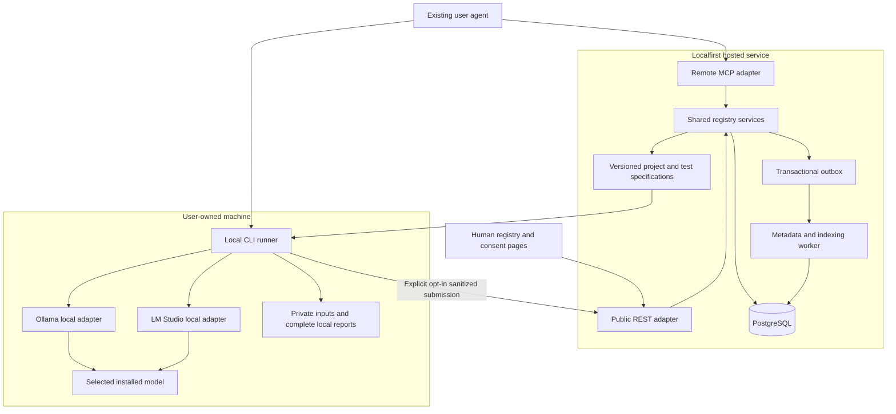

# Localfirst.sh Backend PRD — The home of local AI

**Version:** 0.3 · October 14, 2026

**Status:** The registry, local testing, and Phase 3 community backend surfaces are implemented. Bounded multi-agent environments and a constrained LangGraph/Docker profile are implemented behind default-off gates. General custom harnesses, arbitrary agent SDKs/tools, richer modalities, and model/runtime installation remain unsupported. Code/contracts and local checks are the source of truth; coverage, verification results, and known gaps are in [docs/product/IMPLEMENTATION_STATUS.md](IMPLEMENTATION_STATUS.md).

**Agent environments:** Section 21.1 specifies the versioned environment contracts, local preparation/execution, isolated framework profile, and release gates. The CLI remains unpublished; use the built repository runner until distribution is released.
**Research:** [RESEARCH.md](RESEARCH.md)  
**Audience:** Product, backend, local-runner, integration, and operations engineers.

Localfirst helps people discover, build, test, reproduce, and share local-AI projects using owned hardware and controlled models/runtimes. Its primary interfaces are agents through MCP/API and, where useful, a local CLI. The website supports command-first onboarding, discovery, reviews, and contribution management.

This replaces the prior GitHub-only, small-business-first PRD. Preserve the agreed Node.js/Hono/TypeScript, Better Auth, PostgreSQL, and Drizzle stack. Retain immutable versions, explicit approval, attribution, conservative compatibility, and durable jobs. Remove mandatory Git commits for documentation/hardware projects, the one-project-per-repository restriction, mandatory verified builds before registry launch, and integrator/SaaS features as product foundations.

All payloads, IDs, source URLs, hashes, versions, and measurements below are illustrative contract examples. They describe no real executed benchmark. `example_*` IDs stand in for opaque server UUIDs. Proposed domains, CLI package names, and commands are not provisioned or released infrastructure.

## Contents

1. Product boundaries and priorities
2. Architecture and execution boundary
3. Domain model and lifecycle
4. Portable project specification
5. Minimal test manifest
6. Build/configuration contract
7. Local runner and runtime adapters
8. Test results, measurements, and comparisons
9. Evidence and compatibility policy
10. Authentication, scopes, and consent
11. Shared API conventions
12. REST route inventory
13. MCP tools and resources
14. Publishing, versioning, and remixes
15. Ingestion, provenance, and source tracking
16. Persistence, queues, and consistency
17. Security, privacy, and moderation
18. Search and human discovery
19. Nonfunctional requirements and observability
20. Acceptance criteria
21. Delivery phases and smallest milestone
22. Configuration and implementation organization
23. Open decisions and decision log
24. Sources and documentation validation

## 1. Product boundaries and priorities

### 1.1 Four connected pillars

Models, hardware, projects, and builds are discovery pillars over shared records. Runtimes and test evidence connect them. A build combines a project version, selected model artifacts, runtime versions/settings, hardware/OS, and changes. Test results describe a bounded observation of that combination. They are not interchangeable objects.

The backend stores structured public specifications, source references, drafts, configuration records, sanitized opt-in reports, provenance, search, and compatibility policies. The user's machine owns inference, sensitive inputs, runtime credentials, sensors, execution consent, and complete local reports. Public documentation can be useful without a runnable harness or any test evidence.

### 1.2 Priority definitions

- **P0 / Phase 1:** Necessary for the first agent-native registry. Publication/discovery via API and a supported MCP client must work for repository and non-repository projects.
- **P1 / Phase 2:** Necessary for the first supported local testing release, including Ollama and LM Studio adapters and a declarative text-task runner.
- **P2 / Phase 3:** Community compatibility improvements, independent verification, remixes, collections, and carefully gated richer workflows.

Route/tool phase labels are binding: a future feature is not advertised as available. A declared harness in a Phase 1 specification does not mean a runner has shipped. Keep adapter/runner availability separate from project-declared `test_support`.

### 1.3 Functional requirement matrix

| ID | Priority | Requirement |
| --- | --- | --- |
| FR-01 | P0 | Create, validate, export, review, and publish portable `PROJECT.md` through API/MCP |
| FR-02 | P0 | Accept public repository references or direct specifications with documentation/hardware sources |
| FR-03 | P0 | Immutable project versions, author attribution, explicit unknown fields, and source provenance |
| FR-04 | P0 | Task/model/runtime/hardware search and conservative compatibility assessment |
| FR-05 | P0 | GitHub human sign-in; resource-scoped Localfirst OAuth credentials for agents |
| FR-06 | P0 | Publication authorized by an exact-artifact human approval or by a per-connection delegation the owner enabled; ownership checks, moderation, idempotency, and audit |
| FR-07 | P0 | Curate five attributed Jetson/edge entries without claiming execution or endorsement |
| FR-08 | P0 | Public schema/spec retrieval and tested MCP setup instructions above the catalog |
| FR-09 | P1 | Open-source local runner with separate Ollama and LM Studio discovery/inference adapters |
| FR-10 | P1 | Single-model declarative text tests, execution preview, explicit consent, local result files |
| FR-11 | P1 | Select installed models, detect unsupported capabilities, and record substitutions |
| FR-12 | P1 | Save private build/configuration and sanitized report; optionally publish after review |
| FR-13 | P1 | Method-tagged timing/token/resource metrics with explicit unavailable reasons |
| FR-14 | P1 | Report validation, reviewed evidence, failure history, and withdrawal/reaggregation |
| FR-15 | P2 | Scoped independent verification, improved evidence matching, comparison eligibility |
| FR-16 | P2 | Derivative/remix lineage, curated collections, attributed troubleshooting notes |
| FR-17 | P2 | Richer modalities/workflows/custom harnesses only after isolation and permissions gates |

### 1.4 Non-goals

No cloud inference dependency, model-weight hosting, central arbitrary-code execution, remote shell into user machines, mandatory agent IDE, replacement runtime, GitHub replacement, CRM, SaaS business-management suite, agent marketplace, or generic popularity feed. Paid ranking, support referrals, and an integrator marketplace are removed from the current product plan. A graph database and full standalone hardware/model catalog administration are not MVP requirements.

## 2. Architecture and execution boundary

### 2.1 Agreed stack and proposed defaults

| Layer | Decision | Status |
| --- | --- | --- |
| Runtime | Node.js, pinned supported LTS | Agreed |
| HTTP | Hono + strict TypeScript | Agreed |
| MCP | Official TypeScript SDK and supported HTTP adapter | Agreed; exact release/profile tested during implementation |
| Auth | Better Auth with GitHub sign-in and MCP/OAuth composition | Agreed; verify package integration before deployment |
| Database | PostgreSQL + Drizzle | Agreed |
| Jobs | PostgreSQL-backed queue; pg-boss candidate; transactional outbox | Proposed default |
| Schemas | Shared Zod/JSON Schema/OpenAPI contracts | Proposed default |
| Runner | Small open-source Node.js/TypeScript CLI using local HTTP adapters | Proposed P1 design; no arbitrary project-code evaluation |
| CLI package and executable | `localfirstdotsh` | First public package version: `0.1.0`, MIT; compiled contracts included in the runner distribution. Package release/ownership still to validate |
| Observability | Structured logs/metrics; OpenTelemetry where useful | Proposed default |

REST and hosted MCP call the same application services and ownership/evidence policies. The local runner imports shared contract definitions but keeps local capabilities, endpoints, credentials, and execution policy in a separate package/process. Framework selection does not supply the product's authorization or trust model automatically.

### 2.2 Topology



The last arrow is outbound user-initiated submission, not a hosted execution channel. The backend never calls `/api/chat` or `/v1/chat/completions` on behalf of users. Public-spec retrieval can be performed without a Localfirst account; the local runner can operate from a previously saved validated bundle offline.

### 2.3 Responsibility matrix

| Capability | Hosted backend | Local runner / user's agent |
| --- | --- | --- |
| Publish/retrieve structured project/test specs | Yes | Prepare/inspect/export |
| Connect to Ollama/LM Studio | Never | Explicitly selected local endpoint |
| Discover full model inventory | Never | Local, permission-based; not automatically uploaded |
| Execute inference or project harness | Never | Supported harness after execution consent |
| Measure machine resources | Never | Local instrumentation, when supported |
| Store private prompts, documents, outputs, or tokens | No | Local paths/keychain with access controls |
| Validate sanitized submitted report | Yes | Prepare/review an allowlisted export |
| Independently verify reported execution | No by mere ingestion | Separate authorized verifier run and reviewed evidence |

The agent itself may process context outside the user's machine. The runner must not return private test data to an agent automatically; default output to an agent is a bounded summary and local report path. Any richer disclosure requires explicit user consent for that destination.

### 2.4 Proposed surfaces and process boundaries

- Website: `https://localfirst.sh`.
- Backend: `https://api.localfirst.sh`.
- MCP resource: `https://localfirst.sh/mcp`.
- REST resource: `https://localfirst.sh/api/v1`.
- Auth issuer: `https://localfirst.sh/api/auth`, explicitly configured and tested against discovery.
- API, metadata worker, and migration job deploy separately from the same backend codebase.
- The local runner is a separately distributed client, not a centrally deployed execution worker.

MCP and REST tokens have their own resource audiences. Do not accept a token for one automatically at the other. Local inference endpoint tokens are unrelated to either audience and must remain local.

### 2.5 Browser UI and backend authority

All browser pages are owned by the root Next.js `apps/web/` app: public discovery, sign-in, OAuth consent, account connections/projects/usage/deletion, publication review and privacy. They share the production React components and light/dark tokens. The backend supplies JSON read models and retains all authentication, ownership, approval and publication enforcement; it no longer renders HTML pages. Previously issued backend sign-in/account/review/privacy URLs return uncached redirects to the website, preserving their path and original query.

| Layer | Source | Responsibility |
| --- | --- | --- |
| Shared design foundations | `apps/web/src/design-system/`, `apps/web/src/components/` | Tokens, native controls, page shell, feedback, fields and exact-text inspection |
| Browser features | `apps/web/src/features/auth/`, `account/`, `review/` | React presentation and same-origin interactions |
| Browser route integration | `apps/web/src/app/` | Metadata, private page composition, sign-in recovery and not-found handling |
| Private read models | `apps/api/src/api/browser/index.ts` | Session-only owner-filtered data, registered client metadata and authoritative approval lifecycle; no-store JSON |
| Auth and mutations | `apps/api/src/auth/`, `apps/api/src/api/v1/`, `apps/api/src/services/` | Existing cookie sessions, consent protocol, ownership, acknowledgements, revision/digest matching, expiry and single-use publication |
| Public-origin proxy | `apps/web/src/lib/backend-proxy.ts` | Stream API/auth/MCP/discovery/schema requests to the private backend while retaining public authority, status, redirects and separate Set-Cookie headers |

Deploy the website as the browser's public origin. Set `API_BASE_URL`, `WEBSITE_URL` and `LOCALFIRST_SITE_URL` to that origin, and `LOCALFIRST_API_URL` to the backend's distinct private address. The auth issuer and MCP/REST audiences derive from the public origin; GitHub callbacks use `<public-origin>/api/auth/callback/github`. This is a coordinated configuration migration: existing OAuth issuers/callback registrations and credentials must be reviewed when changing origins. No deployment or credential migration is implied by merging code.

`/sign-in` initiates GitHub authentication through the same-origin auth proxy. `/consent` submits the original, unnormalized OAuth query to Better Auth; names remain self-reported/unverified and every requested scope stays inspectable. Browser read models accept human sessions, not agent or linked-machine credentials, and return no private data on denial. Unauthenticated private pages redirect to sign-in with a safe local continuation; inaccessible records remain 404. API refusals retain their 401/403/404 JSON envelopes. Account deletion retains explicit handle/confirmation safeguards.

`/review/drafts/:draft_id` displays owned exact content, bundled files, selected public projections, complete warnings, digest/revision and server approval/publication state. Approval/revocation still call the existing guarded draft endpoints. The browser never publishes: an authorized REST/MCP caller separately consumes an exact, unexpired, single-use approval. Denial requires no warning assent. Changed revisions, stale records, expired approvals and uncertain responses require appropriate recovery; a browser response alone never establishes publication.

Private reads bypass Next's public data cache. Sensitive HTML has a per-request nonce CSP, no third-party resources, no-referrer and no-store behavior. React escapes untrusted strings; full artifact text is never inserted as HTML. `/design-system` is an opt-in reference importing production components. No browser page opens a local model/runtime channel or sends private local inputs to the hosted service.

## 3. Domain model and lifecycle

### 3.1 Minimal entities and relationships

| Entity | Priority | Relationship / invariant |
| --- | --- | --- |
| User + external identities | P0 | Provider-neutral user ID; GitHub first identity provider, not project source requirement |
| Project | P0 | Stable ID, slug, manager, type/category, visibility, current version |
| ProjectVersion / specification | P0 | Immutable normalized frontmatter + Markdown, manifest digest, source refs and schema version |
| SourceReference / attribution | P0 | Repository, documentation, hardware note, media link, or original authored specification; authors separate from submitter |
| ModelReference / ModelVersion | P0 references, P1 resolved identities | External source, role, license, identity scheme, revision/digest; unknown values preserved |
| RuntimeReference | P0 | Family/version/backend/API profile; no hosted inference credentials |
| HardwareProfile | P0 supplied summary, P1 saved evidence | Sanitized capabilities; public type descriptor or opted-in run environment, no machine identifier |
| Draft + PublicationApproval | P0 | Exact revision/digest, owner, kind, warnings, single-use approval |
| BuildConfiguration | P0 embedded declared configurations; P1 saved builds | Immutable actual selections/changes; project version FK; cannot assert it ran by itself |
| TestDefinition | P0 optional declaration, P1 executable contract | Versioned manifest/fixture/evaluator digests; bound to project version |
| RunReport / TestRun / benchmark result | P1 | One report storage model: manual build observations or supported test runs; test runs additionally require test-definition FK; immutable facts |
| CompatibilityReport | P0 | Derived evaluation of requirements/evidence, not an independent observation |
| EvidenceReview | P1 | Review states and evidence level; no client-controlled authority |
| DerivativeRelationship | P2 first-class; P0 optional declaration | Parent project/version + change summary; no inherited verification |
| Operation / outbox / audit | P0 | Durable async status, product-event delivery, minimal actor/target history |

Keep a normalized model/hardware reference table only where needed for joins/deduplication; no separate ontology service. Small configuration/check/measurement structures can remain validated JSONB. Distinct identities are still required for build versus run versus test specification.

### 3.2 Lifecycle rules

Projects: `published`, `unpublished`, `quarantined`. Owners control unpublish/republish; only operators can restore quarantine. Public reads of hidden records must not disclose private content. Published version content never changes; new content creates a new draft/version.

Drafts: `editable` -> `ready_for_review` -> `approved` -> `published`; optional import uses `ingesting` / `ingestion_failed`; `discarded` is terminal. An edit increments revision and invalidates approval. Validation may update derived ready state without changing content revision. Expired approvals return the draft to ready state. An import may not overwrite newer edits.

P0 draft kind is `project`. P1 reuses the draft/approval mechanism for `build` and `test_result` public contributions; private saves do not imply public publication. Review states for submitted evidence are `pending`, `accepted`, `rejected`, `withdrawn`, separate from visibility and reported execution outcome.

### 3.3 Sources, ownership, and duplicates

A Git commit is required only for a reproducible Git-source claim or executable plan relying on repository code. Documentation-only and hardware projects use the immutable specification digest plus available document revision/content snapshot metadata. A mutable source URL with unknown content digest remains explicitly unpinned.

A repository can contain several projects, guides, and derivatives. Do not enforce one project per repository. Identify a source entry by provider repository identity plus manifest path where applicable; use deduplication warnings and claim workflows for overlapping entries without automatically assigning ownership. Preserve stable provider repository ID through rename.

Store `listing_origin` (`creator_submitted` or `curated_from_upstream`), original authors, source licenses, submitter relationship, and maintainer-claim status separately. GitHub login does not prove control of an organization or document. A curated listing cannot imply its author submitted it. Operator-reviewed claims and future GitHub App control proof are separate paths.

## 4. Portable project specification

### 4.1 Required, optional, and conditional metadata

Canonical schema: `localfirst/project/v0.2`. It is a preimplementation replacement for the prior v0.1 business schema. P0 exports YAML frontmatter + Markdown and normalized JSON. `null` means unknown, never zero/false/empty. Unknowns require a state/reason where safety or reproducibility depends on them.

| Group | Publication requirement | Stronger execution/evidence requirement |
| --- | --- | --- |
| Project | Key/name/summary/type/categories/project version | Registry ID assigned on publication; not required in portable source |
| Source/attribution | Public source/documentation link or explicitly original authored specification; kind, authors, relation | Immutable source revision or snapshot digest where execution depends on content |
| License | Known/unknown/not-applicable state; reference when known | Resolve applicable project/model/fixture/dependency terms before auto-download/use claims |
| Models/runtimes | Declared/unknown/not-applicable state and roles when declared | Selected local identifiers, capabilities, settings, and sufficient identity for matching |
| Hardware/OS | Declared requirements or explicit unknown state | Actual environment and relevant measurements/version facts |
| Setup/workflow | Markdown instructions or explicit unsupported/manual state | Bounded harness contract or separately approved setup plan |
| Tests | `none`, `manual`, or `declarative_task_v1` declaration | A validated executable test bundle and supported runner version |
| Limitations/data boundary | Required disclosures, explicit unknowns | Required locality/capability checks must pass for local-only execution |
| Media/lineage | Optional source links and derivative description | License/attribution checks; no inherited evidence |

Project types: `application`, `workflow`, `demo`, `robotics`, `experiment`, `hardware_build`, `documentation`. Initial task categories are a small extensible controlled vocabulary. No mandatory `business` group remains.

Markdown sections: Purpose; Architecture/workflow; Setup; Execution; Test/evaluation; Limitations; Sources/attribution. A source without code can describe hardware assembly or an experiment. Optional screenshots/media are references; server retrieval and hosting are not required at launch.

### 4.2 Example `PROJECT.md` frontmatter

This documentation-only-source example declares a task harness; the separate YAML example in section 5 is submitted in the same bundle at `TESTS/request-label-v1.yaml`. The URL is illustrative. It requires no GitHub repository.

```yaml
---
schema: localfirst/project/v0.2
project:
  key: request-labeler
  name: Local Request Labeler
  summary: Classify a short request with a locally selected chat model.
  type: experiment
  categories: [text-classification]
  version: "0.1.0"
  license: {state: known, id: MIT, reference: "https://example.org/request-labeler/license"}
sources:
  - key: primary
    kind: documentation
    url: https://example.org/request-labeler
    revision: null
    content_digest: null
attribution:
  authors: [{name: Example Builder, url: "https://example.org/builder"}]
  relationship: original_author_claimed
models:
  state: declared
  roles:
    - key: classifier
      required_capabilities: [chat, json_output]
      minimum_context_tokens: 4096
      substitution: allowed_for_task_test
      preferred: null
runtimes:
  state: declared
  supported:
    - {family: ollama, version_constraint: null}
    - {family: lmstudio, version_constraint: null}
hardware:
  state: declared
  architectures: [arm64, x86_64]
  minimum_memory_bytes: 8589934592
  accelerator: optional
operating_systems:
  state: declared
  supported: [macos, linux]
dependencies:
  state: declared
  items: []
configurations:
  - key: local-chat
    model_roles: [classifier]
    setup_kind: manual
    workload: {context_tokens: 4096, concurrency: 1}
data_boundary:
  inference: local_required
  storage: local
  runtime_network: unknown
  external_services: []
test_support: declarative_task_v1
tests:
  - key: request-label-v1
    schema: localfirst/test/v0.1
    path: TESTS/request-label-v1.yaml
limitations:
  - One smoke-test case does not establish task accuracy.
  - Minimum RAM is a creator claim; actual model fit requires local assessment.
evidence: []
media: []
derivative_of: null
---
```

The example's 8 GiB memory figure is a declared sample requirement, not a finding that any model fits it. Runtime support is likewise a declaration until exercised. `runtime_network: unknown` prevents a claim of offline verification while allowing a local-only test only after separate runtime locality checks.

### 4.3 Bundle and source validation

Direct submission accepts `project_md` text plus bounded `files[]` containing supported test YAML/public fixture text only. Relative paths must match declared references, stay within the bundle, and be unique; reject traversal/symlinks/archive tricks. GitHub import retrieves files at one resolved commit. A manually submitted source URL is stored as a reference; the backend does not fetch arbitrary websites automatically.

For original hardware notes/documentation with no preexisting host, allow source kind `authored_specification`, `url: null`, and explicit original-author attribution/license state. Publication creates a canonical public documentation URL backed by the immutable specification digest. This hosts contribution metadata/documentation, not a duplicate code repository. Third-party material must retain its actual source and attribution instead of using this path to erase provenance.

Before publication validate schema, author attribution, license state, source visibility/state, test references, declared dependencies, safe Markdown, and secrets. Unknown optional metadata is visible; it must not invent model, hardware, or license facts. User-supplied evidence IDs are references/claims, not authority. Unknown executable requirements block plans while permitting a suitably labeled documentation listing.

Limits: Markdown 256 KiB, normalized manifest 512 KiB, at most 20 bundled test/fixture text files and 2 MiB bundle total initially. P0 rejects scripts/binaries/media uploads. Reject unsafe YAML tags/expansion/prototype keys and excessive nesting. Version the schema; expose explicit errors for unknown fields except bounded `extensions`.

## 5. Minimal test manifest

### 5.1 Contract and support boundary

Schema: `localfirst/test/v0.1`; harness: `declarative_task_v1`. A test definition binds a project version, model role, public fixture set, bounded inference settings, runner/evaluator version, safety policy, and scope (`component`, `workflow`, `end_to_end`). P1 supports **component** text-chat tests only. A pass cannot claim whole-project reproduction.

Allowed evaluators initially: `exact_match_v1` and `json_assert_v1`, implemented in trusted runner code. No JavaScript/Python expressions, plugins, arbitrary shell, unrestricted regex evaluators, remote judge APIs, or tool calls. Output parsing and JSON checks enforce size/depth/time limits. A future human/local-model rubric must record rubric and judge identity separately.

### 5.2 Example `TESTS/request-label-v1.yaml`

```yaml
schema: localfirst/test/v0.1
key: request-label-v1
project_key: request-labeler
configuration_key: local-chat
scope: component
harness: declarative_task_v1
runner_contract: localfirst/runner/v0.1
model_role: classifier
required_capabilities: [chat, json_output]
fixture_kind: public_inline
fixture_license: CC0-1.0
inference:
  temperature: 0
  max_output_tokens: 32
  context_tokens: 4096
  concurrency: 1
  stream: false
  seed: null
  reasoning: default
response_schema:
  type: object
  properties:
    label: {type: string, enum: [billing, support, other]}
  required: [label]
  additionalProperties: false
cases:
  - key: billing-001
    messages:
      - {role: system, content: 'Return a JSON object with label billing, support, or other.'}
      - {role: user, content: 'Please explain the charge on my invoice.'}
    evaluation:
      kind: json_assert_v1
      assertions: [{path: /label, equals: billing}]
limits:
  max_cases: 1
  request_timeout_ms: 30000
  run_timeout_ms: 60000
  max_response_bytes: 65536
execution:
  locality: local_required
  allow_tools: false
  allow_project_code: false
  allow_downloads: false
measurement:
  repetitions: 1
  warmup_runs: 0
  load_state: observe
  cache_policy: observe
  timing: end_to_end_v1
sharing:
  default: local_only
  allow_public_fixture_case_ids: true
```

This fixture is a synthetic public contract example. It deliberately contains one smoke case; passing does not establish accuracy on billing requests. The runner resolves its actual configured model locally. `response_schema` is mapped by the runtime adapter, not copied into every provider request unchanged.

### 5.3 Definition versioning and integrity

Normalize and hash the test manifest, fixture set, evaluator specification, and project bundle independently. Any change creates a new immutable definition/version. The backend returns all digests and its acceptance/capability state with the resource. The runner verifies the downloaded bundle against the approved plan and rejects changed/withdrawn content before execution.

Public fixtures can be inline text in the initial bundle; remote fixture downloads are excluded from the initial harness. Private local inputs can be used in a separate local run, but their content and hashes are excluded from registry exports and their result is not comparable to the public-fixture protocol. Do not claim the public fixture was used after substituting private inputs.

## 6. Build/configuration contract

A saved build is immutable configuration content, with visibility mutable through an approved publication/withdrawal flow. It may be `declared`, `attempted`, or supported by separately referenced run evidence. It records model substitution and source/configuration deviations. Runtime aliases and actual artifact identity are different fields.

### 6.1 Example saved build

```json
{
  "schema": "localfirst/build/v0.1",
  "id": "build_example",
  "project_id": "project_example",
  "project_version_id": "version_example",
  "configuration_key": "local-chat",
  "source": {
    "kind": "documentation",
    "url": "https://example.org/request-labeler",
    "revision": null,
    "project_manifest_digest": "sha256:1111111111111111111111111111111111111111111111111111111111111111"
  },
  "model_bindings": [
    {
      "role": "classifier",
      "runtime_model_id": "example-local-chat:local",
      "model_version_id": null,
      "artifact_identity": {
        "scheme": "ollama_manifest_sha256",
        "digest": "sha256:2222222222222222222222222222222222222222222222222222222222222222"
      },
      "source_url": null,
      "quantization": "Q4_K_M",
      "license_state": "unknown",
      "execution_location": "local",
      "locality_method": "adapter_preflight_and_user_confirmed_config"
    }
  ],
  "runtime": {
    "family": "ollama",
    "application_version": "0.0.0-example",
    "engine_version": null,
    "adapter_profile": "ollama-native/v0.1",
    "backend": "metal"
  },
  "hardware": {
    "platform": "apple-silicon",
    "os": {"name": "macos", "version": "example-os"},
    "cpu_architecture": "arm64",
    "cpu_model": "Example chip",
    "memory_bytes": 17179869184,
    "unified_memory": true,
    "accelerators": [{"vendor": "apple", "backend": "metal", "memory_bytes": null}]
  },
  "effective_settings": {
    "temperature": 0,
    "max_output_tokens": 32,
    "context_tokens": 4096,
    "concurrency": 1,
    "stream": false,
    "seed": null,
    "reasoning": "default"
  },
  "changes": [{"kind": "model_selection", "role": "classifier", "note": "Selected an already installed model."}],
  "parent_build_id": null,
  "visibility": "private",
  "reproducibility": "incomplete"
}
```

Server-only fields `id`, visibility, normalized fingerprint, and reproducibility classification are returned by the API, not accepted as client authority. The example has unknown upstream model/engine identity and an illustrative environment; it does not qualify as independently verified or as a complete reproduction record. A runtime-specific manifest digest must not be equated with a portable model-file hash.

`hardware` is optional: a contributor may decline to share hardware details (section 14.2), in which case it is `null`. Such a build is at most `partial`, has a fingerprint without a platform, and its accepted evidence can never be an exact platform match. The server derives reproducibility as `incomplete` when a model binding lacks an artifact identity or an upstream identity (a model version or a declared public source URL), an effective setting is unknown, or the runtime application version is unknown; as `partial` when those are known but the engine version, a digest, or hardware memory is missing; and as `complete` otherwise. `seed: null` is a known unseeded value, not an unknown setting.

P1 input may submit the build inline with a run in one transaction or reference an existing owned build ID. Export only the selected model binding and coarse hardware the user has approved, not all installed models or local file locations. A configuration-only substitution stays under the existing project version; changed code/workflow/test content requires a new version or derivative.

### 6.2 Manual build reports for projects without a harness

`build_save` / `POST /builds` may include an optional `manual_report` in the same private transaction. It records schema `localfirst/build-report/v0.1`, a submitter-scoped `client_run_id`, `outcome` (`reported_success`, `reported_failure`, `partial`), a bounded public-safe method/changes description, reported checks, diagnostic codes, and completion time. There is no test-definition ID, fabricated evaluator, or runner-executed-test claim. Keep observations immutable and review/visibility separate, using the same report storage/review policy as test runs.

After explicit public approval and review, a manual report can support `community_reported` evidence, never `reproducible_test` or `independently_verified` merely because it is well formatted. This is the P1 contribution path for hardware, robotics, and documented workflows whose automated harness is unsupported. Actual actuation or arbitrary-code execution remains outside the runner. Withdrawing the build/report removes its manual claim from active aggregation; correction creates a linked replacement.

## 7. Local runner and runtime adapters

### 7.1 Local execution state machine

`spec_retrieved` -> `local_discovery_authorized` -> `preflight` -> `plan_reviewed` -> `execution_authorized` -> `running` -> `local_report_saved`.

Optional continuation: `export_reviewed` -> `upload_authorized` -> `private_submission` -> `public_contribution_approved` -> `published`. Each stage has its own permissions; none is implied by the previous stage. Cancellation preserves a local partial report and never silently retries inference or submits data.

The runner's default is no upload, no telemetry, no automatic downloads, no arbitrary code, no tools, no actuation, and no persistent service. Running public sample tasks can load a model and consume RAM/VRAM/CPU/GPU; preview these effects. Downloads, package setup, OS changes, model loading/unloading where separately controllable, and privileged commands require separate explicit authorization.

### 7.2 Proposed local CLI interface

The npm package and executable are named `localfirstdotsh`. The MCP setup entry point is `npx localfirstdotsh mcp add`. These commands are design contracts for the future open-source package, not currently executable product commands:

```text
localfirstdotsh mcp add --client <tested-client>
localfirstdotsh project export <project-id> --version <version-id>   # anonymous; writes a digest-verified bundle
localfirstdotsh runtime discover --runtime ollama
localfirstdotsh runtime discover --runtime lmstudio
localfirstdotsh test plan <project-id> --test request-label-v1 --runtime ollama --model <installed-id>   # registry or --bundle <dir>
localfirstdotsh test run <approved-local-plan>
localfirstdotsh report show <local-report>
localfirstdotsh report compare <local-report-a> <local-report-b>
localfirstdotsh report export <local-report> --review   # the exact upload under one digest; hardware and --model-source-url are opt-in
localfirstdotsh report submit <approved-sanitized-export>
localfirstdotsh contribution review <draft-id>
```

Noninteractive test execution requires a locally established approval bound to exact spec/model/settings/data class and resource effects; a fetched manifest's `allow_run: true` is never authorization. A generic `--yes` cannot bundle discovery, execution, downloads, and publication. API tokens grant registry rights only. `contribution review` shows a draft's state and can open the browser review page; the CLI never records a publication approval itself (§10.4).

An optional local stdio MCP adapter can expose these local capabilities later. Do not expose them as hosted registry tools or a public HTTP daemon in P1. If a future browser companion is introduced, require loopback binding, per-session pairing, Origin/Host validation, CSRF protection, capability grants, and a dedicated threat review.

### 7.3 Provider-neutral adapter contract

| Operation | Input | Output / requirement |
| --- | --- | --- |
| `probe` | Explicit endpoint and local credential reference | Runtime family, API profile, reachability, version facts with observation source |
| `list_models` | Selected runtime endpoint | Local-only inventory: runtime ID, loaded/available state, artifact identity, capabilities and unknowns |
| `inspect_model` | Explicit selected runtime model ID | Role/capabilities, effective context/options, identity scheme, execution locality |
| `preflight` | Test requirements, model, workload, available capacity | Hard blockers, unknowns, permitted resource effects; no inference probe without consent |
| `infer` | Bounded messages/schema/settings and execution grant | Normalized content events, usage/metrics with raw local provider metadata |
| `cancel` | Active local run handle | Best-effort cancellation result; no automatic rerun |
| `measure` | Approved sensor scope and interval | Method-tagged observations or explicit unsupported reasons |

Capability values are `supported`, `unsupported`, `unknown` with source `provider_metadata`, `tested_adapter_profile`, `user_declared`, or `consented_probe`. Include model/API distinction: a runtime can support JSON-schema requests while a selected model/task still fails them. Unsupported critical options may not be dropped silently. Effective settings must be confirmed or marked unknown.

### 7.4 Ollama adapter profile

- Defaults to an explicitly approved loopback endpoint, ordinarily port 11434; no LAN scanning.
- Uses native tags/loaded-state/detail APIs locally and probes server version where supported. The documented endpoint path for version is `/api/version`; the adapter must integration-test it against its supported releases.
- Uses `/api/chat` for the initial text task, mapping schema/settings through the native adapter. Records returned count/duration information with its unit and interpretation.
- A manifest with `stream: true` sends `stream: true` and reads the NDJSON reply. First-token time is the first non-empty content fragment; empty keep-alive and `thinking` chunks do not count.
- Rejects known cloud model selections for local-only tasks, including cloud inference routed through a local server. Unknown locality blocks execution unless a supported locality check establishes it; user assertion alone cannot create offline-verification evidence.
- Records runtime manifest identity separately from any known underlying weight-file identity. No automatic pull, model creation, deletion, or server configuration change.

Sources: [Ollama listing](https://docs.ollama.com/api/tags), [details](https://docs.ollama.com/api-reference/show-model-details), [chat](https://docs.ollama.com/api/chat), [version docs](https://docs.ollama.com/api-reference/get-version), [local/cloud behavior](https://docs.ollama.com/api/introduction).

### 7.5 LM Studio adapter profile

- Defaults to an explicitly approved loopback endpoint, ordinarily port 1234; keeps any server token in local secure storage.
- Prefers native `/api/v1/models` for discovery where supported; uses `/v1/models` as a capability-limited fallback. Preserve available versus loaded distinction and unknown metadata.
- Uses `/v1/chat/completions` for the first common task profile. Structured output maps through a tested response-format profile. Version/capability differences can block a case rather than trigger an unsafe guess.
- Streaming is mapped on this profile only (server-sent events, `stream_options.include_usage`); a role-only opening chunk or reasoning delta is not the first token. The native profile has no tested streaming mapping and blocks `stream: true` with `stream_unsupported`.
- Native `/api/v1/chat` is an optional separately tested instrumentation profile. When used, set storage off and omit integrations/tools; do not inherit existing chat sessions or remote MCP integrations. Its statistics are tagged as provider-native, not silently merged with client timings.
- Reports application/server, CLI, and inference-engine versions separately where available. Missing facts remain null; do not report an `lms` version as an engine version. Remote-linked models/unknown execution origin do not satisfy local-only mode.

Sources: [native discovery](https://lmstudio.ai/docs/developer/rest/list), [compatible model list](https://lmstudio.ai/docs/developer/openai-compat/models), [chat](https://lmstudio.ai/docs/developer/openai-compat/chat-completions), [native chat](https://lmstudio.ai/docs/developer/rest/chat), [authentication](https://lmstudio.ai/docs/developer/core/authentication).

### 7.6 Execution and isolation policy

P1 executes a bounded declarative task in trusted runner code. It does not import repository modules, evaluate plugins, run lifecycle hooks, execute shell, or expose tools to model output. Fixtures remain untrusted text; they cannot grant capabilities. Requests reach only the selected local runtime; reject unsafe redirects and global proxy forwarding that could move sensitive content elsewhere.

A local HTTP address does not prove a local execution origin. For a strict local-only run, the adapter must identify a local model/profile and refuse unresolved delegation. An **offline_verified** claim additionally needs a documented egress restriction covering the runtime process, not just the runner. If the platform cannot constrain/observe runtime egress reliably, return offline check `unknown` or `not_run`. Never silently turn off system networking or change runtime configuration.

The runner's interim method is `no_route_observed`: it samples the interface table during the run and records the value only when no sample shows an address beyond loopback and link-local. It is a self-reported observation that the machine had no path off the local link, covering the runtime process and every other process; it is not `offline_verified`, grants no badge, and does not detect a path that appears between samples or reach link-local neighbours.

Later custom harnesses require a reviewed platform-specific process/container/VM sandbox, separate workspace, pinned dependencies, network policy, time/resource limits, approved accelerator/device access, and no secrets/home-directory mounts by default. A container with GPU access is not automatically a secure isolation boundary. Unsupported sandboxing means the harness remains manual/unsupported, not silently executed on the host. Robotics, cameras, microphones, multi-agent tools, and downloads are P2 capability gates.

Section 21.1 defines a bounded workflow harness: a bounded declarative graph interpreted by trusted runner code, without project code, dependency installation, or model-selected tools. A separately gated LangGraph/Docker profile runs one pinned creator module inside a restricted Linux container, with dependency setup and execution approved separately. Other frameworks and setup hooks remain subject to the platform isolation requirements above.

## 8. Test results, measurements, and comparisons

### 8.1 Sanitized result example

This matches sections 4–6: `request-labeler`, configuration `local-chat`, test key `request-label-v1`, case `billing-001`, one repetition, nonstreaming, one selected classifier model. It is synthetic; the numeric latency is not a benchmark finding.

```json
{
  "schema": "localfirst/test-result/v0.1",
  "client_run_id": "run_example_001",
  "project_id": "project_example",
  "project_version_id": "version_example",
  "build_id": "build_example",
  "test_key": "request-label-v1",
  "test_definition_id": "test_example",
  "test_manifest_digest": "sha256:3333333333333333333333333333333333333333333333333333333333333333",
  "fixture_digest": "sha256:4444444444444444444444444444444444444444444444444444444444444444",
  "fixture_kind": "public_inline",
  "evaluator": {"kind": "json_assert_v1", "version": "1"},
  "scope": "component",
  "runner": {"version": "0.0.0-example", "contract": "localfirst/runner/v0.1"},
  "outcome": "pass",
  "counts": {"defined": 1, "evaluated": 1, "passed": 1, "failed": 0, "errors": 0, "skipped": 0},
  "case_results": [{"key": "billing-001", "outcome": "pass", "repetition": 1}],
  "measurements": {
    "latency_ms": {"value": 1200, "method": "client_monotonic_end_to_end_v1", "samples": 1},
    "time_to_first_token_ms": {"value": null, "reason": "nonstreaming_run"},
    "tokens_per_second": {"value": null, "reason": "generation_interval_not_exported"},
    "peak_memory_bytes": {"value": null, "reason": "runtime_sensor_unavailable"},
    "hardware_utilization": {"value": null, "reason": "sensor_unavailable"}
  },
  "measurement_context": {"load_state": "unknown", "cache_state": "unknown", "repetitions": 1, "warmup_runs": 0},
  "checks": {"locality": "pass", "offline": "not_run"},
  "completed_at": "2026-10-11T20:00:00Z",
  "redaction_version": "localfirst/export/v0.1",
  "diagnostic_codes": [],
  "visibility_requested": "private"
}
```

The backend derives submitter, received time, digest, review state, evidence level, and comparison eligibility. The example's incomplete build environment/identity limits it to a reported result. Client fields must never assert `verified`, review authority, or a badge. Invalid extra private fields are rejected; redaction is not a license to submit raw sensitive content.

### 8.2 Metrics contract

All measurements include value/unit implied by canonical field name, method/version, scope, sensor/provider source, sample count/window, and missing reason when unavailable. Store canonical bytes/milliseconds; convert provider nanoseconds explicitly. Preserve raw provider statistics locally, not arbitrary raw response bodies in the hosted report.

| Metric | Interpretation | Required caveat |
| --- | --- | --- |
| Case outcomes | Declared evaluator and defined/evaluated/pass/fail/error/skip counts | A smoke pass is not general accuracy; skipped/errored cases cannot disappear |
| Task accuracy | Versioned dataset and task evaluator over eligible cases | P2 comparison protocol; not inferred from one smoke case |
| Rubric score | Named rubric, evaluator/annotator or local judge version, settings | Human/model subjectivity; no mandatory external judge |
| Latency | Client end-to-end or provider generation duration, explicitly labeled | Load/queue/cache effects differ; clocks must be monotonic locally |
| First-token time | First content-token/chunk event from request start | Nonstreaming unavailable; network headers/reasoning events separately labeled |
| Token rate | Generated count divided by appropriate generation duration | Provider tokenizer/reasoning/cache accounting differs; zero-duration rejected |
| Peak memory | Named runtime process/device/system sensor, interval and coverage | Runner RSS is not inference memory; unavailable sensor is null |
| Utilization | Device/CPU sensor method and observation window | Competing workloads and sampling affect results |

For Ollama, a documented generation-rate derivation is output-token count divided by output-generation duration in seconds when those fields exist and are valid. Do not substitute prompt counts, cached prompt rates, or total request duration into that measure. LM Studio native performance fields require their own tagged method; OpenAI-compatible usage alone does not guarantee timing instrumentation. [Ollama timing fields](https://docs.ollama.com/api/chat), [LM Studio native statistics](https://lmstudio.ai/docs/developer/rest/chat)

### 8.3 Comparison eligibility

A comparison group includes test/fixture/evaluator digests, test scope, runner/adapter protocol, workload/context/concurrency, effective generation settings, repetitions, warm/cold and cache policy, model artifact identity, runtime/backend, and metric method. Record which dimension intentionally varies, such as selected model or hardware; other relevant dimensions must match or be disclosed as confounders.

Changing model is a valid task experiment, not an assertion of equivalent quality. Cross-model token rates require tokenizer caveats. Different test revisions, private fixtures, unknown effective settings, missing artifact identity, incomparable sensors, or unsupported task coverage can make a comparison ineligible. Return reasons instead of an aggregated universal score. P1 primarily compares local reports; P2 adds public comparison routes only for eligible groups.

The public route requires `project_version_id`, with one `varies` dimension (`model`, `runtime`, `hardware`, or `settings`) and one `metric` (default `case_outcomes`). It pages accepted public reports in bounded windows, returns protocol groups and exclusions, and explicitly says groups/contributor counts can span windows. `comparison_ready` requires at least two eligible reports in the window; a singleton carries no comparison claim. Every group discloses runner/version/adapter, workload, fixtures/evaluator, repetition protocol, measurement method/sample count, and per-report differences from its baseline. Only approved public projections are used. Complete artifact digests/upstream identity, runtime/engine/backend, known effective settings and shared coarse hardware are required. Unknown warm/cache state excludes timing comparisons, while evaluator outcomes disclose it as uncertainty. Different metric methods cannot join the same group. Coarse hardware does not establish exact chip/OS-release equivalence. Smoke-case outcomes are not general task accuracy; no universal score is produced.

### 8.4 Submission semantics

A runner produces a complete local report even without an account. It exports an allowlisted subset only after user review, then uploads only on explicit consent. Public-fixture digests/case IDs may be shared; private inputs, outputs, prompt hashes, documents, inventory, credentials, filesystem/network identifiers, and raw logs are excluded by default.

`POST /test-results` stores a sanitized private report and queues metadata validation; it does not run a test. Separate public contribution approval publishes the selected report/build fields. A record changing from private to public requires the exact payload digest approved by the user. Changed redaction or added hardware detail invalidates approval.

`POST /test-results` accepts either the bare sanitized result (naming an owned build) or an envelope with the result and either `build_id` or an inline `localfirst/build/v0.1`; an inline build also needs `builds:write` and is created in the same transaction. The first-party runner uploads the result and its inline build as one object under one reviewed digest. Operators review only reports whose owner has published them; a private upload is never queued for review.

Deduplicate client run IDs per submitter and request digests. Retries must not create new independent contributors or duplicate counts. Rejected/withdrawn evidence is excluded from matching, while immutable report facts and permitted correction history remain available to the actor. Corrections create a linked replacement report rather than editing observed facts.

## 9. Evidence and compatibility policy

### 9.1 Shared evidence vocabulary

These labels are identical to the research and are server-derived classifications, not client assertions:

| Level | Required provenance | Boundary |
| --- | --- | --- |
| `claimed` | Declared fact with author/submission attribution | No documented or observed proof implied |
| `documented` | Relevant source statement/version and extraction/reference provenance | No actual Localfirst run implied |
| `community_reported` | Authenticated report with named configuration/outcome and review state | Truth is not established by schema validation |
| `reproducible_test` | Accepted report with supported test, fixture/evaluator digests, environment, effective settings, and sufficient artifact/source identity | Bounded repeatable protocol, not independent verification |
| `independently_verified` | Separate authorized independent reproduction and reviewer/criteria provenance linked to the exact original claim | Applies only to the stated build/test scope |

Represent review state, evidence level, execution outcome, and visibility as separate fields. A valid JSON report can remain pending/rejected. A signature confirms signer identity, not real execution. Published tests and saved builds without a run carry no run-success badge.

P0 derives only claimed/documented compatibility from supplied/source metadata. P1 collects reviewed reports and eligible reproducible task evidence. P2 introduces the versioned `localfirst/independence/v0.1` policy, served by `/api/v1/verification-policy`, and links separate verifier runs. A human operator records the repeat procedure, external evidence URL, conflict disclosures, author/submitter/reviewer independence, execution authorization, identity completeness and hardware/software coverage. The server additionally requires two separately submitted accepted/public reproducible runs of the exact same public component protocol, approved build identity/settings/platform, case counts and outcome. The reproduction submitter and reviewer must be distinct from the original submitter and project manager; registered author identities also exclude them. External affiliations and author aliases require human review; account IDs or supplied booleans alone do not prove independence. Disclosed conflicts block qualification under this policy.

Verification is a separate immutable claim linking the original and reproduction; ordinary report review remains capped at `reproducible_test`. The claim verifies bounded component case outcomes, including a separately reproduced failure, and does not verify latency/throughput numbers, offline use, or an entire project. Verification history identifies reviewer/policy/procedure/claim digest, counts distinct qualifying verifier accounts, and preserves revoked/ineligible decisions. Withdrawal, rejection or quarantine of either run/build/project removes active qualification on read, before queued reaggregation finishes; revocation is audited and cannot resurrect the same decision. Do not create a central arbitrary-code verifier service. Human-authorized independent runners or reviewed lab runs produce the verification records.

### 9.2 Compatibility algorithm

1. Resolve a visible immutable project version and configuration.
2. Normalize minimal voluntarily supplied hardware, selected model capabilities, runtime/API profile, and workload.
3. Evaluate architecture/OS/backend/driver, capacity, task modality, required context/tool/JSON features, dependencies, and requested data boundary.
4. Separate missing installable prerequisites from a hard-incompatible machine/model.
5. Match accepted evidence to exact project/build/test/artifact identities and relevant environment/workload dimensions.
6. Explain near matches, conflicts, unavailable facts, and source/test drift.
7. Return one outcome and per-requirement checks with provenance and evidence levels.

| Outcome | Meaning |
| --- | --- |
| `evidence_match` | Exact applicable accepted `reproducible_test` or `independently_verified` evidence; known hard constraints pass |
| `candidate` | Known requirements pass based on documented/declared/reported facts, but exact strong evidence is absent |
| `incompatible` | A known hard requirement fails |
| `unknown` | Critical missing/conflicting facts prevent a defensible assessment |

The scope of `evidence_match` must identify component versus workflow/end-to-end coverage. A text classification test does not prove a robotics workflow, tool integration, or full offline application. `candidate` is not a guarantee. Requested strict local/offline requirements that are unresolved produce `unknown` and block a plan claiming to satisfy them.

A caller may share each selected model's runtime artifact identity (`selected_models[].artifact_identity`); `evidence_match` requires it, together with the runtime family and version and the platform the accepted evidence names, to match exactly. Effective settings, known engine version, adapter profile, model quantization, and disclosed platform/memory must also match. Anything not shared is reported as an unmatched dimension instead of being assumed; a partial report with unknown engine identity cannot qualify for public comparison or independent verification.

Use bytes and separate system RAM from discrete VRAM. Do not add Apple/Jetson unified memory twice. A raw weight-size estimate excludes runtime/KV-cache/concurrency overhead and cannot produce a positive observed-fit claim. Available memory/disk are transient; recheck locally before execution. Recorded peak memory is method-specific, not a universal minimum.

### 9.3 Model substitution

Check the role interface, model modality, context capacity, structured-output/tool needs, runtime/backend support, prompt templates/tokenizers, generation settings, licenses, and hardware requirements. A similar model name or parameter count is insufficient. An installed model with unknown digest can be tested locally with a warning, but incomplete identity limits shared reproducibility/comparison evidence.

The supported declarative task can bind a new model to a permitted role without changing the project. Actual substitution is stored in a new build; code/workflow/harness changes require a project version or derivative. No evidence transfers automatically from the original binding. Returning an adaptation proposal does not execute it.

### 9.4 Assessment example

```json
{
  "project_id": "project_example",
  "project_version_id": "version_example",
  "configuration_key": "local-chat",
  "outcome": "candidate",
  "evidence_level": "claimed",
  "evidence_scope": "requirements_only",
  "rules_version": "localfirst/compatibility/v0.1",
  "checks": [
    {"requirement": "chat", "status": "pass", "source": "supplied_adapter_profile"},
    {"requirement": "json_output", "status": "pass", "source": "supplied_adapter_profile"},
    {"requirement": "declared_minimum_memory", "status": "pass", "source": "supplied_hardware_and_creator_requirement"},
    {"requirement": "offline", "status": "unknown", "source": "no_applicable_test"}
  ],
  "blockers": [],
  "uncertainties": ["No exact tested configuration backs the selected model and declared capacity.", "Offline execution has not been observed."],
  "evidence_ids": [],
  "test_support": {"declared_kind": "declarative_task_v1", "runner_available": false}
}
```

Offline use is not a hard requirement in this example. If it is requested, outcome becomes `unknown`. The creator's minimum-memory claim and supplied hardware pass the declared check but do not establish measured model fit. If a critical model capacity or runtime fact is missing, return `unknown` instead. `runner_available: false` shows a Phase 1 declaration without a shipped runner, avoiding a misleading test action. Supplied adapter facts are attributed to the caller and do not become independent observations.

### 9.5 Conflicting and stale evidence

Include accepted failures as well as successes for matching configurations. A contradictory report triggers uncertainty/review rather than an averaged probability. Distinct eligible contributors, not run count, determine independent reproduction counts. A creator's ten reruns are not ten independent verifications.

New project/model/runtime/test revisions get new fingerprints. Old evidence remains historical and never silently verifies new source or a derivative. Withdrawal/rejection/quarantine removes affected evidence from active matching and schedules reaggregation. The graph may use a near-match similarity rule, but every result discloses which dimensions differ; no transitive compatibility guarantee.

## 10. Authentication, scopes, and consent

### 10.1 Identity and resource access

GitHub is the first human sign-in provider using Better Auth; this does not require every project to have a GitHub source. Provider-neutral identity tables permit a later sign-in option for builders without GitHub. Anonymous public reads and local tests need no account. Private saves and contribution require a Localfirst identity.

Localfirst OAuth authenticates agents to registry resources. GitHub tokens and Ollama/LM Studio credentials are never registry bearer tokens. Browser sessions use CSRF/origin protections. Bearer verification checks issuer/audience/signature/expiry/scopes and current account/target policy. An invalid supplied bearer token must not fall back to a valid cookie silently.

### 10.2 Product scopes

| Scope | Phase | Capability | Further restriction |
| --- | --- | --- | --- |
| `projects:read` | P0 | Hosted MCP catalog/resources/compatibility queries | Visible public records; no other users' drafts |
| `projects:draft` | P0 | Own project drafts, imports, validation/export | Ownership and source policy |
| `projects:publish` | P0 | Publish exact approved own project artifact | Exact human approval, or delegation enabled for the connection (§10.4) |
| `projects:update` | P0 | Version updates and owned listing visibility | No immutable edits or quarantine override |
| `profile:read` | P0 | Minimal own identity/account state | No provider credentials |
| `builds:write` | P1 | Save/read own private builds and prepare build drafts | No evidence authority |
| `builds:publish` | P1 | Publish approved own build contribution | Exact exported fields approved, or delegation (§10.4) |
| `tests:submit` | P1 | Upload/read own sanitized reports and prepare result drafts | Explicit local upload consent; no inference grant |
| `tests:publish` | P1 | Publish approved own sanitized report | Approval or delegation (§10.4); evidence policy unchanged |

Read scopes do not grant execution. There is no hosted `runtime:execute` or arbitrary-code scope. OIDC `openid`/`profile` and OAuth `offline_access` are protocol scopes, not product permissions. Advertise only implemented phase scopes and ask for the minimum needed operation.

Publication delegation is deliberately not a scope. Clients choose which scopes to request, consent grants them all at once, and MCP clients commonly request every advertised scope, so a delegation scope would become a silent default. Existing `*:publish` grants keep their meaning (publish what a person approved). Delegation is a per-connection setting that only a human session can change (§10.4).

### 10.3 Permission boundaries

| Action | Authorization |
| --- | --- |
| Inspect local source/machine inventory | User permission in existing agent/local runner |
| Execute local test | Local explicit grant for exact plan/model/settings/data class/resource effects |
| Change runtime/load/download/install | Separate local approval for the applicable effect |
| Save a private local report | Local file permission; no registry upload implied |
| Upload sanitized report | User review/opt-in for the exact export and destination |
| Publish project/build/result | Scoped registry capability plus either an exact-artifact human approval or the connection's publication delegation |
| Mark independent verification | Operator-reviewed independent provenance; never a submitted flag |

An OAuth connection consent grants recurring capabilities; by itself it does not approve any future artifact or test. Publication delegation (§10.4) is the one standing authorization, and a human session enables it separately for one connection. The backend can enforce publication approval but cannot independently prove that an arbitrary third-party agent obtained truthful human local-execution consent. The first-party runner enforces that boundary; reports remain attributed claims unless stronger provenance exists.

### 10.4 Publication authorization

Approval binds actor, draft kind/ID, revision, canonical payload digest, warning acknowledgements, policy version, expiry, and one-use consumption. Proposed lifetime: 30 minutes. Any content/redaction/model-binding/source/test reference edit invalidates approval. Changing derived view counters does not change artifact content.

A human may deny a valid reviewable artifact without acknowledging its warnings. Denial grants no publication rights, revokes any existing unconsumed approval, and records the exact revision/digest and denial in the audit trail. Warning acknowledgement remains mandatory for approval and is rechecked during publication; denial retains the same session, ownership, lifecycle, validation, and exact-artifact checks.

Publication needs one of two authorizations, checked inside the publish transaction:

1. **Exact-artifact approval** (the default). A human browser session approves the exact revision and digest on `/review/drafts/:draft_id`; MCP cannot mint it by claiming `user_approved: true`. Contribution preparation, extraction, editing, validation, and final publication remain API/MCP operations; the browser is a minimal consent surface, not a mandatory web authoring app. `contribution review --open` opens that page from the CLI.
2. **Publication delegation.** The owner lets one connection publish their own drafts without a per-artifact approval, the way a developer lets an agent push to a repository. It is off for every connection by default, and only a human session can turn it on or off: on the connection's row in `/account/connections`, or with **Approve and let <client> publish without asking** on the review page, which records the approval and enables delegation for the connection that created the draft in one step. Delegation belongs to the grant (user and OAuth client), not to a token: it survives token refresh and ends when the connection or the delegation is revoked, within the access-token and cache bounds of §10.5. A token can never change it; it only learns whether its own connection is delegated (`publication_delegated` on `GET /drafts/:id` and `draft_get`). The publish call still names the exact revision and digest and lists `acknowledged_warning_codes`; the publish transaction records a delegated approval for that revision and digest, with `authorization: delegated`, the connection, and the agent's acknowledgements, and consumes it at once, so every published version still has exactly one consumed approval. Delegation changes nothing else: ownership, the kind-specific publish scope, every §14.4 blocker except the missing approval, quarantine, idempotency, single use, the publication rate limit, and audit all still apply.

Delegated publication stays visible. The published version records how it was authorized; public project and version pages say when a version was published by a connection without per-version review, showing the client's self-reported display name as unverified. The owner sees each connection's delegated publications on `/account/connections`, with an unpublish action.

There is no local approval channel. The earlier linked approval device (`auth approver-login`, `contribution approve`, `lfh_` credentials, `/account/devices`) is retired. An agent running as the same OS user could answer its interactive terminal through a pseudo-terminal and read its credential from the keychain, so it neither proved a person was present nor was more convenient than delegation. Existing device credentials and open link requests are revoked when this change ships.

### 10.5 OAuth/session defaults

Proposed defaults retained: 15-minute access tokens, maximum 30-day refresh authorization, seven-day browser sessions, five-minute authorization codes. Require PKCE where applicable, strict callbacks, stable signing keys, rotation/revocation, and explicit client registration/discovery. Test actual client flows instead of copying examples from incompatible auth/SDK releases.

Apply online revocation/account checks on private reads and mutations; cache at most 60 seconds. Public-only MCP read tokens may remain usable until the short access-token expiry, with that limit documented. Keep provider secrets encrypted where retained and out of logs. Request minimum GitHub identity/email access; repository-writing permissions are not needed to publish registry metadata. A future GitHub App handles selected-repository permissions separately.

### 10.6 Auth, discovery, and browser route contract

Protocol endpoints remain owned by the pinned Better Auth integration. Prefixes below assume auth base path `/api/auth`; verify actual methods/aliases in the generated contract. Protocol bodies/errors do not use the domain REST envelope.

| Method | Route | Purpose / access |
| --- | --- | --- |
| POST | `/api/auth/sign-in/social` | Initiate GitHub login; auth-library protections |
| GET | `/api/auth/callback/github` | Provider callback with validated state |
| GET | `/api/auth/get-session` | Safe browser session state |
| POST | `/api/auth/sign-out` | CSRF-protected session termination |
| GET | `/api/auth/oauth2/authorize` | Agent authorization flow with resource binding and PKCE |
| POST | `/api/auth/oauth2/token` | Code/refresh exchange; registered client rules |
| POST | `/api/auth/oauth2/consent` | Human permission consent, separate from artifact approval |
| POST | `/api/auth/oauth2/revoke` | Credential/grant revocation |
| POST | `/api/auth/oauth2/introspect` | Authenticated resource-server/client token-state check |
| GET | `/api/auth/jwks` | Public signing keys only |
| GET | `/.well-known/oauth-authorization-server/api/auth` | Path-based issuer discovery |
| GET | `/api/auth/.well-known/oauth-authorization-server` | Library-supported issuer-local alias if configured |
| GET | `/.well-known/oauth-protected-resource/mcp` | MCP resource metadata |
| GET | `/.well-known/oauth-protected-resource/api/v1` | REST resource metadata |
| POST | `/api/auth/oauth2/register` | Optional tested legacy registration fallback; off unless required |
| GET | `/sign-in` | Human login page |
| GET | `/consent` | Client identity/resource/scopes grant/deny page |
| GET | `/review/drafts/:draft_id` | Owner's exact project/build/result publication review |
| GET | `/account/connections` | Human grant review/revocation |

Optional OIDC userinfo/discovery and root protected-resource aliases are enabled only when configured and unambiguous. Mount root well-known handlers explicitly; an `/api/auth/*` catch-all alone cannot serve all discovery paths. Current Better Auth MCP composition incorporates the OAuth provider; do not register duplicate provider owners of the same endpoints. [MCP auth specification](https://modelcontextprotocol.io/specification/2026-07-28/basic/authorization), [Better Auth MCP](https://better-auth.com/docs/plugins/mcp), [OAuth provider](https://better-auth.com/docs/plugins/oauth-provider)

## 11. Shared API conventions

- Domain paths: `/api/v1`; hosted MCP: `/mcp`; schemas: `/schemas/...`; OAuth keeps protocol-native semantics.
- JSON schemas reject unknown fields except bounded extensions. Use full source revisions where known, SHA-256 identity with declared scheme, canonical bytes/ms, UTC RFC 3339 times, and opaque UUIDs.
- Success envelope: `{"data": ..., "meta": {"request_id": ...}}`. Lists include opaque filter/sort-bound cursor, `has_more`, and `next_cursor`; default 20/max 100; no expensive count required.
- Public/private serializers differ. Submitted private fields cannot leak through resources, search, operations, caches, or error details.
- Require `Idempotency-Key` for draft/import/publication/build/result creation; MCP uses `idempotency_key`. Scope to actor/operation/target and canonical request digest across adapters. Same key with different content returns `409`; simultaneous retry reuses one operation/result. Authorize before replaying private responses.
- Keep replay records at least 24 hours; database uniqueness prevents later duplicate client-run/version creation too.
- Draft PATCH requires `If-Match` revision ETag; MCP update uses `expected_revision`. Publication/approval explicitly bind revision/digest.
- Asynchronous response `202` includes `operation_id`, target ID, `Location`, and initial `Retry-After: 2`. Operations: queued/running/succeeded/failed/cancelled; ownership and relevant scope checked on polling.
- Resource/schema/API major versions are independent. Canonical serializer and digest algorithms are versioned; approved artifact bytes must not drift through ambiguous YAML normalization.

### Error example

```json
{
  "error": {
    "code": "MODEL_LOCALITY_UNKNOWN",
    "message": "The selected runtime/model does not establish local execution.",
    "retryable": false,
    "details": {"required_locality": "local", "observed_locality": "unknown"}
  },
  "meta": {"request_id": "request_example"}
}
```

| HTTP | Use |
| --- | --- |
| 200 / 201 | Successful read/evaluation or synchronous creation/publication |
| 202 / 204 | Durable async work or successful no-body discard/withdrawal |
| 400 / 415 | Malformed/unknown inputs or unsupported media type |
| 401 / 403 | Missing/invalid credential or insufficient capability/account authority |
| 404 | Missing/inaccessible record or unimplemented phase route without private disclosure |
| 409 | Invalid lifecycle, content/idempotency conflict, absent/expired artifact approval |
| 412 / 428 | Failed/missing revision precondition |
| 413 / 422 | Size limit or schema/semantic execution/publication blocker |
| 429 | Shared rate limit; Retry-After |
| 503 | Dependency unavailable or work cannot be accepted durably |

Compatibility `incompatible` and `unknown` are normal assessment outcomes, not HTTP failures. A request for an executable plan with a hard blocker returns `422 PLAN_BLOCKED` with reasons. Local adapter errors are classified locally as `RUNTIME_UNREACHABLE`, `MODEL_NOT_AVAILABLE`, `CAPABILITY_UNSUPPORTED`, `MODEL_LOCALITY_UNKNOWN`, `RESOURCE_LIMIT`, `TEST_TIMEOUT`, `CANCELLED`, or `UNSUPPORTED_HARNESS`. No local error triggers an automatic cloud fallback.

## 12. REST route inventory

**Public:** published safe content, anonymous bounded reads. **Session/token:** human session or correct REST-audience bearer with listed scope plus ownership. **Human:** session only. **Operator:** administratively assigned human role. Future routes remain disabled/unadvertised until their phase passes acceptance.

### 12.1 Registry and source-independent publication

| Method | Route | Phase | Access / contract |
| --- | --- | --- | --- |
| GET | `/api/v1/projects` | P0 | Public; query/category/type/model/runtime/hardware/evidence filters |
| GET | `/api/v1/projects/:project_id` | P0 | Public visible listing/current version; safe source/attribution/test-support summary |
| GET | `/api/v1/projects/by-slug/:slug` | P0 | Public canonical ID resolution |
| GET | `/api/v1/projects/:project_id/versions` | P0 | Public published immutable history |
| GET | `/api/v1/projects/:project_id/versions/:version_id` | P0 | Public exact specification/resources/provenance |
| GET | `/api/v1/projects/:project_id/export` | P0 | Public `PROJECT.md`; optional version query; no credentials embedded |
| GET | `/api/v1/catalog/facets` | P0 | Public controlled filter vocabulary and phase support |
| GET | `/api/v1/models` | P0 | Public bounded model references derived from project records; no weights |
| GET | `/api/v1/hardware` | P0 | Public hardware descriptors/references, no private machine inventory |
| GET | `/api/v1/runtimes` | P0 | Public runtime reference/profile catalog and support status |
| POST | `/api/v1/drafts` | P0/P1 | Session/token; scope based on kind; direct text bundle or import descriptor |
| GET | `/api/v1/drafts` | P0 | Session/token; own permitted drafts, kind/state filters |
| GET | `/api/v1/drafts/:draft_id` | P0/P1 | Session/token; own draft/revision/issues/review URL and operation |
| PATCH | `/api/v1/drafts/:draft_id` | P0/P1 | Session/token; kind-specific write scope, If-Match |
| POST | `/api/v1/drafts/:draft_id/validate` | P0/P1 | Session/token; schema/semantic results and derived review state |
| POST | `/api/v1/drafts/:draft_id/import` | P0 | `projects:draft`; bounded explicit GitHub extraction, 202 |
| POST | `/api/v1/drafts/:draft_id/approval` | P0/P1 | Human; exact payload/revision/digest/warning approval |
| DELETE | `/api/v1/drafts/:draft_id/approval` | P0/P1 | Human; revoke exact approval |
| POST | `/api/v1/drafts/:draft_id/publish` | P0/P1 | Kind-specific publish scope + human approval or connection delegation (§10.4), immutable artifact |
| DELETE | `/api/v1/drafts/:draft_id` | P0/P1 | Kind-specific write scope; discard own nonterminal draft |
| POST | `/api/v1/projects/:project_id/drafts` | P0 | `projects:draft` + `projects:update`; owned version-update draft |
| POST | `/api/v1/projects/:project_id/unpublish` | P0 | `projects:update`; owned visibility change |
| POST | `/api/v1/projects/:project_id/republish` | P0 | `projects:update`; no quarantine override |
| POST | `/api/v1/projects/:project_id/claim-requests` | P0 | Human; evidence-backed manager/author claim, no automatic transfer |

Static routes such as `by-slug` must precede/conflict-proof parameter routes. Direct submission with public documentation references is P0, not deferred behind GitHub ingestion. Sources, models, hardware, and runtimes are joined references; reference GETs do not imply four fully featured portals.

### 12.2 Compatibility, builds, and local test specifications

| Method | Route | Phase | Access / contract |
| --- | --- | --- | --- |
| POST | `/api/v1/hardware-profiles/validate` | P0 | Public/rate-limited; normalize voluntarily supplied capabilities, no raw-body persistence |
| POST | `/api/v1/projects/:project_id/compatibility-checks` | P0 | Public/rate-limited; version/config/model/runtime/hardware requirement assessment |
| GET | `/api/v1/projects/:project_id/tests` | P1 | Public visible test definitions; version filter; scope/support clearly labeled |
| GET | `/api/v1/test-definitions/:test_id` | P1 | Public immutable manifest + public fixtures/digests, safe provenance, and the public bundle files (`bundle_files`: path, kind, content, content digest) so a client can recompute the version content digest and verify what it will run |
| GET | `/api/v1/test-definitions/:test_id/plan` | P1 | Public generic local plan template; requirements/effects, no machine probing or execution |
| POST | `/api/v1/builds` | P1 | `builds:write`; private immutable configuration with optional bounded manual report |
| GET | `/api/v1/builds/:build_id` | P1 | Public approved view or owner with builds:write; no private diagnostics |
| POST | `/api/v1/builds/:build_id/withdraw` | P1 | `builds:write`; withdraw own public build/manual evidence and reaggregate |
| GET | `/api/v1/projects/:project_id/builds` | P1 | Public approved build configurations with review/evidence status |
| POST | `/api/v1/test-results` | P1 | `tests:submit`, also `builds:write` for inline build creation; private report, 202 metadata validation; never execution |
| GET | `/api/v1/test-results/:result_id` | P1 | Public published safe view or owner with tests:submit |
| GET | `/api/v1/projects/:project_id/test-results` | P1 | Public published reports with scope/review status; default accepted evidence filter |
| POST | `/api/v1/test-results/:result_id/withdraw` | P1 | `tests:submit`; withdraw own report/evidence and reaggregate |
| GET | `/api/v1/projects/:project_id/compatibility-reports` | P1 | Public accepted evidence summary with source/build/test/version dimensions |
| GET | `/api/v1/comparisons` | P2 | Public eligible protocol groups and exclusions; no universal leaderboard |
| GET | `/api/v1/projects/:project_id/derivatives` | P2 | Public attributed lineage and independent evidence status |
| POST | `/api/v1/projects/:project_id/derivative-drafts` | P2 | `projects:draft`; parent-version/change/attribution draft, no parent management right |
| GET | `/api/v1/collections` | P2 | Public curated collections, no automatic author endorsement |
| GET | `/api/v1/verification-policy` | P2 | Public versioned independent reproduction criteria and limitations |
| GET | `/api/v1/test-results/:result_id/verifications` | P2 | Public qualified claim history; rejected/withdrawn records remain inaccessible |
| POST | `/api/v1/admin/independent-verifications` | P2 | Human operator; separate exact qualifying runs, criteria/provenance, idempotency |
| POST | `/api/v1/admin/independent-verifications/:verification_id/revoke` | P2 | Human operator; immutable claim revocation with reason/audit/reaggregation |
| GET | `/api/v1/models/:reference_id/relationships` | P2 | Visible current project references plus scoped evidence; no transitive inference |
| GET | `/api/v1/hardware/:reference_id/relationships` | P2 | Visible current hardware declarations plus separate scoped evidence |
| POST | `/api/v1/collections` | P2 | `community:write`; immutable private attributed collection with pinned project/version entries |
| GET | `/api/v1/collections/:record_id` | P2 | Accepted public view, or owner with `community:write` |
| POST | `/api/v1/collections/:record_id/withdraw` | P2 | `community:write`; owner withdrawal |
| GET/POST | `/api/v1/troubleshooting-notes` | P2 | Public accepted notes / `community:write` private attributed note with source/license/limitations |
| GET | `/api/v1/troubleshooting-notes/:record_id` | P2 | Accepted public view, or owner with `community:write` |
| POST | `/api/v1/troubleshooting-notes/:record_id/withdraw` | P2 | `community:write`; owner withdrawal |
| POST | `/api/v1/admin/community/:record_id/review` | P2 | Human operator; accept/reject published collection/note; no curator self-review |

Collections and troubleshooting publish through the existing draft/approval/publication flow, using kinds `collection` and `troubleshooting` and scopes `community:write`/`community:publish`. An immutable note correction names `supersedes_id`; it does not edit the original facts. Publication stays pending until a separate operator accepts it. `/admin/reviews?kind=community` lists only published pending contributions. Attribution includes the curator handle, cited authors/sources and license; curation implies neither author endorsement nor run verification. Hidden/withdrawn project references hide the contribution from public views.

There is no hosted `/runtime/discover`, `/inference`, `/tests/execute`, localhost proxy, or central harness executor route. A generic plan template can be retrieved anonymously; a private actual plan with selected endpoint/model/data is completed and approved locally. Sensitive selection details need not reach the backend to perform a test.

### 12.3 Account, moderation, and service routes

| Method | Route | Phase | Access / contract |
| --- | --- | --- | --- |
| GET | `/api/v1/me` | P0 | `profile:read`; safe own profile/account state |
| GET | `/api/v1/me/connections` | P0 | Human; owned agent grant summaries, publication delegation state and delegated publications, no token bodies |
| DELETE | `/api/v1/me/connections/:connection_id` | P0 | Human; revoke grant using auth-provider lifecycle; also ends its delegation |
| PUT | `/api/v1/me/connections/:connection_id/publication-delegation` | P0 | Human; enable delegation for that grant; audited |
| DELETE | `/api/v1/me/connections/:connection_id/publication-delegation` | P0 | Human; disable delegation; published versions are unchanged |
| POST | `/api/v1/me/deletion-requests` | P0 | Human with recent authentication; confirmed private/public effects |
| GET | `/api/v1/operations/:operation_id` | P0/P1 | Owner + relevant scope, or operator; safe status only |
| GET | `/api/v1/admin/reviews` | P0/P1 | Operator; source/claim/moderation/evidence queue |
| POST | `/api/v1/admin/projects/:project_id/moderation` | P0 | Operator; quarantine/restore with reason |
| POST | `/api/v1/admin/claim-requests/:claim_id/review` | P0 | Operator; authorship/management review and explicit transfer |
| POST | `/api/v1/admin/test-results/:result_id/review` | P1 | Operator; accept/reject/withdraw, scoped evidence classification |
| POST | `/api/v1/admin/builds/:build_id/report-review` | P1 | Operator; review optional manual report, at most community_reported |
| POST | `/api/v1/admin/operations/:operation_id/retry` | P0 | Operator; audited eligible retry |
| GET | `/api/v1/admin/audit-events` | P0 | Operator; bounded safe event search |
| GET | `/health/live` | P0 | Public process responsiveness only |
| GET | `/health/ready` | P0 | Internal/platform; DB/schema/durable-work readiness |
| GET | `/openapi.json` | P0 | Public implemented phase REST contract |
| GET | `/schemas/project/v0.2.json` | P0 | Public specification schema |
| GET | `/schemas/test/v0.1.json` | P1 | Public test contract; may be preview-only in P0 |
| GET | `/schemas/build/v0.1.json` | P1 | Public configuration contract |
| GET | `/schemas/test-result/v0.1.json` | P1 | Public allowlisted report contract |
| GET | `/metrics` | P0 | Internal authenticated monitoring |

### 12.4 Key request/response contracts

**Direct project draft:**

```json
{
  "kind": "project",
  "project_md": "<the full PROJECT.md text from section 4>",
  "files": [{"path": "TESTS/request-label-v1.yaml", "content": "<the test YAML from section 5>"}]
}
```

The angle-bracket strings are placeholders for literal document text, not valid publication payloads. Direct draft creation is synchronous `201` unless async source validation is needed. Git import instead uses `source_import: {provider, repository_url, ref, manifest_path}` and returns `202`; resolve ref once. Generated draft response includes ID, revision/ETag, validation issues, normalized manifest/payload digest, provenance, and review URL.

**Approve/publish:** human approval body contains `draft_revision`, `payload_digest`, `acknowledged_warning_codes`, decision, and optional `delegate_connection: true`, which also enables delegation for the connection that created the draft (drafts record their creating connection). Publish body contains the approval ID or, for a delegated connection, `acknowledged_warning_codes` instead; the same revision/digest; and an idempotency key. Response returns artifact kind/ID/version, how publication was authorized, visibility/review state, and URL; never automatically assigns run verification. A missing/expired approval without delegation, an unacknowledged warning, or a stale revision is an explicit conflict.

**Compatibility query:** project version/configuration key, requirements, and optional minimal hardware/selected-model/runtime summary. Unknown critical fields are returned as unknown. Raw inventory, endpoint credentials, prompts, and document contents are rejected. The selected-model summary is voluntarily shared; otherwise assess locally from public specification data.

**Run contribution:** `POST /test-results` receives section 8 plus an existing owned build ID, or `build` inline using section 6 input fields. One transaction stores the build/run and outbox event. Reply `202` with IDs, `review_state: pending`, and operation ID. To publish, create a `test_result` draft referencing the owned sanitized result, choose public fields, review, approve, and publish through the generic draft flow. A build-only publication uses kind `build` and builds:publish.

## 13. MCP tools and resources

### 13.1 Transport and client compatibility

Use the official SDK's tested HTTP transport/profile via Hono. Prefer the current supported profile but record an actual matrix of client version, protocol version, auth discovery/registration, resource support, and observed round trip. The earlier PRD's current `2026-07-28` stateless profile remains a candidate, not a guarantee that every target client speaks it.

| Method | Route | Behavior |
| --- | --- | --- |
| POST | `/mcp` | SDK-owned authenticated requests/notifications |
| OPTIONS | `/mcp` | Explicit allowed preflight; no execution |
| GET | `/mcp` | 405 in the chosen stateless profile; enable only if the tested profile requires it |
| DELETE | `/mcp` | 405 in the chosen stateless profile; bounded session cleanup only for explicit legacy support |

No manually implemented JSON-RPC parser or silent auth downgrade. Earlier session-oriented clients need an explicit SDK-supported adapter with lifecycle/multi-instance policy or a documented API/CLI fallback. Auth grants, approvals, and jobs always use durable storage regardless of protocol session behavior. Client-metadata retrieval has bounded DNS/address/redirect checks.

### 13.2 Hosted tool inventory

Wire names use underscores; semantic documentation may use dots. Register one name per operation. Strict input/output schemas and truthful tool annotations are required. P1/P2 tools are absent from discovery until implemented.

| Wire tool | Phase | Inputs | Outputs / authority |
| --- | --- | --- | --- |
| `project_search` | P0 | q, type/category/model/hardware/runtime/evidence filters, cursor, limit | Visible summaries/cursor; projects:read |
| `project_get` | P0 | Project ID or slug, optional version | Spec, provenance, model/runtime/hardware links, test declaration and availability; projects:read |
| `project_check_compatibility` | P0 | Project version/config key, requirements, optional explicitly shared minimal environment/model summary | Section 9 assessment; no local probe; projects:read |
| `contribution_create_draft` | P0/P1 | Kind plus direct PROJECT.md/files or import descriptor; P1 owned build/result reference and proposed public fields; idempotency key | Draft/operation IDs/revision/review URL; kind-specific write scope, update scope for an existing project |
| `draft_get` | P0/P1 | Draft ID | Owned content/validation/approval/operation and whether this connection may publish without approval; kind-specific write scope |
| `draft_update` | P0/P1 | Draft ID, expected_revision, bounded editable patch | New revision/digest, revoked approval; kind-specific write scope |
| `draft_validate` | P0/P1 | Draft ID, expected_revision | Issues/warnings, ready state; kind-specific write scope |
| `contribution_publish` | P0/P1 | Draft ID, revision/digest, idempotency key, and the approval ID or, for a delegated connection, acknowledged warning codes | Published immutable artifact, how it was authorized, and review/evidence state; kind-specific publish scope |
| `test_get` | P1 | Project version/test key or test ID | Immutable manifest/public fixtures/digests, supported scope; projects:read |
| `test_plan_local` | P1 | Test ID and target runtime family/profile | Generic local plan template, capability requirements, consent/resource effects; projects:read; no execution |
| `build_save` | P1 | Actual sanitized build config, optional manual_report, idempotency key | Private build/report IDs, fingerprint/reproducibility gaps; builds:write |
| `build_get` | P1 | Build ID | Public safe build or owned private content; scope/ownership by visibility |
| `test_submit_result` | P1 | Sanitized result, owned build ID or inline build, idempotency key | Private result/operation IDs/pending review; tests:submit, builds:write if creating build |
| `test_get_result` | P1 | Result ID | Public safe view or owned pending report/operation; tests:submit for private |
| `build_get_evidence` | P1 | Project/build/version/test scope/environment filters | Accepted successes/failures, evidence levels, freshness; projects:read |
| `project_create_derivative_draft` | P2 | Parent version, source/spec changes, attribution, idempotency key | Derivative project draft with no inherited evidence; projects:draft |
| `project_get_derivatives` | P2 | Project ID | Visible immutable parent/child lineage and retained source/license attribution; projects:read |
| `comparison_get_groups` | P2 | Version ID, intended variable, metric, cursor/limit | Eligible protocol windows, confounders and exclusions; projects:read |
| `reference_get_relationships` | P2 | Model/hardware reference ID | Current visible declarations and separate scoped evidence; projects:read |
| `community_save` | P2 | Collection/troubleshooting payload, idempotency key | Immutable private record; community:write |
| `community_list` | P2 | Kind, optional project filter and cursor/limit | Accepted public attributed community records; projects:read |
| `test_get_verifications` | P2 | Report ID | Separate independent decision provenance and active/revoked/ineligible history; projects:read |

`contribution_create_draft` accepts only kind `project` in P0 and adds `build` and `test_result` in P1. Both API and MCP expose preparation, editing, validation, and publication of every implemented contribution kind. Publication authorization is explicit: an exact human approval, or a delegation the owner enabled for this connection (§10.4). There is no hidden website-only authoring dependency.

There is no hosted `local_runtime_discover`, `test_run`, or code-execution tool. A user's existing agent invokes the first-party local CLI where it has local permissions. Optional local stdio tools in a future runner are a different server and capability boundary.

### 13.3 Example tool inputs and result

```json
{
  "tool": "test_plan_local",
  "arguments": {"test_definition_id": "test_example", "runtime_family": "ollama"},
  "result": {
    "project_version_id": "version_example",
    "test_key": "request-label-v1",
    "scope": "component",
    "harness": "declarative_task_v1",
    "required_capabilities": ["chat", "json_output"],
    "model_role": "classifier",
    "model_selection": "performed_locally",
    "execution_location": "user_machine",
    "execution_authorization_required": true,
    "upload_default": "disabled",
    "test_resource_uri": "localfirst://tests/test_example/manifest"
  }
}
```

The hosted result supplies requirements and public test content; it neither checks an endpoint nor authorizes a local run. The local runner resolves the actual installed model, effective settings, locality, and limits before presenting the execution approval.

Tools return structured content plus a concise safe text summary/resource references. Authentication/scopes use appropriate OAuth HTTP challenges; ownership/suspension denials must not cause pointless reconsent loops. Domain blockers return stable codes and safe remediation with `isError: true`; incompatible assessments are normal results. Invalid schema/protocol messages use SDK errors. No SQL, stacks, credentials, or raw private logs in outputs.

Read-only hints must reflect actual persistence: search/get/check/template retrieval are read-only; draft validation updates derived state and is annotated accordingly; save/submit/publish mutate records. Metadata annotations never enforce authorization.

### 13.4 Resources

| URI template | Content | Permission |
| --- | --- | --- |
| `localfirst://projects/{project_id}/versions/{version_id}/manifest` | Normalized JSON + digest | projects:read; visible version |
| `localfirst://projects/{project_id}/versions/{version_id}/documentation` | Safe Markdown/portable export | projects:read; visible version |
| `localfirst://models/{model_reference_id}` | External model/version/license references | projects:read; public safe view |
| `localfirst://hardware/{hardware_descriptor_id}` | Coarse public hardware descriptor, related configurations | projects:read; no private machine profile |
| `localfirst://drafts/{draft_id}` | Owned draft/validation preview | Kind-specific scope and ownership |
| `localfirst://tests/{test_id}/manifest` | Supported immutable test/public fixtures/digests | projects:read; P1 and visible definition |
| `localfirst://builds/{build_id}` | Configuration, changes, evidence links | Public safe view or authorized owner |
| `localfirst://test-results/{result_id}` | Allowlisted report/review state | Public safe view or authorized owner |
| `localfirst://schemas/project/v0.2` | Specification schema | projects:read |

Return correct MIME type, size/digest/revision, provenance, and phase/runner support. List bounded public templates and owned permitted private resources. Knowledge of an ID never grants access. Resource subscriptions, background autonomous execution, and agent-specific proprietary prompts are not Phase 1 requirements.

### 13.5 Agent skill

`skills/localfirst/` is a single [Agent Skills](https://agentskills.io)-format skill for agents that use the registry. Install it with `npx skills add localfirstdotsh/localfirst`. It is guidance only: it adds no tool, scope, endpoint, or authority. It teaches the two surfaces (hosted MCP and the local CLI), the human approval boundary, and the publish and local-test flows, and it sends the agent to the live schema resource instead of restating field lists. It loads one reference file per task (discover, publish, local testing, connect). It must not advertise `localfirstdotsh mcp add` or the unpublished npm package as working. `packages/runner/test/ai-toolkit-skill.test.ts` fails if the skill names a tool the backend does not register, omits one it does, cites a CLI command the runner's help does not list, or points at a different schema version. A hosted documentation or code-validation MCP tool is not in scope here; an optional local stdio adapter remains the separate boundary described in section 7.

## 14. Publishing, versioning, and remixes

### 14.1 Project workflow

1. User authorizes their agent to inspect relevant project files or hardware notes.
2. Agent proposes a portable specification; marks unknown/conflicting model/runtime/hardware/license facts.
3. Agent submits direct text/files or a bounded source import descriptor through API/MCP.
4. Server validates/extracts without execution, stores a private draft, and returns provenance/errors/revision.
5. Agent edits and validates; unless the connection is delegated, the user previews the exact artifact and warnings.
6. Authorization: the user approves the exact artifact in the browser (actor/kind/revision/digest/policy, short expiry), or the connection holds the owner's publication delegation (§10.4).
7. Scoped publication consumes the approval (a delegated one is recorded and consumed in the same transaction), inserts immutable version, updates current pointer, and writes audit/outbox in one transaction.
8. Indexing exposes safe public records. No run evidence is created merely by publication.

For hardware/documentation projects, the canonical snapshot is the specification content and supplied source references; missing Git commit is not a publication error. Unknown external source content means unpinned documentation, not independently reproducible code. Metadata generation through an agent does not grant authorship of upstream material.

### 14.2 Build/result workflow

The user completes or attempts a local run, inspects the report, saves locally or explicitly uploads an allowlisted private build/report, then chooses whether to publish a contribution. A draft references immutable private content and an exact proposed public projection. Approval binds that projection and selected attribution. Publication can show an unreviewed community report with its review state; it is excluded from accepted compatibility aggregation until reviewed.

No raw prompt/output attachment is required to contribute. A contributor can decline sharing model/source identity or hardware details; the system must explain resulting limits on matching/reproducibility rather than force upload. Local-only results remain fully useful to the user.

### 14.3 Version and lineage policy

Project/spec/test/build/run identities remain immutable. Visibility, review, correction/withdrawal, source availability, and pointers can change with audit history. A project update creates a new version and new test-definition identity when applicable. Existing builds/runs stay bound to the old version.

Model-only substitution under a supported interface creates a build with changes. Source/workflow/test modifications create an owned update or a derivative draft, depending on management authority. A derivative records parent project/version, attribution, applicable license references, and a change summary. Enforce no lineage cycles and reject unauthorized modifications to the parent. Do not mark the derivative as verified because its parent was.

The source-runner `bakery-holiday` example demonstrates an authored workflow derivative: seasonal price/capacity data, a fourth pickup-checklist agent, larger declared inference limits, and six independent fixture cases. It preserves the original bakery's roles, trusted operations, attribution and licenses, and binds the changed environment/files/tests with new digests. Its local `derivative_of` declares parent key/version without invented registry IDs; documentation records the parent bundle digest. Preparation creates a separate private workspace and no registry relationship or inherited evidence. Published lineage still uses the gated derivative-draft flow with real parent project/version IDs and exact human review. See `FRONTEND_PRD.md` section 10.10 for the proposed owner journey.

### 14.4 Publication and plan blockers

Block publication for secrets, invalid schema/references, missing author attribution, prohibited content, unacknowledged warning set, stale or absent approval for a connection without delegation, or quarantine. A direct documentation URL's public status can be declared/unverified when the backend has not fetched it; make that state visible and reject credentialed/private-network/secret-bearing links. Unknown license/identity facts may permit limited documentation, but not unsupported commercial-use, auto-download, or reproducibility claims.

Executable setup plans are P2 beyond the P1 bounded task harness. They require pinned repository/document artifacts, model/container identities where downloading, dependency locks, command previews, resource/privilege/network effects, and a separate local approval. A pure local task using an already installed model can run with an identity warning; it must not invent a model digest or silently download a replacement. Expired or changed plans are rechecked locally; quarantine blocks new plan issuance.

A first-class derivative pins `derivative_of.project_id` and `derivative_of.project_version_id`, with the matching parent key/version and change summary. A derivative draft creates a new project owned by the contributor, preserving the parent's authors and pinned source/license references. The parent's project license remains available in the lineage view even if the child's project license differs; a required license-review acknowledgement grants no reuse permission. Updates are validated against the same ancestry graph. Publication rechecks a visible parent, and a transaction/advisory-lock plus database trigger rejects self-links, cycles and mutations of existing lineage. Children receive their own evidence; parent ownership/publication rights never transfer. Each derivative version's detail carries `derived_from` (parent project/version IDs, key, version, change summary, `parent_visible`); the parent's slug and link appear only while the parent is published.

## 15. Ingestion, provenance, and source tracking

### 15.1 Source-independent input

P0 direct submission reads no private local files remotely. The agent sends selected public metadata/Markdown/test text after user review. The source reference can be Git, documentation, hardware note, or media. A project does not need every pillar fully resolved before being listed.

GitHub import is a convenience adapter: validate public repository, resolve ref once, read only selected manifest/README/license/config/dependency/installation/test files at that commit, parse deterministically, preserve provenance, scan secrets, and apply extraction only if draft revision/generation remains current. No repository install hook, build, container, model, or test executes centrally.

### 15.2 Provenance records

For a fact store field path, source kind/URL/identity/version, extraction method, file/line when known, observation time, and evidence class. Direct user metadata is `user_declared`; repository extraction is a source reference, not a hardware observation. Agent extraction records that it was proposed by an agent; a missing field remains unknown.

Keep original authors distinct from submitter/curator. Separate application, model, fixture, dependency, and media license references. Do not copy a repository license onto downloaded models. Avoid automatic reproduction of upstream copyrighted text beyond authorized metadata/references.

### 15.3 Retrieval limits and SSRF controls

Default import bounds: 2 MiB/file, 20 MiB total, 100 selected files, 10-second request timeout, five-minute ingestion attempt deadline. No recursive large clone, model-weight/LFS binary download, arbitrary archive, submodule execution, or dependency evaluation. Allowlist provider endpoints and public address destinations; validate redirects/DNS and connection destinations.

Arbitrary documentation links are not server-fetched at P0. A future source fetcher requires separate safe retrieval policy, limits, content handling, and explicit snapshots. OAuth client-metadata fetches have their own public-address validation/pinning/no-unsafe-redirect controls; source allowlists cannot substitute for those.

### 15.4 Source drift and curation

Poll supported public sources with jitter/conditional requests and quotas. Store last checked time, observed upstream revision, pinned revision availability, source visibility, and error class. Unavailable mutable documentation is unknown/stale, not secretly rewritten. Upstream changes never alter old specification/test/build facts or verify a new version.

Seed five Jetson/edge entries with `curated_from_upstream`, original authors, exact source/license/known software stack, documented evidence, unknowns, and explicit test support. Candidate sources are identified in the research; selecting them does not claim they work on every Jetson or pass the text runner. Robotics actuation tests remain outside P1. Extend toward Apple Silicon, consumer GPUs, Raspberry Pi, and other hardware as source quality/evidence permits.

## 16. Persistence, queues, and consistency

### 16.1 Tables by phase

| Table/group | Phase | Purpose |
| --- | --- | --- |
| Auth-library generated identity/session/account/OAuth/key tables | P0 | Pin and review generated schema; no duplicate unmanaged token store |
| `user_profiles`, `operator_roles` | P0 | Safe contributor identity and administratively assigned privileges |
| `projects`, `project_versions` | P0 | Stable listings and immutable specifications/content digests/current pointer |
| `source_references`, `attributions` | P0 | Multiple source entries/authors per project version; optional repo identity/path |
| `model_references`, `runtime_references`, `hardware_descriptors` | P0 | Small normalized deduplication/filter keys with validated JSON details; no separate marketplaces |
| `drafts`, `publication_approvals`, `publication_delegations`, `claim_requests` | P0 | Kind/revision/source-generation/creating connection, exact-artifact or delegated authorization, per-connection delegation state, audited claims |
| `operations`, `outbox_events`, `idempotency_records`, `audit_events` | P0 | Durable work, replay safety, minimal event history |
| `search_documents`, shared rate-limit storage | P0 | Indexed projection and bounded abuse controls |
| `build_configurations`, normalized model-version bindings | P1 | Actual immutable selections/deviations; user-approved hardware summary |
| `test_definitions`, public fixture metadata | P1 | Immutable supported test/evaluator/fixture identities |
| `run_reports`, `evidence_reviews` | P1 | Discriminated manual_build/test_run facts; only test runs require test-definition identity; separate review/provenance |
| `compatibility_summaries`, measurement projections | P1 | Derived accepted evidence view, recomputable |
| `derivative_relationships`, `community_records`, `independent_verifications` | P2 | Immutable attributed lineage/community payloads and separately reviewed exact independent claims |

Store filtering/ownership/IDs/states relationally; store bounded evolving specifications/builds/checks/measurements as schema-validated JSONB. Optional definition text can be stored within P0 version bundles before executable-test services ship. Do not create a separate database per pillar or require a graph engine.

### 16.2 Constraints and indexes

- Unique stable project slug and `(project_id, version_number)`; content digest prevents duplicate versions within a project. Digest computation includes approved public content and source/test refs.
- Current version and configuration/test/build FKs must belong to the intended project/version, never merely an existing ID.
- Source provider identity may be reused across projects; source-path identity detects duplicate submissions without a universal one-repo/one-project constraint.
- Index ownership/state/time for drafts, builds, runs, operations, and reviews. Private authorization must be enforced in queries/serializers, not inferred from IDs.
- Unique `(submitter_user_id, client_run_id)` and content-hash deduplication; fingerprints include identity scheme/test/workload, not a machine serial number.
- Active approval lookup binds kind/draft/revision/digest/expiry; consumption row locked.
- Unique idempotency actor/operation/target/key hash; expiry index; pending outbox and job/review state/time indexes.
- GIN full-text index and relational/JSON projections for task/model/runtime/hardware/evidence facets. Public visibility predicate enforced on every query.
- Lineage rejects cycles and distinguishes version-parent relationship from ownership.

### 16.3 Durable jobs

Jobs: source import, publication indexing, source-drift checks, sanitized-report validation, accepted-evidence aggregation, operation reconciliation, retention/deletion. **There is no inference/test execution job in the hosted queue.**

Write domain state, audit, operation, and outbox atomically. A dispatcher delivers durable queue events; duplicate delivery is expected and safe. pg-boss is a candidate, not a substitute for transaction design or idempotent workers. Network retrieval happens outside long DB transactions; applying results uses short locks plus generation checks.

Default transient retry: five attempts, exponential backoff/jitter capped at 15 minutes; honor provider Retry-After. Invalid schema/ref/prohibited source errors do not retry automatically. Discard/suspension invalidates queued results. Worker crash/deploy reconciliation detects stranded operations; no acknowledgement before durable persistence.

Publishing locks draft/approval/target, rechecks revision/digest/policy, inserts immutable artifact, updates pointer/visibility, consumes approval, writes audit/outbox, and commits or rolls back as one operation. Result submission atomically stores its owned build/run pairing. No partial publication or silently lost reaggregation.

### 16.4 Projections and migration

Detail reads authoritative versions/visibility. Search/evidence projections can lag, with timestamps and pending status. Hidden/quarantined content is excluded by read-time predicates even if indexing lags. Target normal accepted-evidence reaggregation under 60 seconds.

Review SQL migrations generated from Drizzle/auth schemas. One release migration job; replicas do not auto-migrate. CI verifies fresh schema and previous-release upgrades. Additive changes/backfills precede destructive changes; backups/restores and rollback compatibility are mandatory. No deployed v0.1 migration is assumed in this documentation-only repository.

## 17. Security, privacy, and moderation

### 17.1 Threat/control matrix

| Threat | Required control |
| --- | --- |
| Wrong-service/token passthrough | Exact issuer/resource checks; upstream tokens never exposed or accepted |
| Agent scope escalation | Narrow phase scopes, human consent, service-level ownership/state policy |
| False human approval | Session-only exact-artifact approval and delegation changes; no local or token-based approval channel; expiry, edit invalidation, one-use transaction |
| Unwanted publication by a delegated agent | Off by default per connection; enabled only in a human session and revocable; every publication blocker still applies; public label on delegated versions; owner activity list and unpublish; publication rate limit |
| False local-execution consent | First-party runner grant checks; distinguish reported assertions from trusted local enforcement |
| Local/cloud inference confusion | Selected-model locality preflight; reject known/unknown remote execution for local-only tests; no cloud fallback |
| Localhost exposure or unsafe redirect | Explicit loopback endpoints, no network scanning, credential isolation, redirect/proxy restrictions |
| Untrusted fixture/prompt/model output | Bounded declarative evaluator; no automatic tools/scripts; output treated as data |
| Untrusted project/dependency code | No hosted execution; no arbitrary-code runner MVP; pinned reviewed isolation before later enablement |
| Source or client-metadata SSRF | Safe URI/DNS/address/redirect policies; bounded reads; no arbitrary website fetch at P0 |
| Secret/private content upload | Allowlist export, local review, strict schema, server scanning; reject prohibited fields |
| Cross-user private record disclosure | Authorization on queries, resources, jobs, replay, and serializers |
| Fake benchmark or manipulated counts | Separate report/review/evidence levels; independent policy; duplicate/contributor accounting |
| Changed source/spec/evidence | Immutable digests, plan preflight, version-scoped evidence, visible withdrawal/drift |
| Spam/abusive content | Shared quotas, moderation state, author/source attribution, reviewed claim transfer |
| Credential/log leakage | No bodies/prompts/tokens/cookies in logs; encrypted provider credentials where retained |

A listing, clean secret scan, accepted schema, or platform badge does not imply project code is safe. Publish this meaning alongside test instructions and evidence criteria; avoid generic safety certification language.

### 17.2 Privacy defaults

The backend does not require model weights, private prompts/documents, raw test inputs/outputs, API credentials, full model inventory, runtime endpoint URLs, home paths, hostnames, IP/MAC/serial numbers, or private-prompt hashes. The runner stores them locally where the user elects to retain them, with owner-only file permissions and bounded retention settings. Users can delete local reports independently of registry records.

A sanitized shared build exposes only selected identity/hardware facts that the user reviewed. Unknown/redacted facts remain unknown; do not derive a stable machine fingerprint from serial/network identifiers. Public-fixture digests identify public data only. Cross-agent raw context disclosure is a separate choice; printing a report path does not upload its contents.

No automatic runner telemetry, background uploads, model inventory synchronization, or post-run public publication. Discovery contacts and runtime requests are explicit actions with visible destination; model downloads/server changes are separate. Hosted operational counters track backend health, not private local test activity.

### 17.3 Browser and endpoint policy

Production HTTPS; secure HttpOnly cookies, appropriate SameSite/CSRF controls, explicit trusted origins, no wildcard credentialed CORS, validated callback URIs/continuations, and PKCE. Trust proxy headers only from configured ingress. Public client metadata is untrusted; display names/logos do not prove developer identity.

Do not enable website-to-localhost access by relaxing runtime CORS or binding local servers to `0.0.0.0`. The website hands off to CLI/agent. LAN/remote-owned machine execution, if supported later, requires explicit destination/security disclosure and cannot be represented as loopback inference automatically. Initial runner does not tunnel local APIs publicly.

### 17.4 Moderation and independent verification

Operators have administratively assigned roles, not email/username heuristics or public profile fields. Audit reason, actor, target, and policy for moderation, claim transfers, evidence decisions, and retries. Quarantine blocks discovery and new tests/plans; an existing locally cached bundle is outside remote enforcement, so the runner reports last revocation check and any offline inability to refresh it.

Independent verification policy must define independence from author/submitter, conflict disclosures, repeat procedure, identity completeness, hardware/software coverage, and allowed evidence. One operator accepting a report is not the same as an independent run. Correct errors through withdrawal/replacement and reaggregation; never erase contrary failures to improve ranking.

### 17.5 Proposed retention

| Data | Default / rule |
| --- | --- |
| Unsubmitted environment/compatibility inputs | Request lifetime only; no body logs |
| Local complete reports | User-managed local retention; never centrally synchronized |
| Private hosted builds/results | 90 days inactivity by default, configurable; explicit deletion/export |
| Private sanitized diagnostics | 30 days; no raw log uploads initially |
| Drafts discarded by owner | 30 days recoverability, then remove content |
| Idempotency records | At least 24 hours, then safe pruning; long-term uniqueness constraints remain |
| Approval/audit metadata | Up to one year by default; unusable immediately after expiration/revocation |
| Public specs/accepted evidence | Version-history policy with visible correction/withdrawal and deletion obligations |
| Operational logs | 30 days by default, no content/credentials |

The P0 deletion flow previews effects and requires a human session, explicit confirmation, and a matching account handle. It atomically disables account access, removes sessions/provider credentials/access and refresh grants, deletes private drafts/approvals/claims/private community records/operations/import jobs/replay records, and withdraws managed projects and public collections and troubleshooting notes from public reads and search. Quarantine remains in force; already-resolved contribution writes serialize against deletion. Identity, immutable version history, and audit metadata remain pending final retention-policy processing; attribution on projects transferred to another manager requires operator review. Withdrawal is not a claim of complete personal-data erasure. “Append-only” audit design does not imply indefinite personal-data retention. Final legal/retention policy remains open; local execution does not automatically confer privacy, security, or regulatory compliance.

## 18. Search and human discovery

### 18.1 Search contract

Initial query parameters: `q`, repeated `type`, `category`, `model`, `runtime`, `hardware`, `os`, `test_support`, `evidence_level`, `offline`, `derivative`, `sort`, `cursor`, `limit`. P0 evidence supports claimed/documented records; P1 adds report/test dimensions. P2 `derivative=yes|no` limits results to remixes whose current version pins a parent, or to originals. Unknown filters fail rather than broadening silently. Multiple values within a field are OR; fields combine with AND.

Search uses PostgreSQL full-text plus normalized identifier/facet joins. Index project title/task/summary, safe documentation, model references, runtime/platform, declared test support and available runner profiles. No dedicated search/graph engine required initially. Relation pages show which project/build references support an edge.

Sort: relevance when q exists, updated_at, and evidence freshness when qualifying evidence exists. Successful reproduction count may be a disclosed secondary filter/sort in P2; it is not a guarantee or purchased ranking. Sponsored placement cannot alter verification. Pending/unreviewed or incomparable reports do not inflate accepted evidence counts.

### 18.2 Command-first front door

The top of the site offers tested MCP setup for supported clients, optional released connection-helper command, and GitHub/Localfirst permission flow. The command must identify the registry connection, not pretend to install every project or local runtime. Use `npx localfirstdotsh mcp add` once the `localfirstdotsh` package is released and tested; do not advertise the unreleased concept as a working package.

Below it: compact project records; task/model/runtime/hardware/OS/evidence/test-support filters; exact version, source, attribution, configuration links, and outcomes. Human detail pages expose the same resources agents receive. A “test locally” action exists only for supported definitions/runner profiles and hands off to local execution; it never silently contacts localhost.

Profiles and collections support attribution and learning rather than a conventional SaaS dashboard. Social feeds, comments, popularity voting, enterprise admin, and a service marketplace are not prerequisites for Phase 1. Documentation/manual projects remain discoverable even with no executable test button.

Public specifications are exportable; schemas and evidence criteria are documented for reuse. The P1 runner must ship under an explicit open-source license. Contribution publication discloses the applicable reuse terms and keeps original ownership/attribution; source licenses are not silently replaced. Define metadata licensing, correction/withdrawal, and community governance before claiming community ownership of the knowledge network.

## 19. Nonfunctional requirements and observability

### 19.1 Initial proposed targets

These targets are implementation tests, not measured performance. Start with a representative Phase 1 dataset of 10,000 projects and 20 concurrent requests; grow P1 tests to 100,000 reports before expanding infrastructure.

| Area | Target |
| --- | --- |
| Backend availability | 99.5% monthly initial target; external source outages separately classified |
| Search/detail p95 | Under 500 ms within backend boundary on representative indexed load |
| Metadata compatibility p95 | Under one second for a bounded candidate set |
| Direct draft acknowledgement | Under 500 ms when DB/durable work healthy; no source execution |
| Public source import p95 | Under 60 seconds for bounded ordinary inputs; five-minute attempt deadline |
| Accepted-evidence projection | Under 60 seconds under normal worker availability |
| Backup recovery | Proposed RPO ≤15 minutes, RTO ≤4 hours; demonstrate restore before public launch |
| Runner control | Bound per-request/run duration/output/cases; user cancellation surfaced promptly, provider cancellation best effort |
| Local test repeatability | Same declared protocol records all effective differences; no promise of bitwise deterministic model output |

Provider delays and cold loads are not hidden from timing. A timeout/error is an outcome, not a zero-latency success. Serving a plan does not guarantee it runs. No runtime speed promises are made in this PRD.

### 19.2 Limits

Proposed backend defaults: public catalog 120 requests/minute per coarse ingress bucket; public compatibility 30/minute; authenticated reads 300/minute per actor/client; drafts/imports 10/hour and two concurrent imports/user; publications 20/day; opt-in test reports 100/day. Enforce across replicas; return Retry-After and account-aware fairness for shared networks.

**Website traffic and per-visitor limits.** The public website renders on its own server, so every request it makes arrives from one address. Unless the visitor's address is forwarded, all visitors share one anonymous allowance (measured on the real servers: requests 1-120 served, request 121 onward refused, regardless of how many distinct visitors were claimed). The website forwards the visitor's address in `X-Forwarded-For`, taken from a header the deployment names (`LOCALFIRST_CLIENT_IP_HEADER`, one its edge sets or overwrites; `X-Forwarded-For` itself is refused). The API believes it only when the website's hop is in `TRUSTED_PROXIES`, which with the right-to-left reading of the chain means the website must reach the API over a trusted network (the platform's private network, preset `private`): through a public, proxied address the proxy appends the website's own address and the visitors collapse again. Setting one side alone changes nothing. The website's browser-facing links use a separate public address (`LOCALFIRST_PUBLIC_API_URL`).

Local harness defaults: maximum 20 cases per approved plan, one model, concurrency one, maximum 64 KiB output/case, five-minute default total budget unless a smaller manifest limit applies. The section 5 example intentionally restricts further to one case/60 seconds. Restrict imported files, YAML nesting, fixture size, JSON-schema/evaluator complexity, and redirects. Sensor sampling/extra repetitions require explicit effects in the plan.

### 19.3 Logging and observability

Backend request/job IDs, route/tool, status, actor/client IDs where permitted, safe error class, latency, queue age, DB pool utilization, import unknown/conflict rates, approval conflicts, source drift, evidence changes, and withdrawal lag. Logs store digests/IDs, not manifests, commands, private inputs/results, auth headers, cookies, authorization codes, or token responses.

Runner diagnostic details stay local. An opted-in export contains approved codes/method summaries only. Local events are not sent to analytics automatically. Separate product counters for backend searches/drafts/publications/submitted reports from unobservable local executions; do not infer all test attempts from submissions.

### 19.3.1 Usage counters

Purpose: show truthful public adoption signals without tracking individuals. Counters measure **requests served**, never installs, builds, or runs.

| Counter | Source of truth | Definition |
| --- | --- | --- |
| `connections_authorized` | Site counter incremented by a database trigger when a new `oauth_consent` row is inserted | Consents ever created; a consent update does not count, and revocation or account deletion never lowers it. Counts access consent, not a configured or online client. A trigger is used because Better Auth writes consents through its raw adapter, which `databaseHooks` do not observe |
| `connections_active` | Existing `oauth_consent` rows | Consents that currently exist (owner/operator detail) |
| `spec_exports` | Shared export route | Successful `GET /projects/:project_id/export` for a published version |
| `agent_retrievals` | Hosted MCP | Successful `project_get` and `manifest`/`documentation` resource reads for a published version |

Rules:
- Count once per successful response. Failed, `HEAD`, hidden, quarantined, and the project manager's own requests do not count.
- Store aggregates only, in `project_usage_daily(project_id, version_id, day_utc, channel, count)` with primary key `(project_id, version_id, day_utc, channel)`, written with an additive upsert, plus `site_counters`. No user ID, IP, user agent, token, or query is stored.
- Reads have no write transaction, so do not emit one outbox row per request. Buffer increments in process, flush them as batched upserts on a short interval and at shutdown, and swallow and log flush failures so counting never delays or fails a response. A crash can lose a few seconds of counts; these counters are approximate by design.
- Requests are not deduplicated per person, and no identifiers are stored to approximate unique users. Counts feed no ranking.
- Every counted path is rate limited, and a refused request is never counted: the REST export route uses the public-read limit, and each MCP call is charged against the caller's authenticated-read allowance (shared with REST, per account and client). A JSON-RPC batch is charged for every call it carries, so batching cannot bypass the limit. Inflation is bounded by these limits, not eliminated: free accounts and `/24` networks each have their own allowance.
- Retention: daily rows are kept indefinitely (aggregate, non-personal) and are deleted with their project.
- Exposure: public project/summary responses carry `usage: {spec_exports, agent_retrievals, since}` as lifetime totals (`since` is the earliest counted day, null when none); the facets `counts` carry the site-wide `connections_authorized`. `GET /projects/:project_id/usage` returns the per-day series and `connections_active` to the project manager and operators only.
- CLI installs are not observable by the backend. If shown, cite npm download statistics for `localfirstdotsh` as an external, approximate figure.
- The counters are explained on the public `/privacy` page of the website origin, which needs no session because anonymous reads are counted. They are product counters, distinct from operational logs.

### 19.4 Operational behavior

API/worker graceful shutdown, bounded DB pools, job lease/reconciliation, visibility-safe caches, and schema-aware readiness. Separate development/staging/production issuers, OAuth apps, keys, databases, and callbacks. Stable auth signing keys survive restart and rotate with required overlap. Store secrets via deployment management; migration credentials are isolated from API roles.

Feature flags gate local-test specs, result submission, evidence classification, executable setup plans, and legacy protocol adapters. The Phase 2 flags and `FEATURE_COMMUNITY_NETWORK` default on and remain kill switches. `FEATURE_INDEPENDENT_VERIFICATION` also defaults on but is effective only while community and evidence-classification gates are enabled; operator assignment and human provenance review are deployment responsibilities. Disabling community removes its MCP discovery/scopes/OpenAPI paths and rejects direct operations. Executable custom/multimodal/multi-agent harness support is never enabled by these flags; executable plans and legacy adapters default off. Disabling a feature removes tool discovery and rejects direct calls consistently. Rollback preserves accepted mutations. Worker outage leaves durably queued operations pending; failed durable acceptance returns 503.

## 20. Acceptance criteria

These are future implementation checks, not tests already executed. Documentation validation for this update is described in section 24.

### 20.1 P0 registry and authorization

- Actual tested MCP client can log in, discover, create/edit/validate/export a specification, obtain human artifact approval, and publish/retrieve the exact version; with delegation enabled for that connection, it publishes without a per-version approval.
- The same service behavior exists through REST; MCP/API output schemas agree.
- A hardware/documentation project publishes without a GitHub repository or commit and shows its actual source pinning limits.
- No web form reconstruction is required; browsing/approval/auth do not become the only contribution interface.
- Source metadata includes original author/license/curated status and unknowns; agent guesses never become observed facts.
- Model/hardware/runtime filters connect project records and respect visibility.
- Wrong token/audience/issuer/expiry/signature/scope, ID-token misuse, and GitHub-token passthrough fail.
- Invalid bearer plus valid cookie cannot bypass rejection; ownership checks cover resources/jobs/replayed private results.
- Without delegation, a missing/expired approval, stale revision, changed redaction, or spoofed approval flag prevents publication; with delegation, a stale revision or unacknowledged warning still does.
- A token cannot enable or disable delegation or see another connection's state. Revoking the connection or its delegation stops delegated publication within the §10.5 bounds, and delegated versions are labeled publicly.
- Concurrent edit/publish and idempotent retry create one correct immutable version, approval consumption, and audit/outbox.
- Quarantine cannot be bypassed through cached search, update, republish, or a new draft of the same prohibited content.
- Source retrieval does not execute code; unsafe YAML/Markdown/paths/secret fixtures are rejected or safely rendered.
- Actual tested clients/profiles are listed; unsupported clients receive an honest API/CLI fallback, not a false compatibility claim.

### 20.2 P1 runtime/runner and privacy

- Both Ollama and LM Studio adapters discover only an approved endpoint and selected inventory without cloud upload.
- Available versus loaded model state, identity scheme, versions, unsupported capabilities, and unknown metadata are preserved.
- Selected cloud or unresolved delegated models fail local-only preflight; no silent cloud fallback.
- The section 5 task executes with a selected installed compatible model on each supported adapter; unsupported JSON/context/settings fail or return unknown before unsafe execution.
- Unsupported arbitrary-code, tool, multimodal, actuation, or custom harness definitions remain non-executable.
- Local execution requires exact-plan approval; source/fixture edits invalidate it. Runtime downloads/config changes do not occur implicitly.
- Anonymous public-spec/local test flow works without a Localfirst account; offline saved-bundle use states revocation freshness limits.
- Complete report is saved locally; upload/telemetry/publication do not occur without separate review/consent.
- A private-input run export excludes inputs, outputs, private hashes, file paths, credentials, inventory, and machine identifiers.
- Changed model binding produces a new build/deviation, not a false reproduction of the original model.
- Unavailable sensor/version/time-to-first-token metrics are null with reasons; runner memory is not mislabeled as inference peak memory.
- Timeout/cancellation/provider failure creates an honest partial/error report; retries are user-controlled.
- Ollama duration conversion and LM Studio native/compatible measurement methods remain distinct and testable.
- Native LM Studio instrumentation disables storage/integrations for this harness; API/engine version unknowns are not guessed.
- Report schema validation does not assign independent verification; duplicate submissions do not inflate independent counts.
- A manual hardware/workflow build report can be saved, reviewed, and shared without inventing a test definition; its evidence level cannot exceed community_reported through format validation.

### 20.3 P2 compatibility and community

- Eligible comparison groups disclose varying dimension and all confounders; incompatible private/public fixtures and metric protocols are excluded.
- An exact component evidence match does not imply complete-project/offline/robotics success.
- Independent verification requires separate qualified evidence and reviewer criteria; self-report flags/signatures alone cannot create it.
- Accepted failures, conflicts, corrections, withdrawals, and source/model/runtime/test drift affect matching visibly.
- Remixes preserve parent attribution/licenses and reject cycles; no evidence transfers automatically.
- New workflow/custom harness support passes documented isolation/device/network/credential gates before enablement.

### 20.4 Operational release gates

Schema/contract tests, PostgreSQL ownership/constraint/transaction-race tests, fresh/upgrade migrations, outbox/queue crash and replay checks, source quota/SSRF fixtures, browser consent flow, actual MCP client matrix, local runtime integration matrix, expected limits/load tests, sanitized logs, and an isolated backup restore.

No broad duplicate testing solely to mirror implementation. Deterministic domain rules use unit fixtures; meaningful storage/protocol/runtime boundaries use integration tests. Live provider failures are classified separately from deterministic CI. Published examples clearly distinguish synthetic fixtures from measured reports.

## 21. Delivery phases and smallest milestone

### Phase 1 — Agent-native project registry (P0)

Deliver specification schema/export, direct and bounded Git-source drafts, source/author attribution, scoped OAuth, exact-artifact review, immutable version publication, public REST/hosted MCP, basic reference search/compatibility, and five curated Jetson/edge entries. Test one real target client first, then expand the supported client matrix before claiming broad interoperability. Include at least one hardware/documentation-only entry.

A preview test-contract fixture can be published with `runner_available: false`; local adapters or central benchmarking are not dependencies of this release. Retain browser consent/review as a small enforceable surface, not a full SaaS app. A connection helper is optional until a real package/native command is tested and released.

### Phase 2 — Local testing (P1)

Deliver small open-source CLI, separate Ollama/LM Studio profiles, declared text-task bundle/evaluator contract, model selection and preflight, exact local execution approval, private reports, local comparison, optional sanitized upload, contribution draft/approval, and reviewed report/build links. Start runtime integration on a small Mac/Linux matrix, even when the curated catalog emphasizes Jetson. Label Jetson vision/robotics projects manual until their harnesses exist.

Exit: the same public smoke-test protocol runs against selected installed models on both supported runtimes, detects unsupported/locality failures, stores results locally, and submits/publishes only an approved sanitized artifact. This proves component testing, not arbitrary project automation.

### Phase 3 — Community compatibility network (P2)

Deliver accepted evidence matching, comparison groups, independent verification criteria/workflows, model/hardware relationship views, remixes/derivatives, collections/troubleshooting, and incrementally richer modalities/workflows. Introduce custom harness isolation and multi-agent support only after meaningful demand and platform safety/measurement gates. Do not start with a generalized benchmark platform or graph service.

### Recommended smallest viable implementation milestone

A **vertical registry slice**: one real MCP client and REST path can publish and retrieve five attributed projects, including a documentation-only hardware project; export `PROJECT.md`; show unknown requirements; and enforce exact-draft authorization. Keep one declared task test as a not-yet-run fixture. This is smaller and more honest than requiring two local adapters, fully pinned installation automation, and independently verified builds before any registry is useful.

Suggested measures: publication completion/correction rate, source-field completeness, useful search-to-requirement retrieval, reproducible task completion in Phase 2, voluntary report sharing, classified failures, and independent repetitions in Phase 3. These are targets to measure, not current outcomes or proof of market adoption.

### 21.1 Reproducible multi-agent environments

#### User outcome and supported profiles

A creator supplies a complete sample environment: model-role requirements and settings, system prompts, workflow order, state/input/output rules, business data, test cases, limitations, and setup instructions. A requester discovers it through MCP, retrieves an immutable bundle, prepares a new local workspace, selects an installed model, approves an exact plan, runs the workflow, and inspects a local report. Business-specific inputs and data overrides are separate private experiments. Repetition does not promise identical model output or business suitability.

The reference Bakery Order Coordinator has intake, production, and quote agents sharing one installed local model with concurrency one. Trusted operations check capacity, calculate prices in integer minor units using declared minor-unit digits, and determine whether the order needs more information, lacks capacity, or needs owner review. The quote agent's structured price/status must match trusted upstream results. Free-form draft wording still requires human review. The model never places an order, changes a calendar, sends a message, or takes payment.

The original authored sample set contains five independent fictional projects: bakery orders, florist pickup requests, print-shop jobs, bike-repair intake, and pet-grooming requests. Each carries domain-specific role prompts, business data, eight fixture inputs, and explicit expected outcomes. Service examples count daily request capacity; they do not promise appointment-time availability, diagnosis, inventory reservations, or fulfillment. `environment samples` also lists the bakery-holiday remix and ecommerce stock-replenishment example; `environment prepare --sample <key>` prepares any one without model acquisition. Sample preparation creates distinct local identities rather than pretending to publish a registry version.

The stock-replenishment bundle has four review/proposal roles, complete fictional snapshots and 12 public cases. A trusted `replenishment_v1` operation computes closed-window average net unit demand, available stock after reservations, confirmed inbound within the target horizon, the supplier-specific reorder threshold, pack/minimum quantities and integer merchandise cost. Exact duplicate event records are deduplicated; conflicting records, invalid quantities, stale inventory and overdue/too-late inbound require refusal or reconciliation. Pending/approved proposals suppress new proposals in the supplied snapshot. Quotes must be dated, fresh and confirmed; selection considers full-quantity stock, lead horizon, cost and budget, with delivery risk exposed. No seasonality forecast, split supplier fulfillment or durable state is claimed. Structured agent status/quantity/price claims are checked against the trusted result. The baseline proposes 80 units for USD 480.00 before shipping/tax from 8 units/day, 64 available units and a five-day supplier lead plus three-day safety buffer.

The bundled integration-requirements dataset is descriptive documentation, not an execution grant or an extension to the environment schema. Localfirst MCP serves the immutable project, prompts, snapshots, tests and requirements through existing read-only environment tools. Live orders/inventory/vendor MCP or API adapters, new-order/scheduled triggers, durable cursors/proposals, notifications/approval UI and purchase-order submission require separate development and authorization. Snapshot success does not establish live availability or permission to contact vendors, send owner messages, or buy stock. The updated source runner includes the new operation; previously built runners may reject it. Existing five-business verification drivers remain scoped to their original fixtures.

There are two profiles:

- Declarative coordinator: a fixed forward sequence interpreted by trusted runner code, without project code, downloads, external tools, or autonomous loops.
- langgraph-docker/v0.1: a pinned LangGraph 1.5.0 creator module schedules the declared steps in an isolated Linux container. The parent runner owns authoritative state, inference, operations, validation, and permissions. Extra, reordered, or forged broker steps fail before inference. This is a constrained framework adapter, not general execution of arbitrary agent projects.

The first profiles support at most eight agent nodes, sixteen total nodes, twenty fixture cases, and one active inference request per run. Each role declares JSON/chat capabilities and bounded settings. Per-step and whole-run deadlines, state/output size limits, and maximum request/token budgets are enforced. No automatic retries, resume, concurrent agents, multiple model selections, arbitrary SDK/tool servers, model downloads, or runtime installation are provided.

#### Contracts, bundle integrity, and compatibility

| Contract | Purpose |
| --- | --- |
| localfirst/project/v0.3 | Environment references and declarative_workflow_v1 declarations; v0.2 remains supported unchanged |
| localfirst/environment/v0.1 | Agent roles, prompt/data digests, nodes, owned state, reference mappings, output schemas/constraints, limits, tested-configuration declarations, and optional pinned framework |
| localfirst/test/v0.2 | Workflow scope, environment/profile identity, public inputs, and deterministic assertions; v0.1 component tests remain unchanged |
| localfirst/runner/v0.2 and local-plan/v0.2 | Actual model/runtime bindings, coordinator/operation/framework identity, approved inputs/data class and resource effects under one digest |
| localfirst/local-report/v0.2 | Complete local trace, approved plan, outcomes, effective environment, and optional private context |
| localfirst/build/v0.2 and test-result/v0.2 | Strict sanitized workflow identities, per-role settings, scoped outcomes, and bounded step status/timing; historical v0.1 records retain their schema |

The normal sample bundle contains PROJECT.md, ENVIRONMENT.yaml, three PROMPTS text files, menu/capacity/pricing JSON under DATA, and TESTS/bakery-workflow.yaml. An isolated framework environment also contains its explicitly referenced FRAMEWORK/project.mjs module, at most 64 KiB. That module participates in source review, secret scanning, immutable publication, pinned GitHub import, and exact bundle export; it is never executed by the hosted service or ordinary coordinator. This narrow v0.3 extension does not enable general script/archive/binary uploads.

Environment keys, node identities, file references, roles, prompt/data digests, and forward-only references are validated. Cycles, duplicate identities, unsafe paths/symlinks, missing files, unreferenced files, invalid/deep data, unknown operations, and exceeded budgets fail validation. The initial complete bundle envelope remains twenty files and 2 MiB. The supported framework's exact dependency lock is normative and ships with the runner; a different lock requires another supported profile.

Publication stores each spec's actual schema ID and creates immutable test identities. Workflow definitions have an environment key/digest and no synthetic single model role. Database constraints distinguish them from legacy component definitions. Search/facets recognize workflow declarations without asserting execution. Capability availability is computed from the supported definition/profile and effective deployment gates; local planning still checks installed runner, runtime, model, locality, and limits. Historical rows and exports are not reinterpreted as the newest schema.

#### Local workflow and private adaptation

The CLI groups are environment prepare, plan, run, remove, and framework prepare. These are source-runner commands until the package is released. From the repository, build contracts and runner before invoking the binary:

    pnpm build:contracts
    pnpm --filter localfirstdotsh build
    node packages/runner/dist/cli/bin.js environment prepare --sample bakery --out /tmp/localfirst-bakery
    node packages/runner/dist/cli/bin.js environment plan /tmp/localfirst-bakery --runtime ollama --model <installed-id>
    node packages/runner/dist/cli/bin.js environment run <saved-plan-file> --offline
    node packages/runner/dist/cli/bin.js report show <local-report>

A registry preparation names an exact project/version/environment; a saved bundle can be prepared without a registry. Preparation previews the destination and creates an owner-only workspace without overwriting existing content. A local creator bundle receives local identities, not fabricated published registry identities. Missing runtimes/models require manual setup. Runtime discovery, framework dependency acquisition, inference, report export/upload, and publication retain separate consent boundaries. There is no blanket approval switch.

Planning binds the complete public bundle, environment graph, prompts, operations, actual model-role identities/settings, runtime/profile/version facts, data class, and worst-case effects. Creator restrictions on model substitution require the tested artifact identity. Running revalidates content, model/runtime and runner release before inference; stored metadata or a fetched manifest cannot grant execution. The coordinator executes an in-memory snapshot rather than rereading mutable workspace files between steps. Declining/cancelling preserves permissions and never silently retries or submits data.

Private adaptation uses environment plan --input <customer-json> and/or --data <business-data-json>. A data override is an object keyed by declared dataset keys, such as prices or capacity. It cannot replace prompts, code, paths, routing, operations, or permissions. The public bundle remains unchanged. The local plan binds the private envelope and effective environment digests; the private report retains context for inspection/repetition. Private runs check structure and execution, not public-fixture accuracy, and are refused by sanitized export/comparison. Changed workspace content requires a new prepared bundle/version rather than borrowing old registry identity.

Each agent receives only declared upstream fields and owns its own state namespace. Trusted operations own pricing/capacity results. Customer corrections produce new input revisions and rerun dependent steps; stale downstream results cannot become current. Invalid JSON, schema/claim mismatch, unavailable capabilities, cancellation, deadlines, and cleanup failure remain failures with bounded partial local traces.

`report trace <report> --workspace <bundle> --out <new-file> --format html|json` creates a separate local inspection artifact. The bundle must match the approved digest. It describes project/environment setup, files and identities, model/runtime/settings, workflow order, exact system and reconstructed user prompts, recorded step outputs/errors, and each fixture assertion's expected and actual values. Prompt reconstruction is identified as such; externally observed MCP/setup events appear only when captured by a verifier. Missing observations are not invented. HTML escapes untrusted content and requires no scripts or remote resources. Output creation is exclusive and owner-only. Private-run content is omitted unless `--include-private` receives its own local consent; public fixture accuracy is never asserted for private inputs. A full local trail is not a sanitized public evidence export and is never uploaded by this command.

The opt-in `pnpm verify:environments` driver exercises all five samples against an explicitly selected installed local model. It uses disposable loopback PostgreSQL databases and a local registry, captures actual MCP requests/responses and runtime messages, and retains per-project setup/bundles, local reports, JSON trails, readable HTML trails and a combined index. Automated verifier identities and consent responses are labelled as test automation, distinct from observed human approval. Real-model outcome failures remain in the summary; deterministic scripted checks establish coordinator/fixture behavior separately. The verifier does not deploy, publish to a remote registry, download models, or silently start a runtime.

Installed agent CLIs require a distinct verification protocol. `verify:cli-examples` connects an actual Claude Code process to the disposable registry with projects:read and explicit MCP configuration, then evaluates each role through a fresh exact-model CLI invocation at medium effort. Hosted CLI model calls are explicitly out of profile for a local_required environment; they cannot create or export local runner/evidence reports. Expected fixture answers remain outside role sessions. Trusted operations and schema/claim checks stay in the verifier. Artifacts retain exact role prompts, observed model/CLI identity, effort, outputs (including rejected claims), MCP wire observations and assertion comparisons. Sample-declared generation settings are not asserted as effective unless the CLI can enforce them. A requested model unavailable to the installed CLI/account is recorded as unavailable, with no silent alias or fallback substitution. Credentials and hidden reasoning content are excluded from retained metadata; numeric usage may be retained.

Workspace removal needs a matching preparation receipt and an explicit preview/approval. Changed or additional files block cleanup; user work is preserved. Local plans/reports are retained. Containers are removed on success, error, timeout, and cancellation; failed removal is recorded as failure, never a clean successful run.

#### Isolated LangGraph setup and execution

A creator uses the fixed SDK contract and a single exported createWorkflow entry module. The module receives graph constructors and a bounded executeStep broker; the environment still declares all allowed steps and role settings. The framework sample is packages/runner/frameworks/langgraph/bakery.mjs, and bakeryFrameworkBundle builds the corresponding portable creator bundle with exact source/lock digests.

    node packages/runner/dist/cli/bin.js framework prepare --workspace <prepared-workspace> --out <new-artifact.json>
    node packages/runner/dist/cli/bin.js environment plan <prepared-workspace> --runtime <family> --model <installed-id> --framework <artifact.json>
    node packages/runner/dist/cli/bin.js environment run <saved-plan-file>

Dependency setup previews the pinned base, creator entry and lock digests, approved registry origin, and local image effects. It downloads only exact SHA-512-verified lockfile artifacts from registry.npmjs.org, without redirects, lifecycle hooks, or unbounded bytes/time. Installation/build run with networking disabled from downloaded artifacts. Build configuration is isolated from the user's registry credentials. An installed pinned Node base and local Linux Docker engine are prerequisites; missing prerequisites fail instead of enabling an untested fallback. The current build profile uses Docker's local legacy builder; unsupported builder/engine versions remain blocked/manual until another profile is verified.

The prepared artifact binds SDK/version, entry/lock/worker digests, pinned base, actual image ID, and local Unix Docker endpoint. Remote Docker endpoints are rejected. Execution uses the exact local image without pulling, a non-root UID, read-only root, no host/secret/socket/GPU mounts, no network, dropped capabilities, no-new-privileges, capped CPU/memory/processes, and a small temporary filesystem. Inference happens in the parent's existing local runtime; the child never receives runtime tokens or endpoints. SDK code cannot cause arbitrary broker requests, alter authoritative computed state, or expand permissions.

Platform support follows observed verification, not Docker's presence alone. Tests cover normal SDK execution, local inference, host/socket/credential/root/privilege/network denial, kernel resource limits, undeclared requests, cancellation, and teardown. These are bounded profile tests, not a universal sandbox certification or permission to run other frameworks.

#### MCP, API, review, and evidence

Feature-gated environment_get and environment_plan_local require projects:read and name an exact version/key. The former returns validated configuration, public bundle files/digests and profile availability; the latter adds runtime family and returns requirements/effects plus a safe pinned CLI argument list. It does not accept private inputs, endpoints, credentials, or model inventories and performs no probe, installation, inference, or execution. A generic plan template is not local approval.

REST equivalents are GET /api/v1/projects/:project/versions/:version_id/environments/:environment_key and its /local-plan?runtime_family=... child. Public reads use existing visibility policy. The matching localfirst resource exposes immutable public data. Existing test/build/result interfaces dispatch supported schema versions. OpenAPI, JSON Schema documents, facets, and capability metadata describe the enabled profiles without claiming CLI distribution.

Trusted publication review summarizes roles, workflow order, model selection, code effects, and scoped coverage, and exposes every bundled file for exact inspection. A separate public catalog/companion is still governed by FRONTEND_PRD.md; it is not required for terminal/MCP execution. Hosted pages never access localhost or show unobserved inference progress.

Reports remain local by default. Sanitized v0.2 export includes actual role bindings/settings, environment/coordinator/operation/framework identities, approved coarse hardware if selected, public fixture identities, check outcomes and method-tagged measurements, and bounded step IDs/status/timing. It omits private envelopes/digests, raw prompts/customer text, state/tool outputs, inventory, credentials, runtime/Docker endpoints and paths. Export review, upload consent, private submission, exact public review, operator evidence acceptance, withdrawal, and idempotency reuse the established lifecycle.

Workflow matching/comparison includes the graph, prompts, fixtures/evaluator, roles/settings, operations, coordinator, framework identity, runtime and relevant hardware. Missing facts limit eligibility. Component evidence does not become workflow evidence; workflow evidence does not prove inbox/POS integration, live booking, offline verification, or general accuracy. Workflow reports retain workflow scope through aggregation and compatibility. The current independent-verification policy remains component-only; workflow independence claims are unavailable rather than relabeled.

#### Milestone boundaries and release gates

| Milestone | Integration boundary |
| --- | --- |
| M0 | Bakery creator bundle and independent fixture expectations |
| M1 | Versioned contracts, file/graph validation, canonical identities, legacy readers |
| M2 | Schema-aware publication, migrations, immutable definitions, pinned import/export, search |
| M3 | Trusted coordinator, operations, state ownership, schema/claim checks, budgets and partial failures |
| M4 | Workspace preparation/cleanup, per-role preflight, digest approval, private inputs/overrides, local reports |
| M5 | MCP/resources/REST, schema/capability discovery, browser review, sanitized contribution and scoped evidence |
| M6 | Real runtime/client verification, packaging, compatibility checks, gated rollout/rollback |
| M7 | One isolated SDK profile, exact dependency setup, strict broker, resource/access tests, teardown |

Deployment flags FEATURE_AGENT_ENVIRONMENTS, FEATURE_FRAMEWORK_ENVIRONMENTS and FEATURE_WORKFLOW_RESULTS default off. Handoffs require test definitions and agent environments; the SDK profile additionally requires its own gate. New workflow writes are independently gated. Disabling execution leaves immutable documentation and historical approved reports readable. General executable-plan flags do not authorize this or arbitrary project code. Migrations are additive; rollback requires version-aware readers of already accepted rows, not an older binary that cannot parse them.

Release checks include legacy/current contracts and digests; malformed/unsafe graph/file/data refusal; schema/ownership/idempotency/transaction and fresh/upgrade migration tests; actual authenticated MCP retrieval/handoff; CLI consent/change/cancel/private-export boundaries; real model/runtime configurations; SDK isolation/broker/cleanup; and packaged runtime assets. Fixture failures caused by model quality remain failures in reports and do not become a successful business deployment. Claims must remain within observed platform/profile and test scope.

Run pnpm install --frozen-lockfile, build contracts before filtered checks, and run pnpm check for the cross-package integration before a PR. Backend tests require a dedicated TEST_DATABASE_URL, never development/deployed data. GitHub Actions remains suspended; local checks are the gate. Additional frameworks, arbitrary source setup, external tools, concurrency, multiple model selections, model/runtime installation, and expanded platform support require distinct versioned profiles and verified gates.

## 22. Configuration and implementation organization

### 22.1 Proposed backend layout

```text
apps/api/src/
  app.ts / server.ts        Hono composition and Node entry point
  auth/                    Identity, resource scopes, human consent
  api/v1/                  REST adapters
  mcp/                     Hosted registry tools/resources
  services/                Shared publication/search/evidence policies
  domain/                  Versioning/compatibility/approval rules
  sources/                 Bounded ingestion and attribution
  db/                      Drizzle/auth schemas and reviewed migrations
  jobs/                    Metadata-only workers/outbox
  observability/           Safe logs/metrics
packages/contracts/        Shared specification/test/build/result schemas
packages/runner/src/                P1 local client; independently distributed
  adapters/                Ollama and LM Studio capability/identity mapping
  harnesses/               Trusted declarative evaluators
  consent/                 Local plan/execution/export approvals
  reports/                 Local files and allowlisted exports
  sensors/                 Optional method-tagged instrumentation
```

This layout describes the implementation; consult the source for exact module boundaries. Runtime/tool credentials never become backend configuration merely because contracts are shared.

### 22.2 Configuration boundaries

Backend: database/runtime environment, port, auth secret/issuer/base path, MCP/REST resource URLs, website/trusted origins, GitHub sign-in ID/secret, optional separate public-source ingestion credential, encryption/key rotation, worker concurrency, logging/monitoring, feature flags. Validate inconsistent issuer/origin/audience configuration at startup; do not log secrets.

Runner: selected local runtime URL/family/profile, local credential/keychain reference, report directory, local resource budgets/sensors, supported runner/adapter release, registry endpoint for public spec retrieval, optional resource-bound upload token. Raw endpoint/model paths and secrets stay local. No telemetry/upload-enabled default.

Development deliverables: documented Node/PostgreSQL setup, `.env.example` without secrets, migrations, safe seed fixtures, separate API/worker commands, shared schemas/OpenAPI generation, local adapter fixtures, actual client/runtime test matrix, and restore/incident runbook. Release verification must distinguish deterministic fixtures from real runtime/client/platform coverage.

## 23. Open decisions and decision log

### 23.1 Open decisions

| Decision | Default / resolution milestone |
| --- | --- |
| Hosting provider/region and exact supported dependency releases | Pin after M0 foundation, preserving agreed stack |
| Actual MCP/client/auth profile matrix | Prove during Phase 1; use explicit fallback rather than broad promises |
| GitHub-only initial identity versus additional sign-in | GitHub first; anonymous local tests/public reads remain available |
| Exact supported Ollama/LM Studio versions and platform coverage | Pin/test before Phase 2 release; provider metadata alone is not coverage |
| LM Studio application/CLI/engine version detection | Preserve distinct unknowns; validate concrete version paths in adapter spike |
| Model identity with custom aliases/missing artifact hashes | Permit local experiment with warning, limit shared reproducibility eligibility |
| Locality/egress instrumentation per OS/runtime | Fail closed on unknown locality; no offline badge without runtime-inclusive method; `no_route_observed` is self-reported interface sampling, not a badge |
| Local-only trusted artifact approval | Resolved: no local approval channel. A person approves in the browser or delegates publication to one connection (§10.4); the linked terminal device is retired |
| Owner notification for delegated publications | `/account/connections` activity list at launch; email or another push channel once the service has outbound notifications |
| Reviewer independence, staffing, and criteria | Versioned policy v0.1 and human operator workflow; external affiliations/author aliases and staffing require operational review |
| Isolation/device access for custom/multimodal harnesses | Deferred P2, per-platform threat/evaluation gates |
| Model/source/license eligibility for automatic setup | Documentation may be incomplete; executable paths require reviewed policy |
| CLI namespace ownership, signing, distribution, connection syntax | Package/executable name is fixed as localfirstdotsh; verify ownership/release/native setup before publishing |
| Governance, funding, retention, account deletion | Community/legal/product decisions, not fabricated research findings |

### 23.2 Architecture decisions

| ID | Decision | Status |
| --- | --- | --- |
| ADR-001 | The home of local AI: connected models/hardware/projects/builds with evidence | Updated product direction |
| ADR-002 | MCP/API and optional CLI are contribution interfaces; web is a projection/consent surface | Retained and strengthened |
| ADR-003 | Node.js LTS, Hono, TypeScript, Better Auth, PostgreSQL, Drizzle | Retained from agreement |
| ADR-004 | GitHub human login does not imply GitHub-required project sources | Updated |
| ADR-005 | Immutable approved versions with source/spec/test digests | Retained; generalized beyond Git commits |
| ADR-006 | Local runner owns inference/private inputs/credentials; hosted jobs process metadata only | Expanded required boundary |
| ADR-007 | Declarative single-model text harness first, arbitrary project execution excluded | New P1 constraint |
| ADR-008 | Execution, upload, and publication are separate explicit permissions | Expanded required policy |
| ADR-009 | Five shared evidence levels; report validation never proves execution | Updated trust vocabulary |
| ADR-010 | Compatibility outcomes explain known failures/unknowns and test scope | Retained and refined |
| ADR-011 | Modular backend/API/worker; PostgreSQL outbox/queue; no graph service at launch | Retained proposed default |
| ADR-012 | Integrator/SaaS/support-marketplace foundation retired | Superseded scope |
| ADR-013 | npm package and CLI executable are named localfirstdotsh | Accepted user direction |
| ADR-014 | An owner can delegate publication to one connection; the linked terminal approval device is retired | Accepted 2026-10-23 |

No v0.1 deployed API/schema is assumed; implementation begins from reviewed v0.2 documentation. If external consumers later exist, publish a migration/compatibility policy before breaking their schema.

## 24. Sources and documentation validation

### 24.1 Retained and newly consulted sources

Primary documentation links support interface facts. Limits, phase sequencing, route names, lifecycle states, payload schemas, safety policies, and SLOs are Localfirst proposals. Check package-specific details when selecting releases. No model/hardware benchmarks or runtime integration tests were performed for this documentation update.

Retained architecture sources:

- [Hono](https://hono.dev/docs), [official MCP SDK](https://ts.sdk.modelcontextprotocol.io/v2/), [Hono MCP adapter](https://ts.sdk.modelcontextprotocol.io/v2/serving/hono.html).
- [MCP authorization](https://modelcontextprotocol.io/specification/2026-07-28/basic/authorization), [Better Auth Hono](https://better-auth.com/docs/integrations/hono), [GitHub provider](https://better-auth.com/docs/authentication/github), [MCP composition](https://better-auth.com/docs/plugins/mcp), [OAuth provider](https://better-auth.com/docs/plugins/oauth-provider).
- [GitHub scope definitions](https://docs.github.com/en/apps/oauth-apps/building-oauth-apps/scopes-for-oauth-apps), [Drizzle PostgreSQL](https://orm.drizzle.team/docs/get-started-postgresql), [PostgreSQL search](https://www.postgresql.org/docs/current/textsearch.html), [pg-boss](https://github.com/timgit/pg-boss).

Local testing sources:

- Ollama [API/local-cloud boundary](https://docs.ollama.com/api/introduction), [installed models](https://docs.ollama.com/api/tags), [loaded models](https://docs.ollama.com/api/ps), [details](https://docs.ollama.com/api-reference/show-model-details), [version](https://docs.ollama.com/api-reference/get-version), [chat](https://docs.ollama.com/api/chat), [structured output](https://docs.ollama.com/capabilities/structured-outputs), [local-only configuration](https://docs.ollama.com/faq), [compatible API subset](https://docs.ollama.com/api/openai-compatibility).
- LM Studio [native discovery](https://lmstudio.ai/docs/developer/rest/list), [compatible discovery](https://lmstudio.ai/docs/developer/openai-compat/models), [compatible chat](https://lmstudio.ai/docs/developer/openai-compat/chat-completions), [structured output](https://lmstudio.ai/docs/developer/openai-compat/structured-output), [native chat/statistics](https://lmstudio.ai/docs/developer/rest/chat), [server authentication](https://lmstudio.ai/docs/developer/core/authentication), [CLI/runtime management](https://lmstudio.ai/docs/cli).
- [Hugging Face model cards](https://huggingface.co/docs/hub/model-cards) and [Jetson AI Lab](https://github.com/NVIDIA-AI-IOT/jetson-ai-lab) provide portable metadata/curation precedents; the research contains the full seed-source ledger.

### 24.2 Required documentation checks

Verify both documents agree on positioning, four-pillar relationships, three phases/priorities, source-independent projects, five evidence levels, local-only inference boundary, runner limitations, opt-in sharing, client interoperability, and open decisions. Parse example JSON/YAML; match configuration/model role/test key/case/evaluator/settings across examples; check source links and local file references; ensure future routes/tools are phase-labeled and no operational claim is invented.

This document specifies an implementable roadmap. Phase 1 proves an agent-native registry; Phase 2 proves bounded tests on users' models; Phase 3 grows reviewed community compatibility knowledge. Completion of this documentation task does not imply any feature, benchmark, compatibility result, or installer has shipped.
