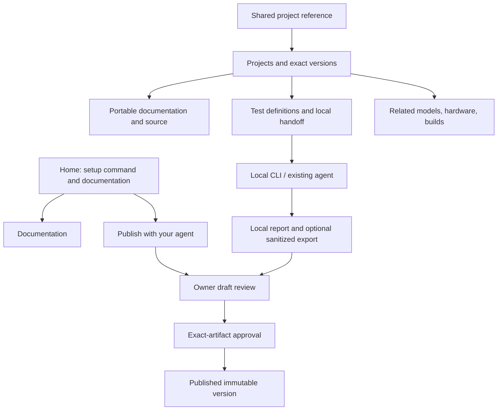

# Localfirst.sh Frontend UI Product Requirements Document

**Version:** 0.3 · October 20, 2026\
**Status:** UI requirements; the public launch centers on commands, documentation, and shared project references.\
**Product:** Localfirst.sh — The home of local AI.  
**Companion documents:** [RESEARCH.md](RESEARCH.md), [BACKEND_PRD.md](BACKEND_PRD.md)  
**Package and CLI:** `localfirstdotsh`  
**Audience:** Product designers, frontend engineers, backend/runner engineers, accessibility reviewers, and QA.

This document turns the agreed registry concept into screen, interaction, state, and integration requirements. The frontend helps people inspect knowledge that their agents can also access. Agent publishing, discovery, and local execution remain first-class workflows; the website is not a required manual authoring portal.

The public launch has a restrained shell, one copyable connection command, AI-tool setup links, and documentation. Access is open to everyone, with GitHub sign-in for contributions; there is no invitation requirement. Creators distribute project references through their existing channels. The homepage and navigation do not expose project previews, search, model/hardware directories, or a builds directory. Existing catalog screens are retained only as explicit previews (`LOCALFIRST_CATALOG_PREVIEW=true`); otherwise their root routes redirect to `/docs`. Shared project and exact-version URLs remain readable under existing visibility rules. This launch decision takes precedence over the catalog proposals below. GitHub-username lookup in the CLI requires a separately implemented contract and must not be advertised as available before it exists. The future engineer-services marketplace is outside this frontend change.

Prototype records, model inventories, commands, and report outcomes are illustrative. Production must use real contracts and released capabilities, with no example data or simulated connection/test states presented as live activity.

## Contents

1. Purpose, audience, and principles
2. Scope and priority matrix
3. Information architecture and browser routes
4. Global shell and MCP onboarding
5. Project catalog, search, and filters
6. Project detail and immutable versions
7. Models and hardware reference views
8. Builds and test-result views
9. Evidence, compatibility, and privacy language
10. Local testing handoff and runner-owned UI
11. Publishing, draft review, and approval
12. Authentication, permissions, and account screens
13. Visual system and component requirements
14. Responsive behavior and accessibility
15. Loading, error, empty, and lifecycle states
16. API integration and frontend state ownership
17. Security, privacy, and content handling
18. Performance, indexing, and discovery
19. Analytics and operational observability
20. Acceptance criteria and QA matrix
21. Delivery plan and smallest viable milestone
22. Backend dependencies and open decisions
23. Source references and definition of done

## 1. Purpose, audience, and principles

### 1.1 Product role

The website answers: what is this project, which models/runtimes/hardware does it reference, what has actually been reported, and what can my agent or local runner do next?

The main conversion is a useful connection or reproducible action, not account creation, feed engagement, or a model download. A visitor can read documentation and retrieve a shared public specification without logging in. The local runner can test a public saved specification without a Localfirst account. Contribution requires identity and explicit permissions.

### 1.2 Primary audiences

| Audience | Main intent | UI priority |
| --- | --- | --- |
| Agent user | Add Localfirst to an existing client | Setup command and tested connection instructions on the landing page |
| Builder | Find or adapt a project for owned hardware/models | Structured search, provenance, requirements, supported tests |
| Hardware/edge developer | Understand device/software configurations | Hardware-linked projects, manual builds, version-specific notes |
| Contributor | Share a project, build, or sanitized report | Agent-first preparation and exact-artifact human review |
| Environment creator | Package a workflow another person or their AI can reproduce | Creation guide, versioned starter, worked example, and validation feedback |
| Business owner/integrator | Adapt a sample to real business inputs and systems | Setup guide, integration requirements, private configuration, and scoped tests |
| Curious visitor | Understand local-AI possibilities | Clear project summaries and related references without login |
| Reviewer/operator | Correct claims, moderate content, and review evidence | Restricted review actions and auditable decisions |

### 1.3 Principles

1. **Agent-native:** a creator can prepare, edit, validate, and publish via MCP/API; the UI does not demand duplicate form entry.
2. **Command first:** MCP setup is the most prominent actionable element near the top of the entry page.
3. **Connected knowledge:** models, hardware, projects, and builds link to each other; they are views over related records.
4. **Evidence before promotion:** distinguish claimed/documented requirements, reported runs, reproducible tests, and independent verification.
5. **Local execution:** the hosted page never becomes an inference proxy, local API scanner, or arbitrary-code runner.
6. **Permission clarity:** connecting an agent, running a test, uploading a report, and publishing it are separate decisions.
7. **Portable content:** `PROJECT.md` can describe repositories, original hardware notes, or documentation without GitHub hosting.
8. **Small release surface:** phase-gate future functionality and handle unknowns honestly.

### 1.4 Success measures

Measure successful tested MCP connections when observable, setup completion feedback, useful shared-reference-to-project/spec retrieval, completed human draft reviews, and publication correction/conflict rates. Phase 2 adds runner handoff usefulness and voluntarily submitted reports; Phase 3 adds eligible independent reproductions.

A copied command is not a completed MCP connection. A selected runtime is not a reachable runtime. A website visit is not an observed local test. Do not infer offline success or all local activity from registry submissions.

## 2. Scope and priority matrix

Priorities match the backend: **P0 / Phase 1 registry**, **P1 / Phase 2 local testing**, **P2 / Phase 3 community compatibility network**.

| ID | Priority | Requirement |
| --- | --- | --- |
| FE-001 | P0 | Command-first entry page with released/verified MCP setup and `localfirstdotsh` naming |
| FE-002 | P0 | Shared Docs navigation and GitHub sign-in; no public catalog navigation |
| FE-003 | Preview | Retained project search, facet filters, shareable URLs, cursor pagination, and honest counts; explicit preview deployment only |
| FE-004 | P0 | Project detail, source attribution, requirements, limitations, data boundaries, and spec export |
| FE-005 | P0 | Exact project-version navigation; historical versions cannot silently become current |
| FE-006 | Preview | Thin Models/Hardware catalogs, available only with the explicit catalog preview setting |
| FE-007 | P0 | Browser login, narrow agent consent, connection management, and sign-out |
| FE-008 | P0 | Agent-first Publish page and owner draft review with enforced exact-artifact approval |
| FE-009 | P0 | Source-independent project presentation, including authored specifications/hardware notes |
| FE-010 | P0 | Evidence/unknown/privacy labels and moderation/visibility states |
| FE-011 | P0 | Responsive, keyboard/screen-reader-accessible interface and safe Markdown rendering |
| FE-012 | P0 | Feature gates, real API state handling, no fake connections/tests/results |
| FE-013 | P1 | Supported test-definition display and safe local runner/agent handoff |
| FE-014 | P1 | Runner-owned runtime/model selection, preflight, local consent, and report workflow specifications |
| FE-015 | P1 | Public build details and project-scoped build/result lists |
| FE-016 | P1 | Sanitized result contribution review, private/public distinction, withdrawal |
| FE-017 | P1 | Metric method/scope/missing-data display and manual-build-report distinction |
| FE-018 | P2 | Eligible comparisons, independent verification details, and conflict history |
| FE-019 | P2 | Derivative/remix lineage, collections, attributed troubleshooting, and richer reference pages |
| FE-020 | P0–P2 | Each phase exposes only backed, tested routes/actions/capabilities |
| FE-021 | P1 | Environment creation guide with a versioned starter, complete bakery example, copyable AI authoring brief, and shared-schema validation guidance |
| FE-022 | P1 | Customer setup guide with per-integration readiness, prerequisites, private configuration, review/test steps, and troubleshooting |

Builds remains a preview-only route during this launch and does not expose fictional results in P0. It can lead to a clearly informational explanation until actual build records/routes are available. In P1, start with project-scoped lists; a global builds directory requires the additive contract in section 22.

Outside initial scope: a full browser code editor, model-weight hosting/download management, arbitrary local HTTP connections, an agent IDE, cloud inference chat, business dashboards, social feeds/upvote ranking, payments, an integrator marketplace, or an unrestricted benchmark upload portal.

## 3. Information architecture and browser routes

### 3.1 Public and authenticated hierarchy



### 3.2 Browser route inventory

These are **frontend routes**, not new API endpoints. The public application and trusted auth/review origin may be separate deployments; preserve the backend's returned canonical review URL.

| Route | Phase | Access | Purpose |
| --- | --- | --- | --- |
| `/` | P0 | Public | Commands, setup links, AI-tool integrations, and documentation; no catalog |
| `/projects` | Preview | Explicit catalog preview only | Redirects to `/docs` by default; preview retains search/filter behavior |
| `/projects/:slug` | P0 | Public visible record | Current published project detail |
| `/projects/:slug/versions/:version_id` | P0 | Public visible version | Exact immutable version detail |
| `/models` | Preview | Explicit catalog preview only | Redirects to `/docs` by default |
| `/hardware` | Preview | Explicit catalog preview only | Redirects to `/docs` by default |
| `/builds` | Preview | Explicit catalog preview only | Redirects to `/docs` by default |
| `/builds/:build_id` | P1 | Public safe view or owner | Configuration, changes, provenance, and associated reports |
| `/test-results/:result_id` | P1 | Public safe view or owner | Scope, outcomes, measurement methods, review state |
| `/publish` | P0 | Public guidance; login for private actions | Not linked from navigation. Reachable from docs and agent-provided links; agent-first contribution instructions and existing draft entry |
| `/account/drafts` | P0 | Owner | Own permitted drafts and review links |
| `/account/projects` | P0 | Owner, on the website origin | Projects the signed-in person manages, with lifetime request totals; links to each project's usage |
| `/account/projects/:project_id/usage` | P0 | Manager only, on the website origin | Requests per day (30 or 90 days) as two charts plus a table; anyone else gets the same not-found as a missing project |
| `/account/connections` | P0 | Human session | Granted clients/scopes and revocation |
| `/account/devices` | P1 | Human session | Approve a terminal's link code; linked approval devices and revocation |
| `/account/privacy` | P0 | Human session | Session/deletion controls and data-sharing explanation |
| `/sign-in` | P0 | Public initiation | Redirect or shared login UI at the trusted auth origin |
| `/consent` | P0 | Human session | Canonical OAuth client/resource/scope consent surface |
| `/review/drafts/:draft_id` | P0/P1 | Owner human session | Canonical exact-artifact publication review |
| `/contribute/results` | P1 | Owner | Optional sanitized export contribution; never raw report auto-upload |
| `/docs` | P0 | Public | Documentation hub linking all public guides, with shared guide navigation; the primary Docs link opens this route |
| `/docs/connect` | P0 | Public | Tested client setup, endpoint, authentication, troubleshooting |
| `/docs/toolkit` | Preview | Public, off by default | Design preview of the `localfirst` agent skill (BACKEND_PRD §13.5). Renders only with `LOCALFIRST_TOOLKIT_PREVIEW=true` or in `next dev`, otherwise 404; `noindex`, linked from the docs hub and guide navigation only while preview mode is enabled, excluded from the sitemap. The hub explains preview availability when disabled. The install command is labelled proposed (section 4.2) until the skill is released |
| `/docs/project-spec` | P0 | Public | Portable specification, required/optional metadata |
| `/docs/testing` | P1 | Public | Runner contract and supported local-test boundaries |
| `/docs/environments/create` | P1 | Public | Creator guide, compatible starter, worked example, and validation instructions |
| `/docs/environments/setup` | P1 | Public | Business-owner setup and integration guide, linked to an exact project version |
| `/collections` | P2 | Public | Real curated collections |
| `/projects/:slug/derivatives` | P2 | Public | Parent-version lineage and distinct evidence |
| `/comparisons` | P2 | Public | Eligible protocol comparisons and exclusions |

Reference-specific `/models/:id`, `/hardware/:id`, public author profiles, and global build aggregation are optional extensions requiring resolved API contracts. P0 model/hardware rows may instead link to `/projects` with their stable returned filter values. Do not create deep links by slugifying display names or inventing IDs.

### 3.3 Origin and authentication ownership

Public website and browser-facing API/auth/MCP origin: `https://localfirst.sh`. The root Next.js app owns all browser routes and proxies machine/auth requests to a distinct private backend address. The backend retains login/consent/approval authority; React presentation does not introduce another authorization implementation.

Public routes can be server rendered without a session. Private website screens resolve the backend session through uncached server requests forwarding the browser cookie to session-only read models. Do not broaden cookie scope merely to enable private SSR; keep auth cookies HttpOnly and preserve the approved cookie/origin architecture. No private SSR data, review payload, token, or approval is placed into a public cache or page source.

The website's server calls the API on `LOCALFIRST_API_URL`, which in production should be the platform's private-network address, and hands browsers `LOCALFIRST_PUBLIC_API_URL` for sign-in, the privacy page, and export downloads. To keep the API's anonymous rate limits per visitor and not per website server, the server forwards the visitor's address from a header the deployment names in `LOCALFIRST_CLIENT_IP_HEADER` (never `X-Forwarded-For`, which a visitor can write), and the API trusts that hop through `TRUSTED_PROXIES` (BACKEND_PRD section 19.2). It is off by default and changes nothing until both sides are configured. Fetches are cached per forwarded address, so a shared public cache is not a substitute for the per-visitor limit.

Return destinations use validated relative paths or server-issued opaque continuations. The browser must not turn an untrusted `returnTo` query or source link into an open redirect. If the website exposes an alias for `/review/drafts/:draft_id`, it redirects to the backend's allowlisted canonical review origin rather than implementing separate approval authority.

### 3.4 Navigation behavior

Use actual links for navigable pages, with normal open-in-new-tab, Back/Forward, and reload behavior. Use buttons for in-page actions and semantic tabs for local sections. Preserve list URL and scroll when opening/backing from a project. Show a clear selected top-level section and breadcrumb for exact versions.

Login is not requested for public browsing, source inspection, spec export, or supported public local tests. A private action prompts login with context and a safe continuation; it does not silently discard the current artifact.

## 4. Global shell and MCP onboarding

### 4.1 Entry-page hierarchy

The first viewport contains the wordmark/navigation, concise positioning, MCP setup command with Copy, a tested client selector/instructions, and a compact preview linking into searchable project records. Avoid a large marketing hero that pushes setup/catalog below the fold.

Primary title: **The home of local AI.** Supporting text: **Projects, models, hardware, and working configurations. Connected by evidence.** Primary public action is connecting an existing agent. There is no Publish button or nav item: publishing happens only through the connected agent over MCP/API. People reach the human review page from a link their agent gives them, and publishing guidance lives in `/docs/connect`.

### 4.2 Setup command contract

Package/executable name is `localfirstdotsh`. The implemented client-specific form is:

```sh
npx localfirstdotsh mcp add --client claude-code --registry <configured-registry-origin>
```

The CLI implements `--client claude-code`, `--client codex`, and `--client gemini-cli`; a client and registry are required (the latter via `--registry` or `LOCALFIRST_REGISTRY`). Display the `npx` form only when this deployment explicitly confirms a released, tested package. Before publication, show `node packages/runner/dist/cli/bin.js mcp add --client … --registry …` from the built checkout and link to build prerequisites. Preserve exact command text and package provenance; do not derive flags from labels.

| Release state | UI behavior |
| --- | --- |
| CLI released and tested | Show real command, release/version context, copy action, and next steps |
| CLI not released | Show the implemented source-build command with Node.js 22+, repository build, installed client, and interactive registration prerequisites |
| Selected client unsupported | Explain supported methods/API fallback; do not copy a command that claims unsupported integration |
| Remote endpoint unavailable | Show operational status and retry/help; do not mark a connection complete |

The setup configures a registry connection; it does not install project code, local runtimes, or model weights. The proposed remote endpoint is `https://api.localfirst.sh/mcp`; display it in connection docs only when configured/provisioned for the environment.

### 4.3 Client selector and instructions

Offer only tested client choices. Auto detection is a CLI capability, not browser detection of installed agent applications. Each choice updates the exact command/instructions and describes the supported transport/auth method. If Auto is unsupported, omit it rather than provide a nonfunctional picker.

The human flow is: copy setup -> run/add connection in existing agent -> authenticate if asked -> review Localfirst permissions -> return to agent and search. The website does not scrape local config files or poll agent applications.

### 4.4 Copy interaction

Copy on explicit click. Show “Copied” only after clipboard success; otherwise expose a selectable command and “Select and copy manually.” Never include `$` prompt decoration, hidden formatting, auth tokens, or trailing UI text in copied content. Preserve an accessible label/live confirmation, do not move keyboard focus unnecessarily, and allow repeated copies.

[Clipboard writeText](https://developer.mozilla.org/en-US/docs/Web/API/Clipboard/writeText) defines the browser API/security context. The fallback must work when permission is unavailable. No clipboard reads are needed.

### 4.5 Connection-state truthfulness

UI states: setup instructions shown, command copied, authentication pending where observable, grant authorized where the backend confirms it, and client setup unconfirmed. Never display “Connected” merely because the user signed in, copied a command, or opened consent.

An OAuth grant confirms access authorization, not that a particular machine's client is currently configured or online. Account connection summaries make that distinction. Existing clients' own inspection/use provides the connection test; no invented browser heartbeat.

### 4.6 Shell on detail/mobile pages

Keep navigation and a compact “Connect your agent” entry on all public pages. The expanded command block is prominent on the homepage and connection guide; on details it may collapse to avoid repeating a large hero. Auth/review pages prioritize artifact/permission clarity and may omit the installation promotion.

No sticky header or bottom bar may cover focused fields, tab content, or approval buttons. Use the shared dark-first appearance, with forced-colors and reduced-motion support.

## 5. Project catalog, search, and filters

These retained browser capabilities are preview-only. Read `LOCALFIRST_CATALOG_PREVIEW` at request time; unset, false, or any other value leaves the public catalog closed. A user-supplied query cannot enable it. CLI/API/MCP retrieval and existing visibility/authentication rules are unchanged.

### 5.1 List anatomy

Each project row includes name/namespace or attribution, short purpose, project type/task, declared hardware/runtime, evidence label, test-support summary, source/curated status when relevant, and a detail link. Do not duplicate the entire manifest in a row.

Use compact rows with restrained surfaces and readable identifiers. Clickable title opens project detail; secondary action may lead to supported test information. Unknown model/hardware fields are visible when necessary rather than replaced with confident badges. Optional thumbnail/media must not dominate structured information or introduce unapproved third-party loads.

Exact list count is optional. With cursor pagination, say “Showing 20 projects” or a bounded loaded count unless the backend supplies a real total. Do not reproduce prototype counts or invent a large community leaderboard.

Usage counts come only from the backend `usage` field (BACKEND_PRD §19.3.1). Rows may show “N exports”; project detail has a Usage panel with “Specification exports” and “Retrieved by agents”; the home page may show site-wide “agent connections authorized” from the facet counts. Label them as request counts with “since” context, and add that they do not show a project was built or run, and that “authorized” does not mean a client is installed or online. Render a count only when the API returns it, hide the “since” text when it is null, and never estimate installs in the browser. CLI install figures, if shown, cite npm statistics as approximate and external.

### 5.2 Search and facet contract

Supported backend fields: `q`, `type`, `category`, `model`, `runtime`, `hardware`, `os`, `test_support`, `evidence_level`, `offline`, `sort`, `cursor`, `limit`. Use stable IDs/enums from the facet contract, never localized labels as query values.

| Facet | UI behavior |
| --- | --- |
| Task/category | Controlled labels; repeated values OR within field |
| Project type | Application/workflow/demo/robotics/experiment/hardware build/documentation |
| Model | Resolved model reference; unresolved role remains a role, not an invented model |
| Runtime | Distinguish runtime family and version-dependent support |
| Hardware/OS | Family/profile filters; no blanket fit guarantee |
| Test support | None/manual/declarative specification; show runner availability separately |
| Evidence | Exact five-level vocabulary, filtered only to available phase data |
| Offline | Declared or applicable tested evidence with method; never infer from local inference |

Filters within one field use OR; different fields use AND. Display active filters, individual removal, and Clear. Unsupported/out-of-phase values produce an explanation instead of silently broadening the query.

Do not label a filter “Runnable now” based solely on a declarative test spec. A real executable action additionally requires a supported runner/profile, visible version, valid test bundle, and eventual local preflight.

### 5.3 URL and interaction behavior

Serialize public list state into a stable URL. Debounce q by approximately 250 ms, cancel/ignore obsolete requests, and preserve focus/caret while results update. Submit by Enter immediately; `/` may focus search only when not typing, with an accessible way to disable the single-key shortcut.

Use history replacement during typing and a deliberate history entry for committed filters/navigation. Reload/Back restores filters and loaded page position where valid. Changed filters/sort reset the cursor; a cursor from another query must never be reused.

Example URL, using illustrative facet values:

```text
/projects?category=text-classification&runtime=ollama&hardware=apple-silicon&evidence_level=documented
```

Actual values must be returned by the catalog contract. Do not place private prompts, full local inventory, credentials, hardware serials, or uploaded report contents into query strings.

### 5.4 Sort and pagination

Default relevance when q exists, otherwise a documented stable recent-update order. Evidence freshness is available only when qualifying data exists. Popularity/upvotes and paid placement are not core ranking. If a reproduction-count sort is added later, its definition and independent-contributor distinction are visible.

Use Load more or accessible Next/Previous around opaque cursors. Loading additional rows preserves visible existing content and focus. If a cursor expires, explain and refresh from the beginning while preserving filters; do not silently repeat rows. Avoid infinite scrolling as the only navigation mechanism.

### 5.5 Responsive filters

Desktop uses a narrow filter rail and flexible results. Mobile uses a Filters disclosure/dialog with active-filter count and Apply/Clear/Cancel; retain current results while editing pending filter state. Opening/closing manages focus and scroll access; Apply commits all selected values once, while Cancel discards only uncommitted changes.

Not every desktop facet needs permanent mobile expansion. Evidence and test support remain available without hover. Search, active chips, result state, and detail links stay keyboard accessible.

## 6. Project detail and immutable versions

### 6.1 Header and tabs

Header: title, original author/curator relationship, project type/category, selected project version, source type, evidence summary, and next actions. Use a Home breadcrumb and preserve links to the shared project and its versions; do not send visitors into a catalog. A curated listing shows original creator/source separately from the Localfirst submitter; no implied endorsement or maintainer ownership.

P0 tabs: Overview, Requirements, Documentation, Versions. Test declarations can be a labeled section before executable test APIs ship. P1 adds Tests and Builds/Results. P2 adds Derivatives and eligible comparisons. Empty supported tabs explain the absence; out-of-phase tabs are hidden or clearly informational, not clickable fake data views.

### 6.2 Overview and source

Display purpose, architecture/workflow, practical limitations, declared model/runtime roles, hardware/OS requirements, dependencies, setup/execution instructions, source license states, and data boundaries. Missing facts render “Unknown,” “Not supplied,” or “Not applicable,” based on actual state—not blank cells implying a pass.

Source kinds include repository, documentation, hardware note, media reference, and `authored_specification`. An authored specification can have no external URL; link to its canonical Localfirst document/version. Do not reject or visually demote a hardware build merely for lacking a GitHub repository. Repository commit, document revision, and manifest digest are different identities.

Source references open with clear destination/domain and appropriate external-link treatment. Full digests/commits are expandable/copyable, with a readable short form; truncation must not prevent inspecting exact identity. Model/runtime links use resolved references; an unresolved model role remains explicitly unresolved.

### 6.3 Requirements and compatibility

Show creator-declared requirements separately from measured configuration data. A project-wide minimum memory claim cannot inherit a build's observed peak-memory badge. Display system RAM and discrete VRAM separately, with units; unified memory is not counted twice.

P0 “Check requirements” may accept a voluntarily entered minimal hardware/runtime/model summary through the public compatibility API. Default fields remain unknown; the website does not discover exact hardware, installed models, or runtime versions from browser information. No machine serial, home path, endpoint credential, full inventory, or private prompt is requested.

Show requirement-by-requirement pass/fail/unknown, source, selected version/configuration, evidence scope, uncertainties, and blocker reasons. Compatibility is an assessment, not a benchmark or install authorization. “Ask your agent to check this machine” offers a bounded public project/version prompt or released CLI path without transmitting local data automatically.

### 6.4 Test support

| Project/backend state | Display | Action |
| --- | --- | --- |
| `test_support: none` | No supported automatic harness | Read documentation / use agent for inspection |
| `manual` | Manual reproduction instructions | Inspect exact source/test procedure; no automatic Run button |
| Declarative specification, runner unavailable | Test specification declared; local testing not available yet | Read declaration/export where supported |
| Supported definition and released runner profile | Supported component test, with scope and requirements | Prepare local handoff; execution approval happens locally |
| Unsupported modality/custom code | Harness not supported by this runner | Manual instructions and explicit limitation |
| Quarantined/withdrawn version | Safe unavailable state | No new test/plan action |

Jetson vision/robotics entries can be useful documentation/manual builds while the first runner only supports text tasks. The UI must not imply that an Ollama/LM Studio text test exercises cameras, actuation, audio, tools, or a whole application.

### 6.5 Version navigation

Default detail resolves the current published version once and shows which version is being viewed. History selection changes the route to an exact version ID. Back/reload preserves that selection. A “Latest version available” notice links to current content but never changes the version behind an open test plan, build, report, or approval.

Historical views display their own source/model/runtime/test references and evidence. Upstream source drift is distinct from a new published Localfirst version. A version with source unavailable can remain readable as historical documentation while its executable action is blocked by policy.

### 6.6 Documentation and export

Render safe Markdown with a table of contents where useful, readable code blocks, copy controls, and accessible heading hierarchy. Export the canonical `PROJECT.md` through the backend; preserve schema version and original attribution. Labels: “View specification” and “Export PROJECT.md,” rather than implying code cloning or model installation.

Media references are optional. P0 can use links/placeholders instead of automatically embedding external trackers or unsafe content. Never render source-provided HTML, scripts, instructions, or styling as trusted UI. The project body cannot alter navigation, permissions, or button behavior.

## 7. Models and hardware reference views

### 7.1 Models

P0 `/models` is a thin view of models referenced by projects/configurations. It is not a weight marketplace or live list of the visitor's installed models.

Rows show resolved name/provider/source, version/quantization or unknown state, role/task, referenced runtimes, license state, evidence context, and a link to associated projects. If only a role such as classifier/embedding exists, label it “Model role; artifact unresolved,” not a resolved model/version. A source URL, runtime alias, manifest hash, and raw weight-file hash must not be treated as interchangeable identities.

Use the existing bounded model reference catalog plus project filters in P0. A richer detail page needs an additive API contract before launch; do not fetch all catalog pages just to pretend an unsupported detail endpoint exists. Reference counts are optional and truthful.

### 7.2 Hardware

P0 `/hardware` displays public hardware families/descriptors with related project links: Jetson/edge devices first, then Apple Silicon, desktop GPU/Linux, Raspberry Pi and other profiles as real metadata permits.

Rows show relevant architecture/OS/backend or software stack, stated memory profiles, and source/evidence. A family view is not an assurance that every device variant supports every project. A sample or contributor profile is labeled as a configuration, not a manufacturer's universal specification. Public profiles exclude serial/network identifiers.

Selecting a hardware descriptor navigates to projects using its stable catalog filter value. Exact hardware/driver/version fit remains a compatibility assessment. No “Detect my machine” web button appears unless a separately approved local handoff exists; the hosted page cannot probe the machine by default.

### 7.3 Connected navigation

Project -> model reference -> related projects; hardware -> configurations/projects; build -> exact project/model/runtime/hardware/test references. Preserve the selected version/configuration where the relationship is version-specific. Do not link broad labels to invented exact evidence.

The relational data is valuable without a visual knowledge graph. Graph animations or separate hardware/model admin portals are outside P0.

## 8. Builds and test-result views

### 8.1 Builds entry and lists

P0 `/builds` can explain the concept and link to documentation; it does not show fabricated reproduction counts. P1 begins with a selected project's `GET /projects/:id/builds` results and deep links from project detail. A project selector may use ordinary public project search. Show the chosen project prominently; do not label a scoped subset “All builds.”

A global searchable builds list is optional and blocked on FE-API-03. Frontend mockups showing several projects together are design previews, not an existing aggregation contract.

Until global discovery is available, the Builds entry uses “Build discovery is coming soon”
with a “Browse projects” action. This describes the unavailable site-wide catalog, not the
existing project-scoped public-build API, and makes no claim that no public builds exist.

Rows show project/version, configuration, selected model/runtime, coarse hardware, changes, visibility/review/evidence state, and outcome only when a report exists. A saved configuration says “Run not reported” if there is no observation. Do not infer success from its presence.

### 8.2 Build detail

Present exact project and configuration, source/spec identity, model role bindings/artifact schemes, runtime/application/engine versions, workload/effective settings, hardware/OS, changed steps, parent build when available, and associated reports.

Show unknown/redacted identity as such, along with its effect on matching/comparison. Distinguish a creator's setup claim, a manual build report, a supported component test, and an independent run. Manual reports do not need fabricated test IDs/evaluators and remain community-reported evidence at most through ordinary validation.

A private owner view is labeled **Private** prominently; public previews show exactly the approved projection. An owner can withdraw an eligible build/manual report using the existing route. Explain that withdrawing evidence changes active matching, while permitted immutable history may remain under retention policy.

### 8.3 Test-result detail

Header includes exact project/build/test version, report author where permitted, completion/received times, execution outcome, review state, evidence level, and scope. Review pending/rejected/withdrawn states are visible separately from reported pass/fail.

Body includes defined/evaluated/passed/failed/error/skipped counts, case IDs permitted by public-fixture policy, evaluator/method, fixture identity, model/runtime/environment completeness, generation settings, repetitions, warm/cold/cache context, offline/locality checks, and metrics with missing reasons.

Do not show one passing smoke case as “100% project accuracy.” Task accuracy requires an eligible defined protocol. A component pass does not verify an entire workflow, private-data suitability, offline execution, or safe code.

### 8.4 Metrics and comparisons

| Field | UI requirement |
| --- | --- |
| Latency | Unit, client end-to-end versus provider interval, sample count/loading context |
| Time to first token | Method/content-event granularity; nonstreaming can be unavailable |
| Token rate | Provider/tokenizer/generation-interval basis; reasoning/cache differences visible |
| Peak memory | Sensor/process/device/system scope and sampling; not runner RSS mislabeled as inference |
| Utilization | Sensor/window and unavailable state |
| Quality | Evaluator/rubric/dataset identity and coverage; subjective judge disclosed |

Null/unavailable values display a concise reason, not zero, a fabricated graph, or an unexplained dash. Decimal/binary memory units are explicit. Partial/failed runs retain useful measurements with outcome caveats.

P1 local comparison belongs to the runner. P2 public comparison displays eligibility groups and excluded/confounded dimensions from the backend. Do not compute a universal quality/speed score or collapse different tests/tokenizers into a leaderboard. Failure reports are not hidden to improve ranking.

## 9. Evidence, compatibility, and privacy language

### 9.1 Evidence labels

Use exact backend enum values internally and consistent human labels:

| Enum | Label | Explanation |
| --- | --- | --- |
| `claimed` | Claimed | Author/user declaration; not established by a run |
| `documented` | Documented | Source supports requirements; no Localfirst run implied |
| `community_reported` | Community reported | Authenticated contributor reports an outcome; review status still matters |
| `reproducible_test` | Reproducible test | Accepted bounded protocol and sufficiently identified configuration; not independent verification |
| `independently_verified` | Independently verified | Separate reviewed reproduction for the exact claim/scope |

A badge opens a detail explanation with source/criteria, reviewed time, applicable project/build/test/environment, and limitations. On small rows, show a conservative summary and link to configuration-specific evidence. Never combine mixed evidence into a stronger project-wide claim.

Claimed/documented/reported states use restrained styling. Stronger evidence may use a soft accent, always with text and scope. A checkmark/shield does not mean safe code, privacy certification, or regulatory compliance. Do not change levels locally after a client-side validation/pass.

### 9.2 Compatibility labels

| Enum | Label | Meaning |
| --- | --- | --- |
| `evidence_match` | Matching test evidence | Applicable exact accepted test/independent evidence for stated scope |
| `candidate` | Candidate configuration | Known requirements pass without exact strong evidence |
| `incompatible` | Requirement failed | At least one known hard condition fails |
| `unknown` | More information needed | Critical facts missing or conflicting |

Show both outcome and evidence level. An unknown assessment is neither “probably fits” nor an API failure. Explain missing inputs and a safe next step; no percentage fit score or automatic cloud alternative.

### 9.3 Data-boundary labels

Separate local inference, local storage, setup-time downloads, runtime network dependencies, optional external services, agent/client processing, and offline-test method. “Local API reachable” is not “local inference established.” A local server can delegate remotely; the runner's preflight owns that determination.

Use “Offline test reported,” “Offline verified for this test,” or “Offline status unknown” according to actual provenance. Do not display one generic Private/Local badge as a substitute for a data path. Provide source/flow details where relevant to a decision rather than a large universal warning wall.

## 10. Local testing handoff and runner-owned UI

### 10.1 Ownership of the interaction

The public website displays test requirements and prepares a handoff. The local CLI/existing agent owns discovery, credentials, model inventory, preflight, sensitive data, execution, sensors, local reports, and local comparisons.

| Interaction | Hosted website | Local runner / permitted agent |
| --- | --- | --- |
| Read public test/spec | Yes | Yes, including saved offline bundle |
| Choose intended runtime family | Yes, as instruction/template choice | Yes, actual endpoint/profile |
| Discover installed models | Never | Explicit selected endpoint after permission |
| Select actual installed model | No live picker without an approved companion | Actual local inventory and capability state |
| Run/preflight/measure | No hosted execution | Supported contract with exact-plan permission |
| Inspect complete private report | Not automatically | Local file/report UI |
| Submit sanitized export | Explicit reviewed upload only | Explicit opt-in export/upload |

The reviewed prototype's Ollama/LM Studio model picker is a **runner/companion interaction concept**. It does not authorize implementing browser localhost access. Production P1 can deliver this through terminal/agent prompts without shipping a desktop companion or daemon.

### 10.2 Public test screen

Show test name/version, component scope, public fixture/evaluator, required chat/JSON/context capabilities, concurrency/output/time limits, runner/profile availability, downloads/tools/code policy, and coverage limitations. Keep source/spec identity visible when creating a handoff.

P1 action: **Prepare local test** or **Continue with your local runner**. Avoid **Run now** when the hosted page cannot execute or observe the test. A runtime-family selector changes tested instructions only. Actual installed-model selection appears in the local tool.

### 10.3 Handoff options

Preferred initial options: copy a released CLI command referencing an exact public project/test version; export/download a validated public specification bundle; or copy a bounded prompt for an existing agent with local command capability. Do not launch a custom URI or companion connection until its protocol/pairing design ships.

Commands are built from validated opaque IDs, controlled keys, and safe argument quoting, never raw search strings or repository Markdown. Private inputs/paths/model aliases do not enter a URL. If a local model argument is needed, the runner prompts or the user supplies it locally. An unpinned latest reference must be resolved and shown before local execution approval.

Proposed runner command pattern (not a released implementation):

```text
localfirstdotsh test plan <project-id> --test <test-key> --runtime <supported-runtime>
```

The CLI resolves installed model and exact effective version/settings locally. A copied command is only a handoff, not execution consent or proof that the runner started. Do not show a live progress spinner waiting for local inference without an authenticated, explicitly supported bridge.

### 10.4 Local tool interaction specification

The runner/agent experience, even when terminal-based, must present:

1. Public test/version and declared scope.
2. Permission to inspect a selected local runtime/endpoint; no broad scanning.
3. Installed/available/loaded model distinctions, artifact identity and unknowns.
4. Preflight failures/unknowns for locality, JSON/tools/modality/context and capacity.
5. Exact plan/settings/data class/resource effects and separate execution approval.
6. Running/cancelled/timeout/error state with honest local observations.
7. A complete local report and optional comparison.
8. A separately reviewed sanitized export and opt-in upload/publication.

A missing runtime does not trigger an automatic install. Unknown model capability/locality blocks the applicable task, not a silent cloud fallback. Loading a model, downloads, configuration changes, and execution have separate effects/permission requirements. Unsupported audio/vision/robotics/custom-code harnesses remain manual.

### 10.5 Results handoff back to the website

P1 can display a server-stored sanitized private/public result after the user explicitly submits it. It cannot open a local file path automatically or import complete raw reports merely because the runner printed a path. No post-run background telemetry/registry synchronization.

Optional `/contribute/results` accepts an explicitly selected **sanitized export**, validates size/schema locally, presents included fields and destination, then sends only the approved subset after Upload confirmation. Reject raw prompts/outputs/logs, weights, archives, credentials, or full inventories. Use the shared backend schemas and server-side enforcement; local parsing does not establish trust.

Upload creates a private record. Public publication requires a separate draft projection and exact-artifact review. Unknown/redacted identities explain evidence/comparison limits. A manual build report has a separate labeled path and does not pretend to be runner-generated test output.

### 10.6 Sharing defaults

**Default: keep the report local.** No sharing checkbox is preselected. Review selected model/runtime identity, coarse hardware, task/check results, metric methods, public-fixture IDs/digests, attribution, and known limitations. Preview omitted private inputs/outputs/credentials/inventory without displaying their values in the hosted page.

A declined upload must not block local testing/report use. Publishing a sanitized record does not publish a private original report or grant future uploads. Changed export fields/redaction invalidate previous approval.

### 10.7 Multi-agent environment integration requirements

This section uses the versioned contracts and gated runner profiles in `BACKEND_PRD.md` section 21.1. Public catalog/companion behavior remains a frontend requirement; the trusted publication review already presents roles, workflow order, code effects, and all bundled files. Local discovery, setup and execution remain runner-owned. The first environment is a Bakery Order Coordinator with intake, production, and quote agents using one installed local model in a fixed sequence. The creator supplies prompts, sample business data, configuration, tests, and setup instructions; the requester prepares the environment locally and can substitute private business data in a separate run.

Project detail adds an environment summary showing agent roles, workflow order, declared inputs/outputs, trusted operations, setup mode, required runner/coordinator version, tested model/runtime/hardware configuration, public sample data, and exact environment/version identity. Distinguish creator suggestions from observed build evidence. Several agent roles using one model must not appear as several model downloads or separate model processes.

Capability states are **Documentation only**, **Manual setup**, **Supported local workflow**, and **Unavailable in this runner/profile**. Render them from authoritative capability metadata with explicit unsupported reasons. A flag or declared graph alone cannot produce a runnable label. Preserve component, workflow, and end-to-end coverage distinctions; a passing bakery fixture does not prove a connected inbox, calendar, POS system, or live order-placement integration.

For a released profile, use **Prepare local environment** as a handoff to pinned CLI instructions, bundle export, or an existing permitted agent. Show the sequence: retrieve sample environment -> prepare workspace -> select installed model locally -> review execution plan -> run -> inspect report. Hosted pages do not discover local models, install packages, execute workflows, or display unobserved local progress. Missing runner/model/profile links to actual setup requirements rather than a simulated launch. Copied commands use validated IDs/keys and the exact project version; no private configuration enters URLs.

Runner-owned review presents every agent's model/settings, prompt/data/graph/operation identities, fixed routing, permitted data/state access, request/token/time ceilings, network/resource effects, workspace writes, and output destination. Initial environment preparation copies bounded files only. The constrained LangGraph/Docker profile has a separately approved pinned dependency setup; other frameworks, model/runtime installation, and arbitrary setup remain manual/unsupported. Private input/business-data overrides are separate local experiments with export disabled. Changed content or settings invalidate execution approval. Local progress and reports show agent/operation status, partial results, cancellation, and expected business outcomes such as missing information separately from technical failures.

The runner's five fictional samples cover bakery, florist, print-shop, bike-repair and pet-grooming requests. Its local HTML/JSON run trail is separate from the hosted evidence view: show setup identities, models/settings, observed lifecycle/MCP calls when recorded, exact declared system prompts, reconstructed user prompts, test inputs, actual outputs and assertion mismatches. Label reconstructed requests and automated verification approvals explicitly. A combined verification index summarizes each project without hiding model failures. Private contents require explicit local inclusion consent; no raw trail is automatically uploaded or embedded into a public project page.

Shared build/result views add actual role bindings, environment/coordinator identity, scoped check results, and method-tagged step/overall timing from the approved sanitized projection. Expanded private prompts, customer text, state values, and raw tool traces stay local. Existing export/upload/publication consent remains separate; no agent conversation is auto-uploaded. Changed private business configuration is labeled a separate local experiment rather than evidence for the public sample protocol.

Acceptance: exact-version environment display/export; honest unsupported/gated states; one tested MCP/CLI handoff with no browser localhost access; exact local approval invalidation; accessible agent/step status presentation without relying on color; correct partial/failure labels; sanitized report field parity; and historical workflow reports remaining readable when new execution is disabled. Implement these views alongside backend/runner M5-M6; a new frontend or companion is not a dependency for the initial terminal experience.

### 10.8 Environment creator guide and reusable starter

Provide a public **Create an environment** guide linked from Docs, Publish, and environment project details. It supports both file authoring and an existing AI client; a browser editor or mandatory setup wizard is not required. Keep the explanatory project description and integration instructions readable beside the executable environment files. The backend/runner contracts remain authoritative for accepted fields, validation, and execution.

The guide follows a concrete sequence:

1. **Define the business outcome.** Describe the customer message, resulting request draft, required owner decisions, supported integrations, and work the sample does not implement.
2. **Select a supported profile.** State the environment/schema, runner/coordinator and dependency versions; required runtime/model capabilities; suggested models separately from configurations with observed test evidence. Explain when several roles share one model and which data remains local or reaches an external provider.
3. **Describe roles and workflow.** Include each role's exact system prompt, input/output schema, routing/order, shared-state access, trusted operations, and failure/partial-result behavior. Mark computed steps as operations without inventing model prompts for them. Include resource limits, permitted tools/network/file effects, and required approvals.
4. **Supply portable files and private configuration instructions.** Show the complete bundle tree, required fields, synthetic business data, dependencies, and supported setup commands. Explain how an owner substitutes prices, capacity, customer input, or account configuration locally. Credentials and real customer data never belong in a public starter; use documented local secret references where supported.
5. **Define tests and expected results.** Include realistic prompts, expected structured outcomes and independently stated assertions, plus missing-information, unsupported-request, capacity, pricing, and failure cases. State whether each case covers a component, the workflow, or an actual external integration.
6. **Validate, inspect, and publish.** Use the released shared-schema validator/runner instructions for the selected version, inspect the exact file set and permission effects, run supported fixtures, then follow the existing draft and human publication review. AI-generated files receive the same validation and review.

Provide a **versioned starter template** and a **complete worked bakery example**. The example shows the actual packaged files, role prompts, business data, ordered steps, test prompts, expected assertions, and a readable sample report with its provenance. Other examples may link to the actual florist, print-shop, bike-repair, and pet-grooming bundles. Sample reports show actual mismatches and are never a claim that every model passes. Link to the exact bundle version/digest; distinguish editable template placeholders from executable sample values.

Show the template's compatible schema/runner/profile and file descriptions before download or copying. Offer executable preparation commands only when the artifact and released profile support them; otherwise provide clearly labeled file-authoring/manual instructions. Preparation must preserve an existing workspace and use the runner's bounded-file rules. Validation feedback identifies the affected file/field, blocker versus warning, and a corrective action; unsupported validation is an explicit state. Browser checks use shared schemas where applicable and do not replace authoritative server/runner validation.

Offer **Copy instructions for my AI**: a bounded authoring brief containing the requested business outcome, exact contract/profile references, required files, integration requirements, tests, and approval boundaries. Preserve unknown requirements as questions or placeholders; do not invent account details, working connectors, credentials, or successful tests. The owner pastes the brief into their chosen client; copying it does not connect that client, modify its configuration, or authorize execution. Public pages do not request private customer messages or secrets to generate the brief.

### 10.9 Business-owner setup and integration guide

Provide a public **Set up for my business** guide linked from environment details and the creator guide. Preserve the selected immutable project version throughout the instructions. Explain the customer journey: inspect requirements -> prepare files -> configure private business data -> review the local plan -> test -> inspect outcomes -> integrate any separately supported business system.

Each project explains its available integration paths, such as manual input, file import, an existing AI client's MCP discovery/handoff, or a separately implemented inbox/POS adapter. For each path, state prerequisites, required accounts/software, who performs setup, ongoing operation, and a contextual difficulty estimate with its assumptions. Distinguish creator estimates from measured setup evidence. A metadata MCP connection alone does not provide message ingestion, external business writes, or unattended operation.

For each integration, present **Implemented and tested**, **Requires configuration**, **Requires development**, or **Unknown** with the supporting scope/version/evidence or missing work. These proposed presentation labels describe integration readiness separately from section 10.7's execution availability and evidence levels. Only an applicable actual test record supports a tested claim. A successful synthetic fixture cannot establish a live connector. Until structured metadata is agreed in section 22, show attributed documentation and unknowns rather than deriving readiness badges from prose.

The setup instructions must answer these practical questions:

| Step | Required information |
| --- | --- |
| Prepare | Supported OS/runtime/profile and versions; actual install/setup instructions; required files, accounts, dependencies, and workspace destination |
| Configure | Required business fields and source data; field mapping from a message to a job request; missing-data behavior; prices/capacity/rules; supported private override mechanism; local secret storage where applicable |
| Connect | For an implemented adapter: provider, trigger/input source, authentication scopes, read/write effects, mapping, duplicate/retry/correction handling, and disconnect procedure; otherwise identify the development needed |
| Review | Role/model bindings, data destinations, exact local plan and resource effects; which decisions need owner review and which actions can actually write to a business system |
| Test | Exact test prompt/input, expected assertions, invocation instructions, actual outputs and mismatches, plus the scope and provenance of the result |
| Operate or recover | Supported operating mode, where reports/errors appear, troubleshooting, safe rerun behavior, connection revocation, and reversible configuration recovery without deleting business records |

The owner's AI must be able to retrieve the same public requirements and versioned files through the existing supported project/environment interfaces. Do not introduce a competing browser-only specification. Mark a missing connector or adapter as development work before offering setup actions. Separate local Ollama/LM Studio runner support from hosted CLI evaluation evidence; an evaluation transcript is not a released runtime adapter.

After local preflight, execution approval belongs to the runner. Connection consent, setup changes, external writes, report upload, and publication remain separate decisions. Guide steps describe only effects implemented by the selected profile; the hosted page never fabricates local progress. Local inspection can include setup identities, observed MCP calls, exact declared/reconstructed prompts, inputs, outputs, and assertion results under section 10.7's privacy rules. Sharing the full local trail is optional and separate from a sanitized contribution.

### 10.10 Worked remix: holiday bakery orders

Use the source-runner `bakery-holiday` sample to illustrate **Remix this workflow**. A business owner starts with Bakery Order Coordinator and requests: “Create a separate holiday version. Increase November 6 capacity to 100 cupcakes, charge USD 3.00 for chocolate and USD 2.50 for vanilla plus USD 0.75 for blue icing, and add an agent that drafts a pickup checklist for my review. Keep the original intact, preserve attribution, and write new tests. Do not book or send orders.”

| Aspect | Original bakery | Holiday remix |
| --- | --- | --- |
| Roles | Intake, production, quote | Same three plus pickup-checklist after quote |
| Runtime | One installed local model | One installed local model shared by all four roles |
| November 6 capacity | 80 cupcakes | 100 cupcakes |
| Chocolate / vanilla / blue icing | USD 2.50 / 2.00 / 0.50 per cupcake | USD 3.00 / 2.50 / 0.75 per cupcake |
| 90 mixed cupcakes with blue icing | USD 247.50; capacity unavailable | USD 315.00; needs owner review, plus checklist |
| Fixture | Eight original cases | Six separate holiday cases; new environment/test digests |
| Evidence | Original version's own reports | Requires separate evaluation; inherits no passes or approvals |

Show a reviewable change summary before handoff: inherited files/roles, changed data, added prompt/node/output, model settings, increased per-case inference budget from three to four requests, and effects. Keep prices/capacity in deterministic operations. The new checklist copies the authoritative decision and drafts packaging/contact/pickup tasks; it does not reserve capacity, contact the customer, collect payment, or mark an order accepted.

The guided journey is select exact parent -> copy/export into a new owned workspace -> describe changes to the owner's AI -> validate the changed bundle and new fixtures -> review a new execution plan -> run and inspect the remix's own results. A private configuration override remains a local experiment; a reusable modified workflow becomes a distinct derivative artifact. Show the six expected scenarios: standard order, expanded capacity, over capacity, missing date, unsupported decoration, and customer instructions attempting to bypass rules. Generated checklist text needs owner assessment in addition to automated status/price assertions.

This sample currently demonstrates local preparation with `environment prepare --sample bakery-holiday`; it is not a shipped browser remix action. Local lineage declares a parent key/version and records the parent bundle digest in documentation. A registry **Remix** action requires the enabled P2 derivative flow with real immutable parent IDs, retained attribution/license references, and a separately approved publication. Never substitute illustrative IDs or imply the child can edit its parent. Unsupported deployments offer export/manual instructions with clear availability labels.

### 10.11 Ecommerce example: stock replenishment proposals

Include **Ecommerce Stock Replenishment Coordinator** (`stock-replenishment`) alongside the original business examples and bakery remix. The owner wants incoming-order frequency to trigger a stock review, check whether suppliers can fulfill the proposed quantity, and deliver a purchasing proposal for approval. The portable sample implements a local review of complete fictional snapshots; continuous monitoring and live business/vendor integration remain **Requires development**.

Present the actual sequence: snapshot selection -> trusted demand/inventory/vendor calculation -> demand-review agent -> vendor-review agent -> purchasing-review agent -> owner-proposal agent. Four roles share one installed local model. Display the dated stock/vendor facts and deterministic proposed quantity/cost separately from generated explanations. A supplier marked confirmed in a fixture is not live-confirmed. The AI client retrieves the public environment and requirements through Localfirst MCP; private order/inventory/supplier connections are separate MCP servers or APIs supplied by the owner.

The worked proposal uses 112 net units sold over 14 completed days, 64 available units after reservations, five supplier lead days and three safety days. At the 64-unit reorder threshold, propose 80 lavender candles at USD 6.00 each: **USD 480.00 before shipping/tax**. The target is 18 days of inventory position, including confirmed inbound. Show the quote date, inventory observation date, stock coverage, existing open orders/proposals, budget, minimum quantity/pack rounding, delivery risk, and owner-approval requirement. These are illustrative fixture facts, not measured live business activity.

`DATA/integration-requirements.json` documents the proposed new-order/daily triggers; required orders, inventory, purchase-order and supplier-quote read access; provider field mappings; local credential setup; and missing durable event/proposal state, owner notifications/approval UI and purchase submission. Do not interpret that file as executable permissions or a newly supported structured API contract. Until agreed integration metadata exists, show its content as attributed requirements under sections 10.9 and 22. Public bundles contain synthetic data; private snapshots and credentials stay outside published artifacts.

Expose all 12 test scenarios: reorder due, healthy stock, duplicate events (including cancellations/returns), confirmed inbound, pending proposal, stale quote, unavailable supplier, demand spike, budget limit, delayed delivery, unconfirmed availability, and missing sales history. Show **Needs information**, **Supplier confirmation needed**, **No feasible vendor**, **Budget exceeded**, **Proposal already pending**, **No reorder needed**, and **Needs owner review** as distinct business outcomes rather than generic technical failures. Generated commentary cannot override authoritative status, quantity or price. Owner review remains necessary for generated wording and the purchasing decision.

Future live setup must explain event delivery/deduplication, cancellation and return reconciliation, persistent pending proposals, quote expiry, owner notification routing, approval invalidation and purchase-order reconciliation before offering activation. The current sample neither sends a proposal to the owner nor contacts vendors or buys stock. No recurring monitoring or external-write control can appear enabled merely because the bundle was retrieved or its snapshot fixture passed.

## 11. Publishing, draft review, and approval

### 11.1 Publish entry page

`/publish` leads with **Publish with your agent**, describes repository/specification/hardware-note inputs, offers tested connection docs, and explains the draft -> review -> approve -> publish sequence. The agent handles metadata extraction and `PROJECT.md` generation through shared API/MCP.

P0 does not require a full website Markdown authoring form. A human may inspect existing owned drafts, export the specification, and follow an exact review link. Optional direct text submission/editor is later work unless needed by validated user demand; it must use the same lifecycle/policies rather than a second publishing route.

Do not equate GitHub sign-in with a GitHub project source. Original authored documentation may be the source record itself. Repository imports preserve upstream author, license, commit/path, curated/unclaimed state, and maintainer claim status.

### 11.2 Draft list

Show only the owner's permitted drafts: title/kind, revision, source, last updated, ingest/validation state, blocking/warning counts, and Review/Continue in agent actions. Pending operations show actual status; retry is available only where supported. A timeout fetching state is not ingestion failure.

Do not list another user's drafts or cached private records after sign-out. Kind-specific Phase 1/2 permissions govern project/build/test-result drafts. A future comprehensive “My published contributions” history requires a resolved list contract; P0 can remain an own-drafts/review view.

### 11.3 Exact review layout

Display selected revision/payload digest, owner/submission relationship, canonical proposed content, schema/source identities, original author, model/runtime/hardware states, licenses, data boundary, tests/coverage, limitations, publication visibility, and server-defined blockers/warnings. For updates, compare with the current version and identify changed source/test/model/configuration fields.

Present a rendered preview and a raw structured/spec view. Preserve exact approved artifact while switching tabs; visual formatting does not authorize an unseen payload. Unresolved fields have readable labels and field paths when helpful. Private build/result review includes the proposed public projection, not the complete local report.

Required acknowledgements come from server policy for that revision. Blockers cannot be dismissed by checkboxes or client-side flags. Warning checkboxes are unselected until the user reads/acts; they do not represent acceptance of unrelated future activity.

### 11.4 Approval versus publication

Default agent workflow button: **Approve this version for publication**. It records human approval; it does not by itself mean the agent has published. Show **Approved — awaiting publication** with expiry and a safe “Return to your agent” next step. Do not expose approval secrets in URLs, public page metadata, logs, or generic clipboard actions.

If a direct browser publish path is implemented, label its actual effect clearly, call approval and publication through the same backend services, and show success only after the immutable artifact response. Preserve one publication idempotency key across retries of the same intended mutation. Disabling duplicate clicks helps UX but is not a server guarantee.

Changes after review, expiry, revoked approval, policy updates, or revision conflicts disable stale approval/publication and require a fresh exact preview. On an uncertain network result, re-read draft/operation state before retrying; never create a new version blindly.

### 11.5 Draft state presentation

| Backend state | UI |
| --- | --- |
| `ingesting` | Import in progress; actual operation status/polling |
| `ingestion_failed` | Safe source error and permitted retry/correction |
| `editable` | Needs corrections/validation; approval unavailable |
| `ready_for_review` | Exact preview available; blockers/warnings shown |
| `approved` | Approved exact revision; expiry/awaiting publication |
| `published` | Public/version URL and immutable ID; derived evidence remains separate |
| `discarded` | Terminal discarded state; no publish action |

A project can publish without any successful run. Public report publication can precede evidence review only with clearly pending/unreviewed state and no accepted compatibility badge.

### 11.6 Owner lifecycle actions

Unpublish, republish, discard, evidence withdrawal, and account deletion have distinct effect descriptions and explicit confirmation where appropriate. Do not combine unpublish with deletion or imply that visibility changes erase permitted immutable history. Quarantined records cannot be restored by an owner button. Errors preserve content and offer allowed correction; operator-only policy is never inferred from frontend roles alone.

## 12. Authentication, permissions, and account screens

### 12.1 Human login

GitHub is the initial sign-in provider. Explain identity access and the separate role of source integrations; do not request broad repository permissions to publish metadata. Preserve a safe continuation to the desired private action. Login failure/cancellation returns a readable state without changing public browsing.

Use auth-library contracts for sessions and CSRF/origin protections. Tokens/code exchanges are not hand-written frontend logic. No long-lived auth, GitHub, or runtime credentials in localStorage, URLs, rendered documents, or analytics.

### 12.2 Agent consent

Show the requesting client's display identity/source context, canonical Localfirst resource, narrow requested capabilities in plain language, grant/deny actions, and how to revoke access. Client names/logos are untrusted display metadata; do not imply verified developer identity without evidence.

Consent can grant project reads, draft writes, publishing, private build writes, or sanitized report submission as appropriate to implemented phase. A read-only connection must not inherit publication/runner execution rights. Protocol identity/refresh scopes are explained separately. This is recurring access consent, not approval of any artifact/test.

### 12.3 Connections and privacy

Connections list safe client/scope/resource/grant summaries and known revocation state; no credential bodies. Revocation confirmation describes which access is withdrawn and the backend's documented short-lived token/cache bounds. It does not claim to uninstall a client from the user's machine.

Privacy view explains what is centrally stored, what remains local, private/public contribution controls, retention/deletion, and safe support identifiers. Account deletion requires recent authentication and a concrete effect review. A guest/local tester has no obligation to create an account.

### 12.4 Session and permission failures

On expiry, retain safe in-progress UI context and ask for sign-in; do not persist private draft/report content into public storage for convenience. Resume by re-fetching authoritative state/revision. On authorization loss, clear private caches immediately and show an access state; never recover by requesting irrelevant scopes or disclosing another owner's record existence.

Operator screens, if added, require server-confirmed roles and use safe state/reason forms. Public profile inputs or GitHub usernames never grant operator status. Restricted review surfaces are P0/P1 operational extensions, not part of the public navigation.

## 13. Visual system and component requirements

### 13.1 Design direction

A minimal, dark-first developer registry. Self-hosted Inter is the primary family for headings, body, and controls; system monospace is reserved for commands and identifiers. Near-black backgrounds, neutral surfaces, subtle separators, and restrained lime emphasis establish hierarchy without gradients, glows, decorative metrics, or shadows.

The homepage centers an introduction headed “The home of local AI.”, one copyable connection command, Get started and Read the docs links, and compact AI-tool integrations. It states that access is open to everyone and GitHub sign-in is used for contributions. There are no project rows, catalog links, search boxes, invitation controls, or engineer-services features. The command comes from validated release configuration; an unreleased deployment instead shows the source CLI command and links to build/setup instructions. The header links to Docs and Sign in. Retained preview directories own their existing search/filter behavior but are not linked from the public shell.

The package is `localfirstdotsh`; the supported MCP registration syntax requires `mcp add --client claude-code|codex|gemini-cli`. The source implementation is `packages/runner/src/cli/commands/mcp.ts`. A released deployment may advertise its explicitly configured command. Before npm publication, show a working `node packages/runner/dist/cli/bin.js mcp add --client … --registry …` command with source-build prerequisites in the connection guide, instead of a prominent unavailable warning. Node.js 22+, an installed client, an interactive terminal, explicit registration confirmation, and client-owned OAuth sign-in are required. Do not claim that copying configures a client. Claude Code, Codex CLI, and Gemini CLI have implemented registration profiles. Gemini uses HTTP transport with explicit user/project scope and `/mcp auth localfirst` for client-owned OAuth; do not enable `--trust`. Cursor CLI/editor and OpenCode use documented native configuration with copyable JSON and their own authentication commands (`agent mcp login localfirst`, `opencode mcp auth localfirst`). Config URLs must come from the registry’s protected-resource metadata, match the configured public API origin, and carry no credentials/query/fragment. On discovery failure, show a retry state instead of guessed configuration. Keep config integrations out of the automatic CLI selector; the shared integration group links all eight to specific instructions under “Works with AI tools,” covering CLI and editor surfaces. Copilot CLI uses `mcpServers` with `type: http`, `url`, and `tools`; use `/mcp auth localfirst` inside Copilot for browser sign-in. Windsurf guidance targets Cascade with `serverUrl`, using the config file opened by the installed app; distinguish newer Devin Local setups. Cline uses `type: streamableHttp` explicitly (omission defaults to legacy SSE), `disabled: false`, and an empty `autoApprove` list. All five native-configuration integrations reuse `McpConfigBlock` and the discovered endpoint, with no invented Localfirst registration flags. Preserve users’ existing settings by instructing them to merge only the localfirst entry. Aider and Goose remain excluded. Ollama and LM Studio are separate source-runner adapters, not MCP hosts installed by registration.


The root Next.js website owns all browser pages, including sign-in, consent, account management, review and privacy. The `/design-system` gallery imports production components and live catalog rows. It is available in development or with `LOCALFIRST_DESIGN_SYSTEM=true` (the `LOCALFIRST_DESIGN_SYSTEM_PREVIEW` spelling is accepted as an alias), unindexed, and otherwise returns 404. `apps/web/src/design-system/tokens.css` owns the shared dark foundations, and `apps/web/src/design-system/assets` contains licensed self-hosted Inter. Styles are composed by `apps/web/src/app/globals.css`; feature folders own domain presentation and backend PRD §2.5 defines session/read-model/mutation authority.

### 13.2 Tokens and foundations

`apps/web/src/design-system/tokens.css` is the canonical palette and type/spacing scale; do not duplicate literal palettes in components. Background/surface/raised/hover are `#0A0A0A`, `#111111`, `#171717`, `#1D1D1D`; ordinary borders are `#262626` and `#383838`, with a separate higher-contrast control border. Text uses `#F5F5F5`, secondary `#A3A3A3`, and muted `#858585`. Lime `#D7FF3F` identifies the brand, selection, and focus; ordinary links inherit a neutral foreground and remain underlined in prose. Success, warning, danger, information, disabled, and focus have separate semantic tokens. Status always includes a textual label. Forced colors and reduced motion remain supported.

Typography: hero 44–72px responsive, page titles 32–44px at weight 650, sections 24px, row titles 17px, body 15px, metadata 13px, and short eyebrow labels 11px. Headings share Inter with controlled tracking and line height. Inputs, buttons, and menus inherit UI typography. Spacing uses 4, 8, 12, 16, 24, 32, 48, and 64px; controls are 44px high with 8px radii. The catalog and header share a centered 1200px container. Reading pages keep that left edge with a shorter measure.

The mobile navigation is a disclosure with an explicit Menu button, Escape dismissal and focus return, and real links. Active routes use an underline plus `aria-current`; Home does not mark Projects as its current page. Header focus tracks pointer versus intentional keyboard input: modifier-only keys do not change modality, so Chromium’s Shift heuristic cannot add an outline to a clicked link. Tab and Shift+Tab retain visible keyboard focus. Shared Select controls support arrow keys, Home/End, typeahead, Enter/Space, Escape, Tab, and outside dismissal; values submit through hidden form inputs.

Trusted browser pages use responsive width variants: authentication 28rem, consent 34rem, account settings 52rem, and publication review 58rem. These are maximum widths, with intrinsic sizing and the existing 4px spacing scale. The authentication layout centers a compact sign-in flow; other layouts use a shared brand header and a footer at the viewport bottom for short pages. Account navigation has only real My projects, Connections, Approval devices, and Danger zone destinations.

Use one bounded panel where useful for consent and each connected application. Review sections use thin dividers rather than nested cards. Surfaces use the shared flat panel treatment; control/card radii stay 8/12px. Primary Kiwi buttons use near-black text and 44px minimum control height. Native disclosures expose exact scope lists, identifiers, digests, and raw artifacts. Artifact text wraps by default, with copy/select fallback, line-wrap toggle, and expandable height. React escapes untrusted strings and serializes props safely. No external HTML or script from an artifact is executed.


Publication review uses a two-column grid at viewport widths of 900px and above: the wider column contains the artifact summary, complete inspection, technical details, and publication limitations; the decision column contains status, acknowledgements, and approval/rejection controls. Below that breakpoint, the same DOM order stacks content before decisions. Columns have intrinsic height and safe long-text wrapping, with no fixed or sticky action region. The design-system review example uses the same grid rules. Authentication uses the centered sign-in card; consent uses the shared reading-width page container.

Acknowledgements use individual unchecked native checkboxes, understandable titles, complete server messages, and reference codes in a disclosure. Pending requests lock decisions; server-confirmed approval replaces the decision area with an awaiting-publication notice. Expired and denied approvals are restored from server records on refresh. Publication is shown only for a published draft. Stale revisions and uncertain request failures offer a refresh recovery. Approval expiry and single-use publication remain server-enforced. Connection revocation uses a consequence disclosure and confirms success only after the existing endpoint responds. The shared palette is dark-first across public and private pages. There is no theme selector or stored theme override; previously saved overrides are ignored.

Unauthenticated private pages redirect to `/sign-in?next=<safe-local-path>`; inaccessible records produce 404 and other load failures retain request identifiers with retry recovery. Backend API errors retain their original 401/403/404/500 JSON envelopes. Sensitive HTML uses nonce CSP and no-store behavior. Reduced-motion and forced-colors support share the website foundations. `pnpm test:e2e` runs real API/Next.js/PostgreSQL journeys, responsive/keyboard checks and axe analysis; `pnpm --filter @localfirst/api verify:web-experience` aliases that browser suite. `verify:browser-consent` starts the real website and retains the session-cookie/MCP/PKCE security journey.

### 13.3 Required reusable components

The root `apps/web/` app owns all production browser components, styling and interactions. Feature folders own auth, account and review behavior; shared primitives/composites/layouts and semantic tokens apply to public and private pages alike. `apps/web/README.md` is the canonical ownership/component/token/gallery guide. Backend PRD §2.5 documents the session/service boundary.

| Component | Contract |
| --- | --- |
| App shell/navigation | Current section, public/private context, responsive menu, skip link |
| MCP command block | Release/client state, exact copy text, honest success/fallback |
| Client instruction selector | Tested alternatives only, no browser app detection |
| Search/facet controls | Stable IDs, URL state, labels, pending mobile selection |
| Project/reference/build row | Bounded summary, source, evidence, support, related links |
| Evidence badge/details | Exact enum, scope, provenance, review state, limitations |
| Compatibility requirement list | Pass/fail/unknown and source/reason, no numeric fit invention |
| Version/source identity control | Exact ID/digest inspect/copy, current/historical distinction |
| Safe Markdown/spec renderer | Trusted chrome separated from external content |
| Data-boundary summary | Local/LAN/internet/unknown edges and actual evidence |
| Test definition/handoff panel | Scope, availability, resource effects, runner-owned actions |
| Metric cell/report table | Method/unit/scope/coverage/missing reason |
| Artifact review panel | Exact revision/digest, public projection, blockers/warnings |
| Approval/publication controls | In-flight/conflict/expired/revoked/completed states |
| Async operation status | Actual safe state, bounded polling, manual refresh |
| Auth consent/revocation panel | Client/resource/plain capabilities, separate artifact permission |
| Status/empty/error region | Correct role/live behavior, safe retry, request identifier |

Icons are small and consistent, with visible text for essential actions. Do not substitute logos/emoji for meaningful labels or fake product screenshots when structured data is available. Decorative icons have no redundant screen-reader announcement.

### 13.4 Content hierarchy

Show decision-relevant facts first and expand technical detail. Source versions, evaluators, identity schemes, and measurement methods are useful in this builder-facing product, but internal queue names, database implementation, stack traces, and debugging instructions do not belong in ordinary flows.

Warnings are specific and actionable. Use one relevant explanation at the action/evidence boundary instead of repeated general caution banners on every page. Dates use the user's locale/timezone with exact UTC available when needed; source measurements/identities are preserved independently of display formatting.

## 14. Responsive behavior and accessibility

### 14.1 Layout breakpoints

| Width | Behavior |
| --- | --- |
| 320–599 px | Single-column content; compact nav/menu; mobile filters; wrap command; no essential hover-only content |
| 600–899 px | Flexible compact catalog; filters can collapse; detail side panel stacks when content demands |
| 900–1,199 px | Filter rail plus results; detail/main action panels side-by-side only when readable |
| 1,200 px and above | Centered bounded content; no excessive full-width line lengths |

Breakpoints are defaults, not proof of layout fit. Test 320/360/390/768/1,024/1,280 px, text zoom, long translated labels, full hashes, and empty/error states. No outer horizontal overflow, hidden controls, or viewport-height traps. Tables needing wide comparison can use a labeled horizontal scroll region while preserving accessible headers and a readable narrow-screen alternative.

Details prioritize purpose/evidence and the relevant next action. Mobile does not hide source, scope, uncertainty, version, or privacy information simply to shorten the screen. Approval/review content is not concealed behind an unchecked “looks fine” summary.

### 14.2 Accessibility target

Target WCAG 2.2 AA for released workflows; this is an engineering acceptance target, not a current conformance claim. [WCAG 2.2](https://www.w3.org/TR/WCAG22/) supplies the normative criteria. Perform automated and manual keyboard/screen-reader/zoom checks.

Requirements include semantic headings/landmarks, accessible names and roles, normal focus order, visible unobscured focus, sufficient contrast, reflow/text resizing, label/error association, and non-color state cues. Aim for 44 px effective touch targets on coarse pointers; keyboard access and accessible authentication are required regardless of pointer size.

### 14.3 Interaction details

- Links navigate; buttons mutate/toggle; native inputs/selects are labeled. Tabs implement standard keyboard and selected-panel behavior.
- Dialog/disclosure controls identify expanded state; modal dialogs manage focus/return and Escape without a keyboard trap.
- Copy/search/result/error announcements use appropriate polite/status or alert regions; do not announce every keystroke or rerender the whole page to screen readers.
- Search updates preserve focus/caret. Navigation moves focus meaningfully to the new main heading, while Load more preserves current interaction.
- An action disabled by policy has a readable reason reachable without hover. It is not only a gray icon.
- Single-character shortcuts are not active in text fields and have a way to turn off/remap or are limited to focused scope.
- Approval/session expiry provides a clear refresh/re-auth path; do not use a countdown as the only way to perceive status.
- Respect reduced-motion preferences; no auto-looping decorative movement. Tooltips provide supplementary information only.

## 15. Loading, error, empty, and lifecycle states

### 15.1 Required state matrix

| Area | State | UI behavior |
| --- | --- | --- |
| Catalog | Initial loading | Stable skeleton/text; no fake badges/counters |
| Catalog | Refetching filters | Preserve previous rows visibly as updating; ignore stale response races |
| Catalog | No published records | Show “No projects yet” with publication guidance and no clear action; confirm registry emptiness with an unfiltered read when the original query is narrowed |
| Catalog | Empty category | Show the selected category in “No demos yet” style with “Explore all projects” when no search or additional filters apply |
| Catalog | No matches | Preserve query state; search takes precedence over additional filters, with “Clear search” preserving filters/sort and “Clear filters” removing filters while preserving sort; failures always have a separate retry state |
| Catalog | Invalid filter/cursor | Explain unsupported/expired value; reset only affected state |
| Detail | Unknown metadata | Explicit unknown/not supplied/not applicable labels |
| Detail | Missing/inaccessible record | Safe unavailable/404 page without private existence disclosure |
| Detail | Historical/upstream changed | Identify selected version and source drift; no silent update |
| Evidence | Pending/contradictory/withdrawn | Separate review state, uncertainty, and active matching status |
| Test | No harness/runner unavailable | Manual/read-spec route; no executable action |
| Handoff | Command copied | Honest copied state only; no invented local progress |
| Draft | Import pending/failed | Real operation, safe error code, allowed correction/retry |
| Draft | Revision/approval conflict | Fetch current artifact; explain review must be repeated |
| Publish | Network result uncertain | Re-read authoritative status with same intended mutation key |
| Account | Signed out/session expired | Public context preserved; private data cleared; safe login continuation |
| API | Rate limited | Honor Retry-After; no aggressive loop |
| API | Dependency unavailable | Safe retry/status; no fallback to fake data |

Projects, Models, Hardware, and Builds share a discovery layout whose results region grows within
the `100dvh` flex-column page shell. Empty states are borderless, centered within the space below
the controls, and use a muted existing glyph with
one relevant action. Populated results retain their normal row spacing. The shared footer uses
the header's maximum-width container, a thin top border, a dynamic copyright year, and Docs,
GitHub, and Privacy links that wrap on narrow screens. Request-count explanations belong beside
usage metrics, rather than in the footer.

Models introduces the page with “Explore the AI models powering local projects.” and shows
“No models yet” after a successful empty response. Hardware uses “Discover the devices and hardware
used to run local AI.” and “No hardware yet”. Both empty states offer “Explore projects”. Their
page introductions remain visible during loading; failures have a separate borderless alert with
a retry action. Discovery list reads bypass the persistent response cache so retry can recover
immediately from malformed successful responses as well as network failures. Technical disclosures
about model references and declared hardware remain in expandable contextual help beside populated
lists rather than in the page introductions.

### 15.2 Error handling rules

Map stable domain codes to concise user-facing explanation and the permitted next step. Include a copyable safe request ID for troubleshooting, not raw API payload/SQL/stack/token content. HTTP 401, ownership denial, missing object, input validation, revision conflict, and failed compatibility are not interchangeable UI states.

Retry only safe reads or idempotent intended writes with the same key after checking authoritative status. Do not automatically retry local inference, start downloads, republish a changed artifact, or request wider OAuth scopes merely to make an error disappear. A test failure is valid evidence, not necessarily an application crash.

### 15.3 Async polling

Follow `Location`/operation IDs and backend Retry-After, with backoff when unchanged. Stop on terminal state, logout, navigation, lost authority, or a documented timeout; provide manual refresh. Polling metadata does not authorize work. Draft approval status should revalidate before public mutation, even if a local timer says it has not expired.

No browser polling of localhost, model processes, or arbitrary source endpoints. Local-runner progress can be shown only through a future supported bridge with explicit permission and a resolved contract.

## 16. API integration and frontend state ownership

### 16.1 Authoritative integration map

This table maps released screens to existing backend PRD contracts. It does not claim the API is implemented yet. Protocol auth routes remain library-owned.

| Method | API route | UI consumer / phase |
| --- | --- | --- |
| GET | `/api/v1/projects` | Home/catalog/project-selector search; P0 |
| GET | `/api/v1/projects/by-slug/:slug` | Browser slug resolution; P0 |
| GET | `/api/v1/projects/:project_id` | Current detail; P0 |
| GET | `/api/v1/projects/:project_id/versions` | Version history; P0 |
| GET | `/api/v1/projects/:project_id/versions/:version_id` | Exact version detail; P0 |
| GET | `/api/v1/projects/:project_id/export` | Canonical specification export; P0 |
| GET | `/api/v1/catalog/facets` | Controlled filters and available phase support; P0 |
| GET | `/api/v1/models` | Thin model references; P0 |
| GET | `/api/v1/hardware` | Thin hardware references; P0 |
| GET | `/api/v1/runtimes` | Runtime reference/support information; P0 |
| POST | `/api/v1/hardware-profiles/validate` | Optional voluntarily entered profile normalization; P0 |
| POST | `/api/v1/projects/:project_id/compatibility-checks` | Requirements assessment; P0 |
| GET | `/api/v1/drafts` | Own draft list; P0/P1 kind support |
| GET | `/api/v1/drafts/:draft_id` | Canonical private review/status; P0/P1 |
| POST | `/api/v1/drafts/:draft_id/approval` | Human exact-artifact approval; P0/P1 |
| DELETE | `/api/v1/drafts/:draft_id/approval` | Revoke approval; P0/P1 |
| POST | `/api/v1/drafts/:draft_id/publish` | Optional direct browser publication of approved artifact; P0/P1 |
| POST | `/api/v1/projects/:project_id/unpublish` | Explicit owner visibility action; P0 |
| POST | `/api/v1/projects/:project_id/republish` | Eligible owner visibility action; P0 |
| GET | `/api/v1/me` | Minimal profile/account state; P0 |
| GET | `/api/v1/me/connections` | Owned grant summaries; P0 |
| DELETE | `/api/v1/me/connections/:connection_id` | Human grant revocation; P0 |
| POST | `/api/v1/me/deletion-requests` | Recent-auth account deletion flow; P0 |
| GET | `/api/v1/operations/:operation_id` | Owner-visible async status; P0/P1 |
| GET | `/api/v1/projects/:project_id/tests` | Available immutable definitions; P1 |
| GET | `/api/v1/test-definitions/:test_id` | Test manifest/public fixture/provenance; P1 |
| GET | `/api/v1/test-definitions/:test_id/plan` | Generic local template; P1, not runtime probe/execution |
| GET | `/api/v1/projects/:project_id/builds` | Scoped public builds; P1 |
| GET | `/api/v1/builds/:build_id` | Public or owner build detail; P1 |
| POST | `/api/v1/builds/:build_id/withdraw` | Owner withdrawal of build/manual evidence; P1 |
| POST | `/api/v1/test-results` | Explicit approved sanitized private upload; P1 |
| GET | `/api/v1/test-results/:result_id` | Safe public or private owner result; P1 |
| GET | `/api/v1/projects/:project_id/test-results` | Scoped report list; P1 |
| POST | `/api/v1/test-results/:result_id/withdraw` | Explicit owner evidence withdrawal; P1 |
| GET | `/api/v1/projects/:project_id/compatibility-reports` | Accepted evidence detail; P1 |
| POST | `/api/v1/drafts` | Optional sanitized build/result public projection draft; P1 |
| GET | `/api/v1/comparisons` | Eligible public protocol comparison; P2 |
| GET | `/api/v1/projects/:project_id/derivatives` | Attributed lineage; P2 |
| GET | `/api/v1/collections` | Curated collections; P2 |
| GET | `/api/auth/get-session` | Browser session state; P0 |
| POST | `/api/auth/sign-in/social` | Auth-library GitHub initiation; P0 |
| POST | `/api/auth/sign-out` | Auth-library browser logout; P0 |
| POST | `/api/auth/oauth2/consent` | Canonical human OAuth consent; P0/P1 phase scopes |

Source import/edit/validate and most preparation are agent-owned API/MCP workflows. If a browser edit path is added, reuse existing draft routes and revision preconditions instead of implementing a separate publication API. Restricted operator consumers reuse server role checks and corresponding admin contracts; they are not public client capabilities.

### 16.2 State ownership

| State | Owner | Frontend rule |
| --- | --- | --- |
| Public query/filter/view state | Browser URL | Shareable, validated, no sensitive local data |
| Navigation preferences | Browser preferences | Minimal non-sensitive persistence |
| Light/dark appearance | OS/browser color-scheme preference | Follows the system; no application theme persistence |
| Project/version/evidence/availability | Backend | Re-fetch authoritative fields; no locally promoted badges |
| Draft revision/digest/approval | Backend | Exact snapshot, conflict/expiry invalidation; no inferred authority |
| Browser identity and OAuth grants | Auth implementation/backend | HttpOnly session; plain safe grant summary |
| Selected endpoint/installed inventory/private data | Local runner | Never automatic website synchronization |
| Test execution approval/progress/full report | Local runner | No browser simulation as live state |
| Sanitized hosted report/public projection | Backend after user opt-in | Separate private/public caches and serializers |

### 16.3 Frontend view models

Generate typed clients/shared schema bindings from the actual versioned contract. A presentation adapter may map backend records into list/detail views; it cannot invent missing fields or truth states.

Minimum project view needs ID/slug/name/summary/type/categories, selected version and schema, source/attribution, model/runtime/hardware states, data boundary, limitations, evidence summary with scope/review, declared test support plus released runner support, and allowed actions. Optional media/counts are not required to render a row.

Minimum review view needs kind/owner/revision/payload digest, canonical proposed public artifact, validation blockers/acknowledgements/policy, safe operation status, current approval state/expiry, lifecycle, and permitted actions. If the chosen backend contract omits a decision-critical field, resolve FE-API-06 before enabling approval rather than reconstructing it from a prototype.

### 16.4 Cache and mutation rules

Public caches are keyed by exact filters/version/visibility-relevant state and have bounded freshness. Private caches include actor and access scope, remain in memory where practical, and clear on logout/revocation/account change. No service-worker/public/CDN cache stores private drafts/reports/consent pages.

Keep one idempotency key per intended write across uncertain retries; new content/revision is a new intent after review. Optimistic UI may show “Submitting” but must not promote public visibility, accepted evidence, approval, or a successful connection before server confirmation. Cancel obsolete reads and reject response races across actors/versions.

### 16.5 Feature/release gating

Use explicit deployment/server capability and release information, not prototype data or inference from navigation labels. Required decisions include CLI released/version/provenance, tested clients, enabled API phases, supported test/runner profiles, and current moderation state. Combine these with per-record policies before showing an action.

The backend facet contract already describes phase support; the exact release/capability shape needs agreement in FE-API-05. Deployment configuration may supply validated release instructions initially. Do not invent a shipped `/capabilities` endpoint or silently assume P1 support.

## 17. Security, privacy, and content handling

### 17.1 Frontend boundary

No browser fetch/proxy to Ollama/LM Studio endpoints, LAN scanning, local process/model inspection, local file auto-read, arbitrary shell execution, model downloads, or credentials collection. P1 actual local selection/execution occurs in the runner. A future paired companion requires its own threat model before enablement.

Cookie-authenticated browser requests use same-origin API paths through the website proxy, explicit credentials policy, trusted-origin/CORS/CSRF controls, and authoritative backend ownership checks. UI hiding is not access control. Separate public safe projections from private records and operator reasons; client IDs/source labels are untrusted text.

### 17.2 Untrusted content

Escape text and render Markdown through a maintained safe pipeline with raw HTML/scripts/styles disabled or strictly sanitized. Validate link/image schemes and destinations; no javascript/data execution or source-provided browser controls. Code blocks remain text. Prevent imported content from spoofing the trusted auth/review action area.

Auth redirects/review URLs are validated against configured trusted origins. Project/source URLs are never treated as registry API endpoints. No arbitrary Markdown-derived URL is fetched by SSR merely to enrich a card. Third-party media/avatars/fonts are limited by privacy, licensing, and CSP policy; safe initials/text references work at launch.

### 17.3 Sensitive data and storage

Do not place tokens, codes, credentials, private artifact contents, test inputs/outputs, model inventory, prompt hashes, endpoint URLs, or machine identifiers in analytics, console/error logs, URLs, localStorage, public HTML, or shared caches. Public search may itself be sensitive; record normalized events without raw q or full URL queries.

Sanitized file submission is explicit and schema-limited; selecting a file alone does not upload it. Validate content/size before preview, enforce server policy too, and do not print rejected private values into diagnostics. Establish exact server upload/export limits before P1 enablement.

### 17.4 Trust and consent

A rendered badge, signed report, passing client validator, or named runtime never establishes code safety or inference locality. Preserve evidence provenance, scope, unknowns, and failures. Publication, execution, upload, and OAuth connection controls remain distinct and unselected unless the user acts.

Source availability/moderation changes can invalidate actions. Recheck before the handoff where online metadata is available; offline saved-bundle execution reports stale revocation knowledge through the local runner. The browser does not claim remote enforcement on an offline machine.

## 18. Performance, indexing, and discovery

### 18.1 Rendering and delivery requirements

Public catalog/detail/spec pages should deliver readable initial content through server rendering or static generation with appropriate freshness, progressive enhancement, and real HTTP status/canonical metadata. Essential source/project links work without a fully initialized client bundle. Private auth/review content remains authenticated and uncacheable; it is not publicly pre-rendered.

Frontend framework/build tooling is not selected by this PRD. Choose during implementation based on public rendering, routing, shared TypeScript contracts, safe content, auth integration, and deployment needs. Backend Hono/Node selection does not automatically choose the frontend framework or hosting provider.

### 18.2 Proposed performance targets

Target Core Web Vitals at the 75th percentile: LCP ≤2.5 seconds, INP ≤200 ms, CLS ≤0.1 for representative released public screens. These are targets, not current measured outcomes. [Web Vitals](https://web.dev/articles/vitals) defines the metrics and thresholds.

Initial proposed public-screen budget: approximately 200 KiB or less compressed critical JavaScript, with later editors/comparisons/formatters lazy-loaded; prefer system fonts/local assets and stable row geometry. Measure actual bundles and representative mobile network/CPU conditions before accepting the budget. Avoid loading all records/versions or private data just to render a count.

Bound Markdown/media, paginate lists, cancel stale requests, and defer optional technical panels until requested. No autoplay media, decorative continuous animation, heavyweight global graph, or blocking external analytics are required.

### 18.3 Public metadata/indexing

Use factual page titles/descriptions, stable canonical shared-project/version URLs, and meaningful links. The sitemap lists the homepage, privacy, docs hub, and public guides only; it never enumerates projects or catalog routes and does not read the registry. Preview catalog pages are noindex. Shared public project URLs remain directly accessible; absence from the sitemap is not an access control. Keep historical version pages clearly identified; do not canonicalize an exact-version evidence link to unrelated current content. Decide filter-page indexing deliberately to avoid an unlimited crawl space.

Private drafts/results/account/consent/review/operator pages are excluded from public indexing and previews, with actual auth controls in addition to robots directives. Hidden/quarantined records follow backend safe visibility policy. No fabricated ratings, benchmark totals, or structured-data review claims.

Model/hardware public views link to related projects; unsupported richer detail pages remain absent. Media previews use approved content/source licensing and do not reveal private artifacts. API/schema/docs links support humans and agents without requiring a client-side scraping workaround.

## 19. Analytics and operational observability

### 19.1 Minimal public product events

Proposed events: setup instructions viewed, setup copy attempted/succeeded/failed, client choice changed, catalog filter committed, project/version/spec viewed, export requested, local handoff copied, review opened, approval submitted/confirmed/conflicted, and publication confirmed.

Phase 2 adds explicit sanitized upload started/confirmed and public contribution review; those events do not represent all local executions. Record route category, allowed public IDs, feature phase, result code, and coarse timing where appropriate—never raw search, copied command contents with user arguments, draft/report bodies, tokens, local model names/paths, or private inputs.

No hidden runner telemetry, local inventory analytics, session replay of sensitive pages, or automatic report upload. Analytics policy and consent/cookie implementation are product/legal decisions before release. Backend operational logs and product analytics have different purposes.

### 19.2 Diagnostics

Capture safe frontend failure categories, route/module, request correlation ID, released app version, and coarse rendering timing. Redact response bodies/URLs and private DOM/form values. A support action can copy a safe diagnostic code/request ID after a user click; it cannot silently send a private report or message to another person/service.

Monitor copy failure, API latency/error, stale/conflicted approval, pagination issues, inaccessible routes, layout/accessibility regressions, and capability-gating mistakes. Do not interpret sample/mockup interaction as production engagement or claim these metrics have been measured.

## 20. Acceptance criteria and QA matrix

These are future product tests, not claims that a production UI already passes. Documentation checks for this file are separate from implementation verification.

### 20.1 Phase 1 public registry

- The connection command and documentation links appear in the first practical desktop viewport; mobile retains a usable copy action and no horizontal overflow. No project previews or public directory links appear.
- The package/executable is `localfirstdotsh` everywhere; no obsolete scoped package or stale CLI name remains.
- Production package commands are released/tested for the chosen client; source-build commands identify prerequisites and unsupported choices cannot imply successful setup.
- Copy emits exact command text and reports success only after clipboard success; manual fallback works without reading the clipboard.
- Guest browsing, source/spec inspection, and exports work without GitHub login.
- Projects/Models/Hardware reference views link through stable actual IDs/facet values; Builds is appropriately informational or enabled by phase.
- Project search/filter/pagination is URL-restorable, handles stale request races, preserves typing focus, and does not invent totals.
- Missing/unknown metadata and non-repository authored specifications render correctly.
- Curated author/source/license/claim states remain visible; imported projects are not presented as submitted/endorsed by their authors.
- Current and historical version links resolve exact content/evidence, with no implicit update after selection.
- Empty/no-match/error/hidden/quarantined states are distinct and do not leak private object existence.
- Evidence and compatibility labels match backend enums; unknowns are not rendered as passes/zeros; no claims of safe code or broad offline verification.

### 20.2 Phase 1 auth and publication review

- A supported agent can prepare a draft through MCP/API and use a canonical browser review without reentering the specification in a website form.
- GitHub login establishes identity without requiring a repository source; safe continuation survives cancellation/re-auth.
- OAuth consent describes the exact client/resource/scopes and does not silently grant publish or local-execution rights.
- The owner review shows every decision-relevant proposed public field, version/digest, blocker/warning, and applicable policy.
- Pending validation/blockers prevent approval; warning acknowledgement never overrides a blocker.
- Client flags or an agent-supplied assertion cannot create human approval.
- An edit/revision conflict, expiry, withdrawal, or policy change invalidates the stale approval state before publication.
- Approved-awaiting-agent and server-confirmed-published states are distinguishable; no premature public success message.
- Retry after uncertain publication reuses intended idempotency/state resolution instead of duplicating versions.
- Login/account change/logout/revocation clears private cached content; no private data reaches public SSR/CDN/indexing/analytics.
- Owner unpublish/republish and human revocation/deletion actions describe actual effects and respect backend authority.

### 20.3 Phase 2 local testing and reports

- The public website does not call localhost/LAN inference APIs, discover installed models, or execute a test.
- A supported test displays exact component scope, fixture/evaluator/identity, required capabilities, resource effects, and runner availability.
- None/manual/declarative-but-unavailable/unsupported-harness states do not produce fake executable buttons.
- Handoff commands/bundles are safe, version-specific, and distinct from local execution approval.
- Actual model selection uses the runner's available/loaded/unknown inventory; cloud/unknown locality cannot produce an automatic local-only pass.
- Execution, local report saving, optional upload, and public publication are independent choices.
- Raw private inputs/outputs/prompts/hashes/credentials/inventory are not auto-read, uploaded, or placed in URLs.
- A passing component smoke case is not presented as whole-project accuracy or offline verification.
- Null metrics show their method-specific reason; runner RSS/provider timings/tokenizers are not misrepresented.
- Manual build reports work without an invented test definition/evaluator and show their proper evidence limits.
- Private versus approved public projections, pending review, conflicts, withdrawals, and failures remain visible.
- A copied command or OAuth grant never generates invented local progress/completion in the website.
- Creator and customer guide links work for guests, retain the chosen version, and expose compatible starter files, exact role prompts, setup instructions, test inputs, and expected assertions.
- The starter and worked example validate against the stated shared contracts; invalid files produce actionable errors. Private data/secrets are excluded from public starter artifacts and rejected by applicable publication checks.
- Integration readiness, execution availability, and test evidence remain distinct; missing configuration/development or an unknown connector cannot produce a tested/ready claim.
- Copied AI instructions preserve unknowns and approval boundaries. Unsupported runtime/profile/template versions provide usable documentation without executable setup actions.

### 20.4 Phase 3 comparison/community

- Comparison eligibility/methods/confounders come from reviewed protocol data, not a frontend score calculation.
- Independent verification has separate provenance/scope and does not follow from format validation or a signature.
- Remixes/derivatives preserve parent-version attribution, changes, license references, and independent evidence state.
- Collections and richer reference pages use backed routes and factual counts; no fictional public profiles/global aggregation.

### 20.5 QA matrix

| Dimension | Required coverage |
| --- | --- |
| Screen widths | 320/360/390/768/1,024/1,280 px; long content and wrapping |
| Appearance | Dark-first, forced colors, reduced motion |
| Inputs | Keyboard-only, touch/coarse pointer, mouse; search caret and dialog focus |
| Accessibility | Automated checks plus screen-reader/reflow/zoom/full-flow manual review |
| Auth | Guest, owner, expired session, wrong actor, revoked grant, operator where relevant |
| Project source | Public repository, documentation reference, authored specification, curated/unclaimed entry |
| Data completeness | Complete, unknown, not applicable, redacted, conflicting, stale |
| Lifecycle | Loading, empty, partial pagination, error, validation failure, approval conflict, quarantine/withdrawal |
| Phase | P0-only capabilities, P1 supported/unsupported tests, P2 eligible/ineligible comparison |
| Runtime handoff | Tested CLI/client choices, unsupported client, unreleased CLI, no clipboard permission |
| Environment onboarding | Creator/customer journeys, exact-version starter, missing business fields, invalid files, unsupported profile, absent connector, failed fixture, safe rerun/disconnect |
| API behavior | 401/403/404/409/412/413/422/428/429/503, stale response, network uncertainty |
| Content | Long IDs/digests, malicious Markdown/URLs, bounded export file, safe public projection |

Contract tests use actual schemas/responses; meaningful browser tests exercise public discovery, login/consent, exact-artifact review, conflict/retry, accessibility, and handoff boundaries. Visual regression covers key responsive/state combinations, not every trivial implementation detail. Public performance measurements and actual client/runtime tests remain separate from mockup QA.

## 21. Delivery plan and smallest viable milestone

### Phase 1 — Agent-native registry UI

Deliver shell/theme/navigation, real setup instructions, project list/facets/search/pagination, current/exact version detail, safe documentation/export, thin model/hardware views, Publish-with-agent guidance, auth/consent/revocation, owner drafts/review/approval, and proper unknown/lifecycle states. Start with five attributed real records including a documentation-only hardware project.

Builds can be explanatory until its data phase exists. Declared test specs do not imply shipped local execution. No browser code editor, companion daemon, independent verification dashboard, public social feed, or full model/hardware administration is required.

### Phase 2 — Local test handoff and evidence UI

Add supported test-definition display, released runner/client instructions, runner-owned selection/preflight/consent/report UX requirements, scoped real builds/results, explicit sanitized contribution review, and missing-method metrics. Implement actual local discovery/execution in the runner package, not in frontend fetch handlers.

Include the creator/customer guides in sections 10.8–10.9, a compatible validated starter, the worked bakery example, and copyable AI instructions. Gate preparation/integration actions on released capabilities; documentation can explain manual or future development paths without claiming those integrations exist.

Optional browser sanitized-export upload and direct browser publication require resolved contract/privacy checks before enablement. A terminal/agent runner can satisfy local UX without a mandatory companion UI.

### Phase 3 — Community knowledge views

Add eligible comparisons, independent-provenance drilldown, remixes/derivatives, curated collections, attributed troubleshooting, and richer model/hardware/build aggregation only with corresponding APIs/evidence. Continue to gate custom harnesses/modalities on actual runner capabilities and isolation policy.

The multi-agent environment extension follows section 10.7 and the ordered milestones in `BACKEND_PRD.md` section 21.1. Ship environment presentation/handoffs only with the corresponding schema, capability metadata, and released local profile.

### Smallest viable frontend milestone

A public command-led catalog for five real attributed projects, one useful detail/version/spec-export flow, an agent-created draft's exact human review/approval, and a successful setup/discovery/publication round trip in one actual supported client. Include a project without a GitHub repository. The milestone does not require local testing or benchmark results.

Release only after the public/auth/private workflows pass relevant accessibility, permission, contract, state, responsive, and basic performance checks. Broaden the supported client matrix before claiming broad compatibility.

## 22. Backend dependencies and open decisions

### 22.1 Contract dependencies

This PRD maps existing backend routes rather than silently assuming new ones. The following require implementation agreement; no backend code or competing API specification is created by this task.

| ID | Need | Initial fallback / phase |
| --- | --- | --- |
| FE-API-01 | Exact model/hardware reference response shape: stable IDs/filter values/source/license/unknown states, bounded pagination and supported query semantics | P0 thin catalogs plus project filters; label filtering as loaded-reference filtering if no global query is supported. **Status:** the website uses the existing `GET /api/v1/models` and `/hardware` as they are (at most 100 rows, no cursor, ordered by project count) and links each row to `/projects` by its returned `key`. Counts and memory figures are declarations, and a list at the 100-row cap is labelled as possibly longer. Pagination and per-item detail pages still need a contract |
| FE-API-02 | Optional model/hardware detail records and richer related evidence | P0 links back to filtered projects; additional detail endpoints/pages deferred until contract exists |
| FE-API-03 | Global build aggregation/search rather than only project-scoped list | P1 selected-project builds via existing project route; optional global `GET /api/v1/builds` is a proposal, not a current contract |
| FE-API-04 | Comprehensive owned published-contribution/history listing | P0 own draft/review/account views; no fake “all my contributions” list |
| FE-API-05 | Authoritative feature/CLI release/version/tested-client/runner-profile information | Validated deployment data plus current facet phase support; agree exact shape before gating production actions |
| FE-API-06 | Complete canonical review view and sanitizer/upload size/field limits | Confirm existing draft/result schemas include required decision fields; approval/upload disabled if critical contract is unresolved |
| FE-API-07 | Versioned environment/agent/graph metadata, effective workflow availability, exact-version CLI handoff, and scoped workflow report projections | Versioned backend/runner extension in section 21.1; documentation/manual state unless the effective profile is enabled and the installed runner is supported |
| FE-API-08 | Versioned starter artifact references and compatibility; structured integration requirements/readiness with scoped evidence references | Public guides and exact existing bundle exports first; agree additive contract fields before structured readiness badges or adapter-specific setup actions. No new guide endpoint is implied |

Existing public author profile endpoints, richer global models/hardware portals, live companion events, and unrestricted benchmark upload are not implied by their appearance in a prototype or roadmap.

### 22.2 Proposed capability view model

The following is an **illustrative frontend configuration/view-model proposal**, not an existing `/capabilities` response or new implemented endpoint:

```json
{
  "schema": "localfirst/ui-capabilities/v0.1",
  "phase": "project_registry",
  "cli": {
    "package": "localfirstdotsh",
    "released": false,
    "version": null,
    "setup_command": null,
    "tested_clients": []
  },
  "runner": {
    "released": false,
    "supported_profiles": []
  },
  "features": {
    "public_build_records": false,
    "local_test_handoff": false,
    "sanitized_result_upload": false,
    "public_comparisons": false
  }
}
```

Release commands/clients/profile availability come from controlled validated sources. The frontend cannot set true merely because a project declares a test or a user copied a command. In a design preview, proposed commands/sample states can be shown with explicit labels; production has no such simulated states.

### 22.3 Open implementation decisions

- Frontend hosting and deployment composition. The framework is decided (FE-ADR-08); the public site deploys separately from the API.
- Public/auth/review page ownership and deployment composition, cookie/CORS/CSRF policy, and shared design components.
- Exact model/hardware reference IDs and query/pagination semantics; richer details and build aggregation timing.
- Validated released `localfirstdotsh` package/version/provenance, tested client commands, and any future custom handoff URI.
- Whether P1 needs browser sanitized-export upload or is initially satisfied by CLI/agent submission plus browser review.
- Final contribution/history/profile/collection UI timing and corresponding backend contracts.
- Content/image licensing, contribution reuse terms, analytics/consent policy, localization, and retention presentation.
- Later paired companion design, independent verification criteria, and richer comparison/harness support.

### 22.4 Frontend decisions recorded

| ID | Decision | Status |
| --- | --- | --- |
| FE-ADR-01 | Command-first registry with Projects/Models/Hardware/Builds as connected views | Agreed direction |
| FE-ADR-02 | Package/executable name is localfirstdotsh | Accepted user direction |
| FE-ADR-03 | Website complements agent/API publishing; minimal trusted artifact review | Required product boundary |
| FE-ADR-04 | Runtime/model discovery and execution belong to local runner, not hosted browser | Required boundary |
| FE-ADR-05 | Phase gates separate declared tests, released runner support, and actual evidence | Required product honesty |
| FE-ADR-06 | Exact versions/digests and five evidence levels preserve provenance | Required shared contract |
| FE-ADR-07 | Thin reference/scoped build views precede richer independent directories | Proposed MVP simplification |
| FE-ADR-08 | The public website is a Next.js (App Router) package at `apps/web/`, server-rendered per request from the registry API, importing `@localfirst/contracts`. It owns public and private browser UI, including sign-in, consent, review and account pages, while authentication and mutation authority remain in the backend. Public data uses short revalidation; session-only private data uses no-store reads and never enters public caches | Decided |

## 23. Source references and definition of done

### 23.1 Product sources

- [RESEARCH.md](RESEARCH.md): positioning, four connected pillars, agent-native workflows, local testing boundary, evidence taxonomy, and phase sequencing.
- [BACKEND_PRD.md](BACKEND_PRD.md): authoritative proposed routes, schemas, scopes, lifecycle/approval rules, runner contracts, and operational policies.
- The reviewed inline ecosystem concept in this conversation: visual hierarchy, restrained styling, command placement, connected navigation, and phase-labeled test detail. This PRD supersedes simulated model/connection/report behaviors from the prototype with actual execution/privacy boundaries.
- [Skills.sh](https://www.skills.sh/): command-first onboarding reference.
- [Hugging Face model catalog](https://huggingface.co/models): compact searchable/faceted registry reference.

### 23.2 Technical references

- [WCAG 2.2](https://www.w3.org/TR/WCAG22/): accessibility acceptance target and normative criteria.
- [Web Vitals](https://web.dev/articles/vitals): proposed public-screen performance metric targets.
- [MDN Clipboard writeText](https://developer.mozilla.org/en-US/docs/Web/API/Clipboard/writeText): copy action and failure/security-context handling.

Requirements, design tokens, routes, phase gates, budgets, and acceptance criteria here are Localfirst proposals. These sources do not mean the UI is implemented or compliant, the CLI is released, or any benchmark has been executed.

### 23.3 Definition of done by phase

P0 is complete when a guest can understand and connect to the real registry, find a useful attributed project/version/specification, and a contributor can approve an exact agent-created artifact through a secure accessible flow. P1 adds an honest local testing handoff and approved sanitized build/result presentation without turning the browser into a local execution service. P2 adds eligible community knowledge views backed by reviewed evidence and real contracts.

This documentation deliverable is complete when its routes/actions are mapped to backend contracts or explicitly identified dependencies, its package/evidence/phase vocabulary matches the companion documents, and it clearly distinguishes the reviewed concept from production functionality. No frontend implementation is part of this document-creation request.
